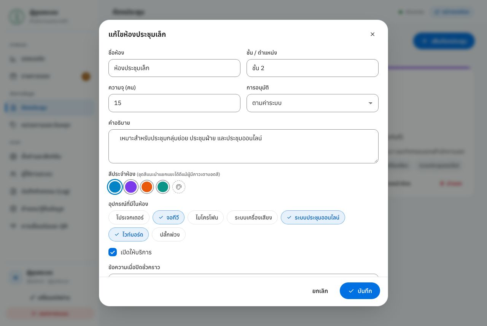

# Administrator and IT Guide

**Meeting Room Booking System — Bang Rak District Office — Handover document**

This document has two parts:

- **Part A — Administrators:** using the admin pages (approving bookings, rooms, settings, users, activity log, backups).
- **Part B — IT:** installation, server, HTTPS, backup/migration, security, troubleshooting and the handover checklist.

The screens are in Thai; each Thai label is given in **bold** followed by its English meaning.

Staff guide: [user-guide.en.md](user-guide.en.md) · **Thai version:** [admin-guide.th.md](admin-guide.th.md)

---

## Contents

**Part A — Administrators**

1. [Roles and signing in](#1-roles-and-signing-in)
2. [Dashboard](#2-dashboard)
3. [Bookings: approve, edit, cancel](#3-bookings-approve-edit-cancel)
4. [Meeting rooms](#4-meeting-rooms)
5. [Departments and holidays](#5-departments-and-holidays)
6. [Settings and features](#6-settings-and-features)
7. [System users](#7-system-users)
8. [Activity log](#8-activity-log)
9. [Backup and restore](#9-backup-and-restore)
10. [Connection, QR codes and door displays](#10-connection-qr-codes-and-door-displays)

**Part B — IT**

11. [Technical overview](#11-technical-overview)
12. [Deployment options](#12-deployment-options)
13. [Enabling HTTPS](#13-enabling-https)
14. [Server options](#14-server-options)
15. [Data, backups and moving servers](#15-data-backups-and-moving-servers)
16. [Updating](#16-updating)
17. [Security](#17-security)
18. [Troubleshooting](#18-troubleshooting)
19. [Routine maintenance](#19-routine-maintenance)
20. [Handover checklist](#20-handover-checklist)

---

# Part A — Administrators

## 1. Roles and signing in

Open `<system address>/admin` (or press **สำหรับผู้ดูแลระบบ** (For administrators) at the bottom of any page).


| Role                            | Access                                                    |
| ------------------------------- | --------------------------------------------------------- |
| **ผู้ดูแลระบบ** (Administrator) | Every menu                                                |
| **เจ้าหน้าที่** (Staff)         | Dashboard and Bookings (view, add, edit, approve, cancel) |

### First sign-in

- On first installation the system generates a random password for the `admin` account (shown in the server window and saved in `data/initial-admin-password.txt`).
- Every new user receives a **temporary password** from an administrator.
- On first sign-in the system **forces the user to set their own password** before any menu can be used.


### Password policy

- At least **12 characters**. A memorable phrase works well, e.g. `Room-Desk-Phrase-31`.
- Common or guessable passwords (e.g. `password1234`, `bangrak@2569`) and passwords containing the username or the person's name are rejected.
- After repeated wrong passwords, sign-in is paused for a while (counted per device and per account).

### Session security

- Automatic sign-out after inactivity (default 12 hours).
- A session is bound to the network it signed in from. If the device's network changes (e.g. Wi-Fi ↔ 4G), sign in again.
- Sensitive actions **ask for your password again**: adding users, changing roles, setting someone's password, restoring data, regenerating the display key.
- Change your own password with **เปลี่ยนรหัสผ่าน** (Change password) at the bottom left.

---

## 2. Dashboard


- Tiles: meetings today · pending approval · bookings this month · average room utilisation.
- **การจองรายวัน** (Daily bookings, browse other months) · **รออนุมัติ** (Pending) with instant approve ✓ / reject ✕ buttons.
- Room utilisation · booking status this month · busiest hours · top departments · today's schedule.
- When a new booking needs approval, any open admin page shows an alert immediately (message + sound).

---

## 3. Bookings: approve, edit, cancel


- Quick tabs: **กำลังจะถึง · รออนุมัติ · วันนี้ · สัปดาห์นี้ · เดือนนี้ · ทั้งหมด** (Upcoming · Pending · Today · This week · This month · All).
- Search by code, title, name, department or phone; filter by room, status and date range.
- Tick several rows to approve / reject / cancel them together.
- Buttons at the top:
  - **ปิดใช้ห้อง** (Block room) — reserve a room (maintenance, ceremonies). Users see it as blocked and cannot book over it.
  - **ส่งออก CSV** (Export CSV) — opens correctly in Excel (Thai text preserved).
  - **เพิ่มการจอง** (Add booking) — book on someone's behalf. Tick **ข้ามกฎการจอง** (Override booking rules) when needed (opening hours, holidays, capacity, duration — overlaps are always still checked).

Press a row for details and the action history.


| Button                          | Effect                                                          |
| ------------------------------- | --------------------------------------------------------------- |
| **อนุมัติ** (Approve)           | Status becomes Approved; the requester sees it immediately      |
| **ไม่อนุมัติ** (Reject)         | Optional reason, shown to the requester                         |
| **แก้ไข** (Edit)                | Any field, including room and time                              |
| **ยกเลิก** (Cancel)             | Keeps the history (recommended)                                 |
| **ลบถาวร** (Delete permanently) | Removes the record for good — only for test or mistaken entries |

> The system sends no e-mail or SMS. Requesters check status under "My bookings". For last-minute changes, phone the number on the booking.

---

## 4. Meeting rooms


- **เพิ่มห้องประชุม** (Add room) / **แก้ไข** (Edit) / **นำออก** (Archive — hidden, booking history kept).
- **เปิดให้บริการ** (In service) switch — close a room temporarily with a message such as "Closed for renovation until 15 Nov".
- **จอหน้าห้อง** (Door display) — opens that room's display page.



| Field                                   | Notes                                                                                                                                                                     |
| --------------------------------------- | ------------------------------------------------------------------------------------------------------------------------------------------------------------------------- |
| Name / floor                            |                                                                                                                                                                           |
| **ความจุ** (Capacity)                   | Used to check attendee numbers (when capacity limiting is on)                                                                                                             |
| **การอนุมัติ** (Approval)               | **ตามค่าระบบ** (Use system setting) / **ต้องอนุมัติเสมอ** (Always require) / **ยืนยันทันทีเสมอ** (Always instant) — e.g. large room requires approval, small room instant |
| Description / colour                    | The suggested colours stay distinguishable for colour-blind users                                                                                                         |
| **อุปกรณ์ที่มีในห้อง** (Room equipment) | Shown on the room card and tagged "in room" on the booking form                                                                                                           |

---

## 5. Departments and holidays


- **รายชื่อหน่วยงาน** (Departments) — choices on the booking form. Add/remove/reorder, then press **บันทึกรายชื่อหน่วยงาน** (Save departments).
- **วันหยุดราชการ** (Public holidays) — these dates cannot be booked (unless holiday booking is enabled).
  - **เติมวันหยุดที่วันที่ตายตัวของปีนี้** (Add fixed-date holidays for this year) — New Year, Songkran, Mother's Day, etc. in one click.
  - **Add manually every year:** lunar holidays (Makha Bucha, Visakha Bucha, Asarnha Bucha, Buddhist Lent), substitution days and special holidays announced by the Cabinet.
  - Press **บันทึกวันหยุด** (Save holidays) each time.

---

## 6. Settings and features


Changes apply to every device as soon as you save, and are recorded in the log.

| Section                                                  | Main settings (default)                                                                                                                                                                                                                                                                |
| -------------------------------------------------------- | -------------------------------------------------------------------------------------------------------------------------------------------------------------------------------------------------------------------------------------------------------------------------------------- |
| **ข้อมูลหน่วยงาน** (Organisation)                        | Organisation name, system name, subtitle, contact text (footer and confirmation slip), logo (PNG/JPG/SVG ≤ 300 KB; empty = district seal)                                                                                                                                              |
| **ประกาศหน้าแรก** (Home announcement)                    | On/off, style (info/success/warning/important), text                                                                                                                                                                                                                                   |
| **เวลาและกฎการจอง** (Hours and rules)                    | Opening–closing (08:00–18:00), slot size (30 min), minimum (30 min), maximum per booking (600 min), buffer between meetings (0), advance window (90 days), minimum notice (0 min), weekends (off), public holidays (off)                                                               |
| **ฟังก์ชันการจอง** (Booking features)                    | Require approval (off), requester can edit (on), requester can cancel (on), cancellation deadline (0), recurring bookings (on, max 12), limit to capacity (on), phone required (on), e-mail required (off), max upcoming per phone (0 = no limit), rate limit (30 per hour per device) |
| **ความเป็นส่วนตัว** (Privacy)                            | Show meeting title in the calendar (on), show requester name in the calendar (on). Phone and e-mail are never public.                                                                                                                                                                  |
| **เช็คอินและคืนห้องอัตโนมัติ** (Check-in & auto-release) | Enable check-in (off), check-in opens before start (15 min), auto-release if no check-in within (15 min; 0 = never)                                                                                                                                                                    |
| **อุปกรณ์และบริการเสริม** (Equipment & services)         | Options requesters can ask for                                                                                                                                                                                                                                                         |
| **ระเบียบการใช้ห้องประชุม** (Room rules)                 | Text requesters must accept (empty = not shown)                                                                                                                                                                                                                                        |
| **รูปลักษณ์และเอฟเฟกต์** (Look & effects)                | Accent colour (blue), default theme (follow device), motion (full), haptics, click sound, confetti on success                                                                                                                                                                          |
| **จอแสดงผลหน้าห้อง** (Door display)                      | Enable door displays (on), show meeting titles on displays (on)                                                                                                                                                                                                                        |
| **ระบบและความปลอดภัย** (System & security)               | Close bookings temporarily (maintenance mode) + message · sound alert for new requests · auto sign-out (12 h) · keep activity log (365 days) · keep automatic backups (30 days)                                                                                                        |

> The **rate limit** is counted per device (IP address). If the system is in the cloud and every office PC shares one public IP, IT must set the office IP (section 14) so the whole office is not limited at once.

---

## 7. System users


- **เพิ่มผู้ใช้** (Add user): username (Latin letters), full name, role, temporary password (**สุ่มรหัส** generates one), and **your own password** to confirm.
- Give the temporary password privately; the user must set a new one at first sign-in.
- **แก้ไข** (Edit): change name or role, set a new password, deactivate, or delete.
- When someone changes job or leaves, **deactivate** the account immediately (log history is kept).
- Keep **at least two administrator accounts** in case one password is forgotten.

---

## 8. Activity log


- Records every booking, edit, approval, cancellation, sign-in (including failures), settings change and user change, with time, actor, IP and device.
- Filter by level (general/warning/security/error), type and date range · **ส่งออก CSV** (Export CSV).
- **ล้างบันทึกเก่า** (Clear old entries) — the latest 30 days are always kept (cannot be deleted); older entries also expire automatically per the retention setting.
- Review **security** entries regularly, e.g. repeated failed sign-ins or sessions used from another IP.

---

## 9. Backup and restore


- **ดาวน์โหลดไฟล์สำรองตอนนี้** (Download backup now) — a .json file (bookings, rooms, settings, departments, holidays, admin list **without passwords**); optionally include the log.
- **ไฟล์สำรองอัตโนมัติ** (Automatic backups) — one per day, kept for the configured number of days, downloadable.
- **กู้คืนจากไฟล์สำรอง** (Restore from backup) — replaces current data (the current data is backed up automatically first); requires your password.
  - **User accounts are not replaced** — existing users on the target server keep working.
- **ข้อมูลระบบ** (System info) — uptime, record counts, data size, memory, data folder.

**Recommended:** download a backup and store it off the server **at least weekly**.

---

## 10. Connection, QR codes and door displays


- Access addresses with copy buttons, and **IP ของคุณที่ระบบเห็น** (Your IP as seen by the system) — used to configure the office IP for cloud hosting.
- QR codes for the booking site and each room's door display · **พิมพ์โปสเตอร์ QR** (Print QR poster).
- **Door displays:** open the link from this page on the door tablet (it embeds the display key so the check-in button works).
  - Set the tablet to never lock, use full-screen mode, keep it charging.
  - Tablet lost or key leaked? Press **สร้างรหัสใหม่** (Generate new key) and reopen the new link on every display.

---

# Part B — IT

## 11. Technical overview

| Item         | Details                                                                                                         |
| ------------ | --------------------------------------------------------------------------------------------------------------- |
| Runtime      | Node.js 18+ — **no external dependencies** (no `npm install`)                                                   |
| Storage      | JSON files in `data/` (atomic writes); no database server                                                       |
| Front end    | Multi-page HTML + `public/css.css` + `public/js.js`; SVG icons; Anuphan font bundled (works without internet)   |
| Live updates | Server-Sent Events (`/api/events`)                                                                              |
| Port         | 3000 (default)                                                                                                  |
| Resources    | 1 vCPU / 1 GB RAM serves hundreds of users. **Single instance only** — never run two processes on the same data |
| Source       | GitHub `MiminZeroX/-` or `bangrak-room-booking.zip`                                                             |
| Tests        | `npm test` — 51 automated API and security tests                                                                |

```
server.js                entry point
src/                     API, booking rules, security, storage
public/                  web pages
scripts/reset-admin.js   reset the admin password
deploy/                  cloud installer (Ubuntu VM + HTTPS)
docs/                    manuals (this document)
data/                    live data (created automatically, not in git)
```

---

## 12. Deployment options

### Option A — Office server (Wi-Fi/LAN)

1. Install Node.js LTS from <https://nodejs.org>.
2. Extract the system to a permanent folder, e.g. `D:\bangrak-room-booking`.
3. Windows: double-click `start-windows.bat` · macOS/Linux: `./start.sh`.
4. Allow it in Windows Defender Firewall (Private networks).
5. Give the machine a fixed IP (static IP / DHCP reservation) so QR codes keep working.
6. Start automatically at boot: double-click `windows-autostart.bat` once.
7. Disable sleep on the machine.

Pros: data stays in the office · Cons: only reachable on the office network; the machine must stay on.

### Option B — Cloud VM (reachable anywhere, HTTPS)

One-command installer for Ubuntu 22.04/24.04 — full steps in [deploy/README.md](../deploy/README.md) (Thai).

```bash
sudo bash deploy/install-vm.sh --domain=booking.example.go.th --office-ips=<office public IP>
```

It installs Node.js, Caddy (automatic Let's Encrypt certificates), a hardened systemd service and the firewall, and runs the app on `127.0.0.1:3000` behind Caddy.

> The system stores requesters' names and phone numbers (personal data under Thailand's PDPA). Check the organisation's cloud policy first.

### Option C — Cloudflare (no server to run)

The whole system runs on Cloudflare Workers: pages come from Static Assets, and the system and its data live in a Durable Object (Cloudflare's SQLite).
HTTPS and a permanent link work immediately, and **it deploys automatically when code is merged into `main`** — full steps in [deploy/CLOUDFLARE.md](../deploy/CLOUDFLARE.md) (Thai).

- Set the Secret `ADMIN_INITIAL_PASSWORD` **before the site is opened for the first time** (initial password of `admin`).
- Set the Variable `OFFICE_IPS` to the office public IP (shown under Admin › Connection).
- All administrators forgot their passwords: set the Secret `ADMIN_RESET_PASSWORD` and open the site (resets `admin` once per value).
- Move data from an existing server with Backup/Restore.

---

## 13. Enabling HTTPS

The server runs **HTTP** by default; its console shows `http://...` with a note recommending HTTPS.

| Situation                               | Method                                                            |   Trusted by all browsers immediately   |
| --------------------------------------- | ----------------------------------------------------------------- | :-------------------------------------: |
| Cloud VM + domain name                  | `deploy/install-vm.sh` (Caddy + Let's Encrypt, automatic)         |                   Yes                   |
| Office server with an organisation cert | `node server.js --port=443 --tls-cert=cert.pem --tls-key=key.pem` |       Yes (if the CA is trusted)        |
| Office server, no certificate           | `./start.sh --https` / `start-windows.bat --https` (below)        | No — install the root CA on each device |

### One-command HTTPS (office server, or testing on a Mac/PC)

Install mkcert once, then start the system with `--https`.

```bash
# macOS:   brew install mkcert
# Windows: winget install FiloSottile.mkcert   (or choco install mkcert)
# Ubuntu:  sudo apt install mkcert libnss3-tools
./start.sh --https            # macOS/Linux
start-windows.bat --https     # Windows (a shortcut with --https appended works too)
```

- A certificate is created automatically in `data/certs/`, covering `localhost`, the machine name and every IP of the machine — **regenerated automatically when the IP changes**.
- The first `mkcert -install` may ask for the computer's password so this machine trusts the certificate.
- Port: macOS/Windows use 443 (open `https://<server IP>` with no port number) · Linux as non-root uses 3443 · override with `--port=`.
- Other devices (staff phones/PCs) must install `rootCA.pem` (its location is printed when the certificate is created, or run `mkcert -CAROOT`) to avoid warnings.
- The certificate files live in `data/`, which is not tracked by git — **never share `rootCA-key.pem`**.
- With HTTPS enabled, the sign-in cookie is marked `Secure`.
- Adding `--https` to `node server.js` directly has no effect (the server warns about an unknown option) — use `start.sh` / `start-windows.bat`.

---

## 14. Server options

Pass as `--name=value` or as environment variables (on the cloud VM: `/etc/bangrak-booking.env`).

| Argument                 | Variable             | Default  | Purpose                                                                                                |
| ------------------------ | -------------------- | -------- | ------------------------------------------------------------------------------------------------------ |
| `--port`                 | `PORT`               | 3000     | Listening port                                                                                         |
| `--host`                 | `HOST`               | 0.0.0.0  | Listening interface (behind a proxy use `127.0.0.1`)                                                   |
| `--data`                 | `DATA_DIR`           | `./data` | Data folder                                                                                            |
| `--allowed-hosts`        | `ALLOWED_HOSTS`      | —        | Extra host names allowed besides IPs/localhost/machine name, e.g. `booking.bangrak.local,*.office.lan` |
| `--tls-cert` `--tls-key` | `TLS_CERT` `TLS_KEY` | —        | Serve HTTPS directly with these certificate files                                                      |
| `--public-url`           | `PUBLIC_URL`         | —        | Public address (cloud); used for links/QR, Secure cookie, and automatically allowed as host            |
| `--trust-proxy`          | `TRUST_PROXY`        | —        | Trusted proxies, e.g. `loopback`; the real client IP is then read from `X-Forwarded-For`               |
| `--office-ips`           | `OFFICE_IPS`         | —        | Office public IPs/networks (comma-separated, CIDR allowed); per-IP limits are 20× higher for them      |

---

## 15. Data, backups and moving servers

| File (in `data/`)            | Contents                                                                         |
| ---------------------------- | -------------------------------------------------------------------------------- |
| `db.json`                    | Bookings, rooms, settings, departments, holidays, admin accounts (scrypt hashes) |
| `logs.json`                  | Activity log                                                                     |
| `backups/`                   | Daily automatic backups and pre-restore backups                                  |
| `initial-admin-password.txt` | Initial password (deleted automatically after it is changed)                     |
| `server.pid`                 | Marks the server as running                                                      |

On the cloud VM the data folder is `/var/lib/bangrak-booking`.

**Move servers (everything, including user accounts):** stop the server → copy the whole `data/` folder to the new machine → start.
**Move booking data only:** use Backup/Restore in the admin pages (user accounts are not transferred).

**Recommended backup strategy**

1. Automatic daily backups in `data/backups/` (same disk).
2. Weekly download from the admin page, stored off the server.
3. Cloud: enable the provider's snapshots/backups · Office: copy `data/` to a NAS/shared drive.
4. Test a restore on a spare machine once a year.

---

## 16. Updating

| Deployment | Steps                                                                                                 |
| ---------- | ----------------------------------------------------------------------------------------------------- |
| Office     | Download a backup → stop the server → replace all program files **except the `data/` folder** → start |
| Cloud      | `cd ~/bangrak-booking && git pull && sudo bash deploy/install-vm.sh` (data is preserved)              |

Users do not need to clear their cache; pages load the new version the next time they are opened.

---

## 17. Security

The system has been penetration-tested and reviewed against the OWASP Top 10 (details in `README.md`, "ความปลอดภัย" section). IT should:

- [ ] Enable **HTTPS** (section 13) — required in the cloud or on Wi-Fi shared with visitors.
- [ ] In the cloud, never expose port 3000 to the internet (the installer binds it to `127.0.0.1`).
- [ ] Set `OFFICE_IPS` in the cloud and consider `--admin-office-only` so admin pages open only from the office.
- [ ] Restrict the `data/` folder to the account that runs the server.
- [ ] Give every administrator their own account; no shared accounts. Deactivate leavers immediately.
- [ ] Keep Node.js (LTS) and the operating system updated.
- [ ] Review "security" log entries regularly.
- [ ] PDPA: the system stores requesters' names, departments, phone numbers (and e-mail if enabled). Define retention and who may access backup files.

---

## 18. Troubleshooting

| Symptom                                           | Cause / fix                                                                                                                                                                                                                                                                   |
| ------------------------------------------------- | ----------------------------------------------------------------------------------------------------------------------------------------------------------------------------------------------------------------------------------------------------------------------------- |
| Other devices cannot connect (office)             | Different network / firewall. Windows: `netsh advfirewall firewall add rule name="BangRak Room Booking" dir=in action=allow protocol=TCP localport=3000`                                                                                                                      |
| IP changed, QR codes broken                       | Fixed IP or DHCP reservation on the router                                                                                                                                                                                                                                    |
| "Port already in use"                             | Another program or a second copy is running — use `--port=3001` or stop the other copy                                                                                                                                                                                        |
| 421 / "host name not allowed"                     | Opened via an unlisted host name — add it with `--allowed-hosts=` (or `--public-url=` in the cloud)                                                                                                                                                                           |
| Still `http://`                                   | HTTPS not enabled — start with `./start.sh --https` (section 13)                                                                                                                                                                                                              |
| All administrators forgot their passwords         | Stop the server → `node scripts/reset-admin.js` (cloud: `sudo systemctl stop bangrak-booking && sudo -u bangrak node /opt/bangrak-booking/scripts/reset-admin.js --data=/var/lib/bangrak-booking && sudo systemctl start bangrak-booking`) → use the temporary password shown |
| The whole office is locked out at once (cloud)    | `OFFICE_IPS` not set, or the proxy does not pass the real IP — see deploy/README.md step 4                                                                                                                                                                                    |
| Administrators are signed out often               | The device's IP changes (mobile data) — by design, sign in again                                                                                                                                                                                                              |
| Door tablet sleeps / check-in button does nothing | Disable screen lock · reopen the display link from "Connection and QR" (the key may have been regenerated)                                                                                                                                                                    |
| Viewing logs / errors                             | Office: the server window · Cloud: `journalctl -u bangrak-booking -f` and `journalctl -u caddy`                                                                                                                                                                               |

---

## 19. Routine maintenance

| When              | Task                                                                                       |
| ----------------- | ------------------------------------------------------------------------------------------ |
| Daily             | Approve pending requests (if approval is enabled)                                          |
| Weekly            | Download a backup off the server · review security log entries                             |
| Monthly           | Review user accounts (deactivate unused) · check disk space · apply OS updates             |
| Yearly (December) | Add next year's holidays (fixed + lunar + substitution) · test a restore · review settings |

---

## 20. Handover checklist

| #   | Item                                                                                             | Done |
| --- | ------------------------------------------------------------------------------------------------ | ---- |
| 1   | Source code received (GitHub `MiminZeroX/-` or zip) with manuals in `docs/`                      | ☐    |
| 2   | System installed and running (option A or B); `npm test` passes                                  | ☐    |
| 3   | HTTPS enabled (required for cloud)                                                               | ☐    |
| 4   | Signed in as `admin` with the initial password and **set a new password**                        | ☐    |
| 5   | At least one backup administrator account created, plus staff accounts as needed                 | ☐    |
| 6   | Rooms (real capacity, equipment, approval), departments and this year's holidays checked         | ☐    |
| 7   | Opening hours, booking rules, announcement and room rules match office policy                    | ☐    |
| 8   | Test bookings removed (if any)                                                                   | ☐    |
| 9   | Door tablets set up with links from "Connection and QR"                                          | ☐    |
| 10  | QR poster printed and posted; system address filled in on the staff guide (section 1)            | ☐    |
| 11  | Backup download tested and a person made responsible for backups                                 | ☐    |
| 12  | Staff guide ([user-guide.en.md](user-guide.en.md) / Thai version) distributed to all departments | ☐    |

| Handed over by | Received by (IT) | Date |
| -------------- | ---------------- | ---- |
|                |                  |      |

---

_This guide matches the delivered version of the system. Screenshots use sample data._
