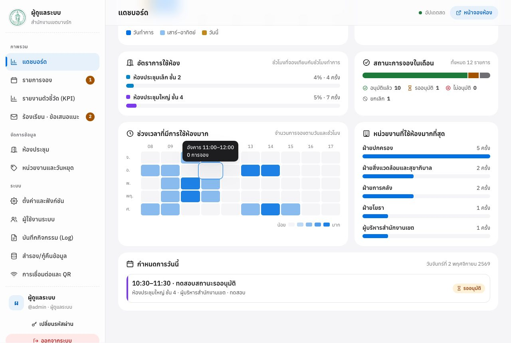
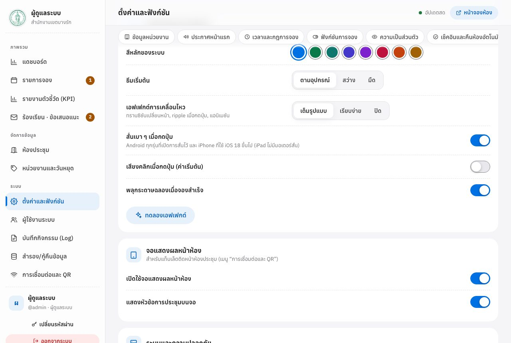
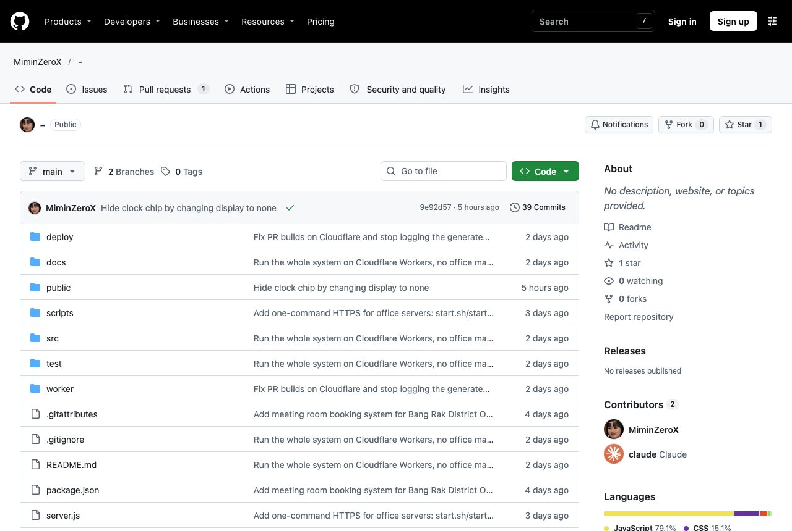
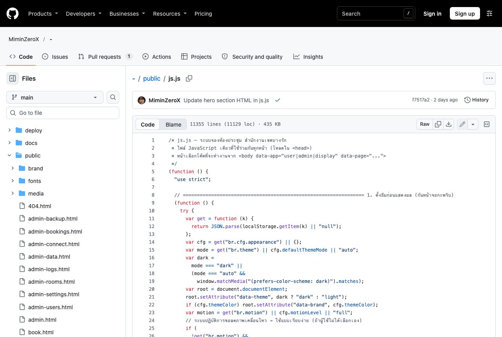
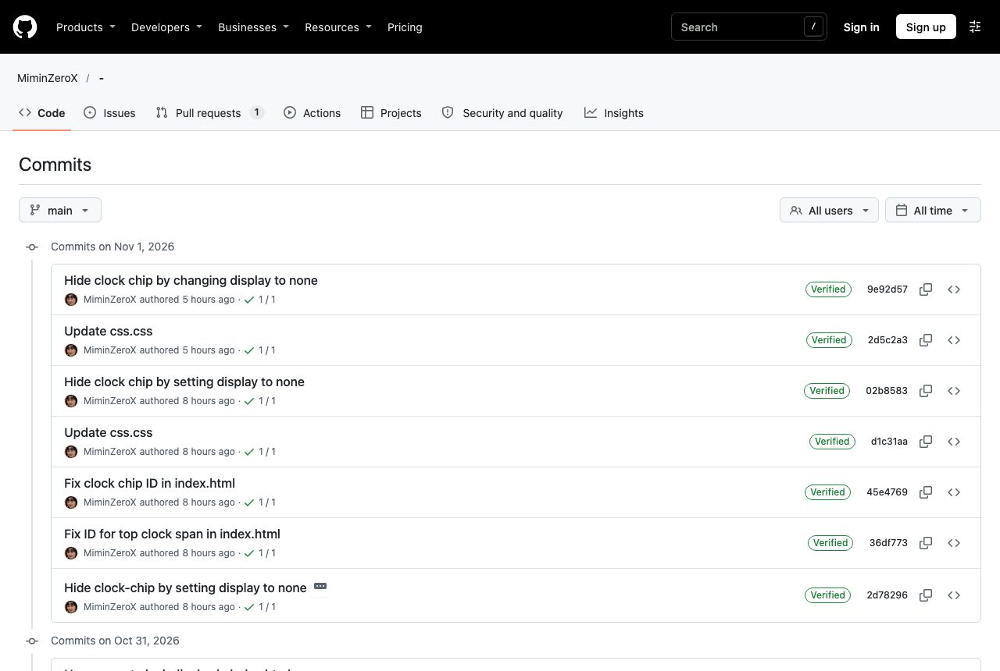
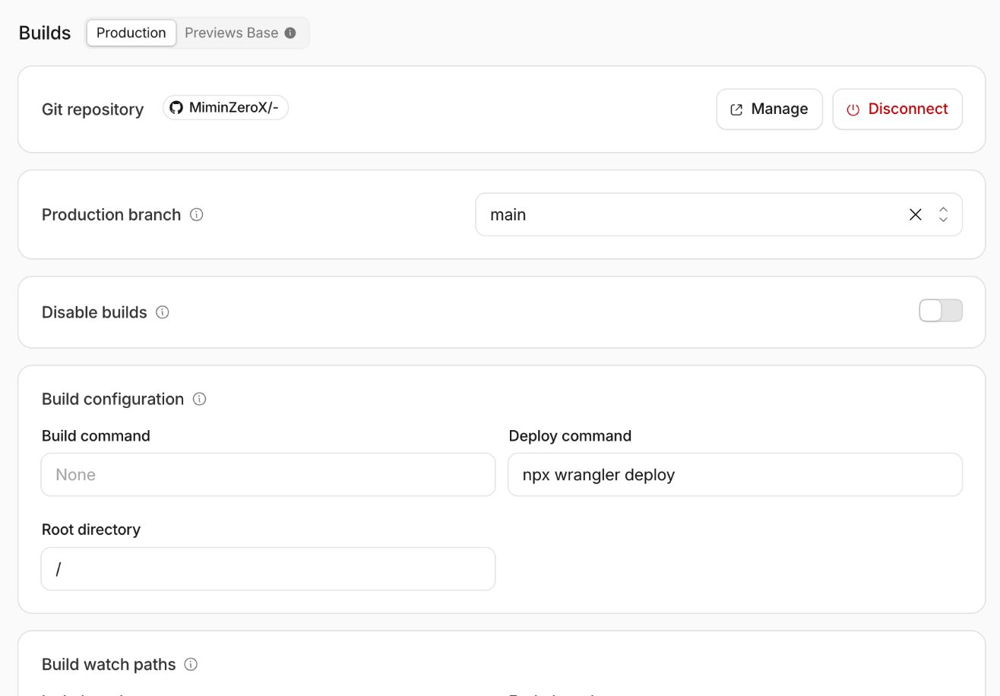
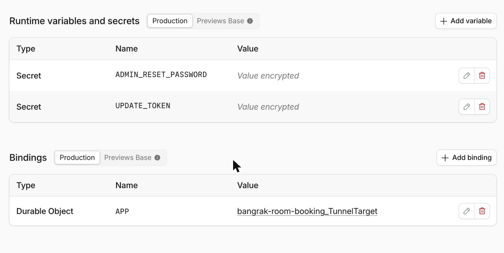
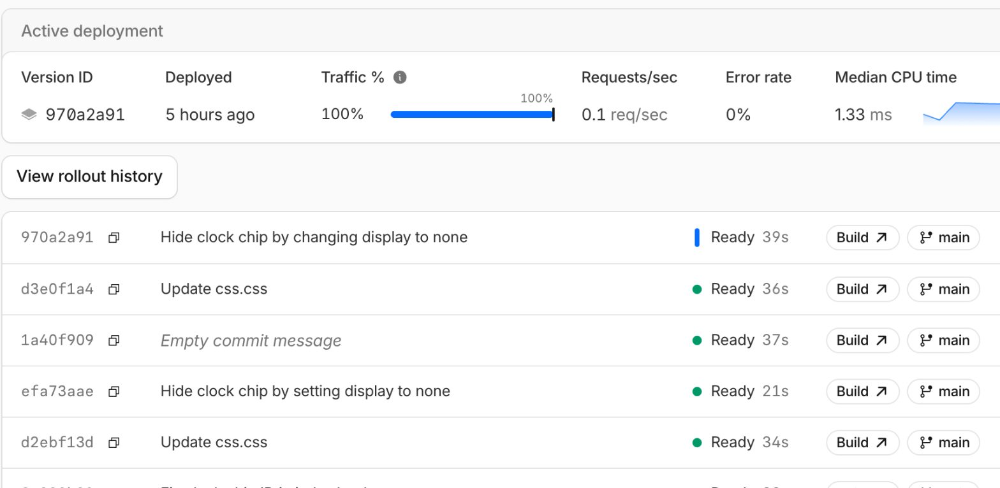

# คู่มือผู้ดูแลระบบและการพัฒนาต่อยอด ระบบจองห้องประชุม

**สำนักงานเขตบางรัก กรุงเทพมหานคร**

คู่มือเล่มนี้จัดทำเพื่อการส่งมอบระบบให้หน่วยงาน ครอบคลุมการใช้งานหน้าผู้ดูแลระบบ การดูแลโค้ดบน GitHub การดูแลเว็บบน Cloudflare การแก้ไขและพัฒนาโค้ดต่อยอดด้วยตนเอง การสร้างระบบใหม่ตั้งแต่ต้น การส่งมอบงาน และความปลอดภัย เขียนให้ผู้ที่ไม่เคยใช้ GitHub หรือ Cloudflare มาก่อนทำตามได้ทีละขั้น และให้นักพัฒนาของหน่วยงานใช้เป็นแนวทางต่อยอดระบบได้

คู่มือที่เกี่ยวข้อง: **คู่มือการใช้งานสำหรับผู้ใช้ทั่วไป** · **คู่มือโปรแกรมตรวจสอบระบบ** · **คู่มือการลบข้อมูลและล้างฐานข้อมูล**

## สารบัญ

---

# ส่วนที่ 1 — ภาพรวมของระบบ

## 1. ผู้อ่านแต่ละกลุ่มควรอ่านส่วนใด

| ผู้อ่าน                                        | ส่วนที่ควรอ่าน            |
| ---------------------------------------------- | ------------------------- |
| ผู้ดูแลห้องประชุม / ผู้อนุมัติการจอง           | 1, 2 และ 8                |
| ผู้แก้ไขหน้าเว็บผ่าน GitHub (ไม่ต้องเขียนโค้ด) | 1, 3, 4 และ 8             |
| นักพัฒนาที่จะต่อยอดระบบ                        | ทุกส่วน โดยเฉพาะ 3, 4, 5 |
| ผู้จะสร้างระบบใหม่ทั้งหมด                      | 1, 6 และ 8                |
| ผู้ส่งมอบ และผู้รับมอบงาน                      | ทุกส่วน โดยเฉพาะ 7 และ 8  |

> ผู้ที่มีสิทธิ์ผู้ดูแลระบบ หรือมีบัญชี GitHub / Cloudflare ของระบบนี้ **ต้องอ่านส่วนที่ 8 (ความปลอดภัย)** ทุกคน

## 2. ภาพรวมการทำงาน

```
ผู้ใช้ (คอมพิวเตอร์ / โทรศัพท์ / แท็บเล็ตหน้าห้อง)
        │  เปิดเว็บผ่าน HTTPS
        ▼
Cloudflare Worker "bangrak-room-booking"
        ├─ หน้าเว็บ (โฟลเดอร์ public/)
        └─ ระบบจอง + ฐานข้อมูล (Durable Object ชื่อ TunnelTarget)
        ▲
        │  ดึงโค้ดไปอัปเดตเว็บให้อัตโนมัติ ทุกครั้งที่ branch main เปลี่ยน
GitHub repository "MiminZeroX/-"  ── โค้ดต้นฉบับและคู่มือ
```

| สิ่งของ                                                          | เก็บอยู่ที่                                 | หมายเหตุ                                        |
| ---------------------------------------------------------------- | ------------------------------------------- | ----------------------------------------------- |
| โค้ด หน้าเว็บ รูปภาพประจำระบบ คู่มือ โปรแกรมตรวจสอบ              | GitHub                                      | แก้ที่ branch `main` แล้วเว็บอัปเดตเอง          |
| การจอง ห้อง รูปห้อง การตั้งค่า ผู้ใช้ เรื่องร้องเรียน Log ไฟล์สำรองอัตโนมัติ | Cloudflare (Durable Object)        | **ไม่อยู่ใน GitHub** สำรองได้จากหน้าผู้ดูแล     |
| รหัสผ่านเริ่มต้น/รีเซ็ตของผู้ดูแล                                 | Cloudflare › Variables and Secrets          | เป็นความลับ ห้ามใส่ใน GitHub                    |

> **คำเตือน:** ห้ามลบ Worker `bangrak-room-booking` ใน Cloudflare ข้อมูลทั้งหมดจะหายถาวร หากจำเป็นต้องลบ ให้ทำตาม **คู่มือการลบข้อมูลและล้างฐานข้อมูล** และดาวน์โหลดไฟล์สำรองก่อนทุกครั้ง

ระบบยังติดตั้งบนเครื่องในสำนักงานหรือเครื่องคลาวด์ (VM) ได้ (หัวข้อ 37) แต่คู่มือนี้เน้นแบบ Cloudflare ซึ่งใช้งานจริงอยู่

## 3. คำศัพท์ที่ควรรู้

| คำ                | ความหมายแบบง่าย                                                                    |
| ----------------- | ---------------------------------------------------------------------------------- |
| GitHub            | เว็บไซต์เก็บโค้ดต้นฉบับ พร้อมประวัติการแก้ไขทุกครั้ง                               |
| Repository (repo) | โฟลเดอร์โครงการบน GitHub ของระบบนี้คือ `MiminZeroX/-`                              |
| Commit            | การบันทึกการแก้ไขหนึ่งครั้ง มีข้อความอธิบาย ย้อนดูและย้อนกลับได้                   |
| Branch            | สายของการแก้ไข **`main` คือสายหลักที่ขึ้นเว็บจริง** สายอื่นใช้ทดลองก่อนรวม         |
| Pull Request (PR) | คำขอนำการแก้ไขจาก branch อื่นเข้า `main` เพื่อให้ตรวจก่อน                          |
| Merge             | การรวมการแก้ไขเข้า `main` (เว็บจะอัปเดตหลังจากนี้ประมาณ 1 นาที)                   |
| Push              | การส่ง commit จากเครื่องของเราขึ้น GitHub                                          |
| Cloudflare        | บริการคลาวด์ที่รันเว็บนี้ ให้ HTTPS และลิงก์ถาวร                                   |
| Worker            | โปรแกรมเว็บบน Cloudflare ของระบบนี้ชื่อ `bangrak-room-booking`                     |
| Deploy / Rollback | นำเวอร์ชันใหม่ขึ้นเว็บ / ย้อนเว็บกลับไปเวอร์ชันก่อนหน้า                           |
| Secret            | ค่าลับ (เช่น รหัสผ่าน) ที่ตั้งใน Cloudflare อ่านย้อนไม่ได้                         |
| Durable Object    | ส่วนของ Cloudflare ที่รันระบบจองและเก็บฐานข้อมูล (SQLite)                         |
| 2FA               | การยืนยันตัวตน 2 ขั้น (รหัสผ่าน + รหัสจากแอปในโทรศัพท์)                            |
| Node.js           | โปรแกรมสำหรับรันระบบและชุดทดสอบบนคอมพิวเตอร์ของนักพัฒนา                           |

---

# ส่วนที่ 2 — การใช้งานหน้าผู้ดูแลระบบ

## 4. เข้าสู่ระบบ บทบาท และรหัสผ่าน

เปิด `ที่อยู่เว็บ/admin` หรือกดลิงก์ **สำหรับผู้ดูแลระบบ** ท้ายหน้าเว็บ


| สิทธิ์          | ใช้ได้                                                                       |
| --------------- | ---------------------------------------------------------------------------- |
| **ผู้ดูแลระบบ** | ทุกเมนู                                                                      |
| **เจ้าหน้าที่** | แดชบอร์ด รายการจอง (ดู เพิ่ม แก้ไข อนุมัติ ยกเลิก) รายงาน KPI และเรื่องร้องเรียน (ดูและปิดเรื่อง) |

- **ครั้งแรก** บัญชี `admin` ใช้รหัสที่ตั้งใน Cloudflare (`ADMIN_INITIAL_PASSWORD` หรือ `ADMIN_RESET_PASSWORD` — หัวข้อ 23) แล้วระบบ **บังคับตั้งรหัสของตนเอง**
- ผู้ใช้ใหม่ได้ **รหัสผ่านชั่วคราว** จากผู้ดูแล และต้องตั้งรหัสใหม่เมื่อเข้าครั้งแรก
- รหัสผ่านอย่างน้อย **12 ตัวอักษร** ห้ามเดาง่าย ห้ามมีชื่อผู้ใช้ แนะนำเป็นวลี เช่น `ห้องประชุม-ชั้นสี่-2569`
- ใส่รหัสผิดเกิน 8 ครั้งจากเครื่องเดียว (หรือ 12 ครั้งต่อบัญชีจากหลายเครื่อง) ระบบพักการเข้าสู่ระบบ **ไม่เกิน 1 นาที** แล้วลองใหม่ได้ (ปรับได้ หัวข้อ 30 ข้อ ช) · ออกจากระบบอัตโนมัติเมื่อไม่ใช้งาน (ค่าเริ่มต้น 12 ชั่วโมง)
- เปลี่ยนเครือข่าย (เช่น Wi-Fi เป็น 4G) ต้องเข้าสู่ระบบใหม่ เพื่อป้องกันคุกกี้ถูกขโมยไปใช้
- รายการสำคัญ (เพิ่มผู้ใช้ เปลี่ยนสิทธิ์ กู้คืน ล้างข้อมูล ฯลฯ) ต้อง **ยืนยันรหัสผ่านซ้ำ**


## 5. แดชบอร์ด และช่วงเวลาที่มีการใช้ห้องมาก


แดชบอร์ดแสดงสรุปวันนี้และเดือนนี้ กราฟการจองรายวัน คำขอที่ **รออนุมัติ** (กด ✓ อนุมัติ / ✕ ไม่อนุมัติได้ทันที) อัตราการใช้ห้อง และกำหนดการวันนี้ หน้าผู้ดูแลที่เปิดค้างไว้จะแจ้งเตือนเมื่อมีคำขอใหม่

**ช่วงเวลาที่มีการใช้ห้องมาก** แสดงจำนวนการจองแยกตามวันในสัปดาห์และชั่วโมง ช่องสีเข้มคือช่วงที่ใช้มาก ชี้เมาส์ที่ช่องเพื่อดูจำนวน ใช้วางแผนเพิ่มห้องหรือกำหนดเวลาประชุมประจำ



## 6. รายการจอง


- แท็บ **กำลังจะถึง · รออนุมัติ · วันนี้ · สัปดาห์นี้ · เดือนนี้ · ทั้งหมด** · ค้นหาและกรองตามห้อง สถานะ วันที่ · ติ๊กหลายรายการเพื่อทำพร้อมกัน
- **ปิดใช้ห้อง** — กันห้องไว้ (ซ่อมบำรุง งานพิธี) · **ส่งออก CSV** — เปิดด้วย Excel · **เพิ่มการจอง** — จองแทนผู้ใช้ (ติ๊ก **ข้ามกฎการจอง** ได้เมื่อจำเป็น แต่ระบบยังตรวจการจองซ้อนเสมอ)
- กดรายการเพื่อ **อนุมัติ / ไม่อนุมัติ / แก้ไข / ยกเลิก** หรือ **ลบถาวร** (ใช้เฉพาะรายการทดสอบหรือจองผิด การยกเลิกจะเก็บประวัติไว้)


## 7. รายงานตัวชี้วัด (KPI)

เมนู **รายงานตัวชี้วัด (KPI)** สรุปผลการใช้งานระบบเทียบกับเป้าหมาย สำหรับรายงานผู้บริหาร เลือกช่วง **รายวัน / รายสัปดาห์ / รายเดือน / รายปี / กำหนดเอง** และกด **พิมพ์ / บันทึก PDF** เพื่อแนบรายงาน


| ตัวชี้วัด                                   | เป้าหมายเริ่มต้น | ความหมาย                                                       |
| ------------------------------------------- | ---------------- | -------------------------------------------------------------- |
| การสำรองข้อมูลอัตโนมัติครบทุกวัน            | 100%             | วันที่ระบบสำรองข้อมูลสำเร็จ (ระบุวันที่ขาด)                    |
| อัตราการใช้ห้องประชุม                       | ≥ 30%            | ชั่วโมงที่ใช้จริง เทียบกับเวลาที่เปิดให้จองในวันทำการ          |
| อัตราการยกเลิก/ไม่อนุมัติ                   | ≤ 20%            | สัดส่วนการจองที่ถูกยกเลิกหรือไม่อนุมัติ                         |
| ระยะเวลาอนุมัติเฉลี่ย                       | ≤ 24 ชั่วโมง     | นับเฉพาะคำขอที่ต้องรออนุมัติ                                    |
| อัตราการเช็คอินเข้าใช้ห้องจริง              | ≥ 80%            | ใช้เมื่อเปิดฟังก์ชันเช็คอิน                                     |
| เรื่องร้องเรียน/แจ้งปัญหาที่ดำเนินการแล้ว   | ≥ 80%            | สัดส่วนเรื่องที่ทำเครื่องหมาย “ดำเนินการแล้ว”                   |

ด้านล่างมีสรุปการใช้งาน (จำนวนการจอง ชั่วโมงประชุม ผู้เข้าร่วม หน่วยงาน) แยกรายห้อง และสรุปด้านความปลอดภัย (การเข้าสู่ระบบ ครั้งที่ผิด เหตุการณ์ความปลอดภัย) เป้าหมายแก้ได้ที่ค่า `KPI_TARGETS` ในไฟล์ `src/app.js` (หัวข้อ 31)

## 8. เรื่องร้องเรียน แจ้งปัญหา และข้อเสนอแนะ

ผู้ใช้ส่งเรื่องได้จากลิงก์ **ร้องเรียน · แจ้งปัญหา · เสนอแนะ** ท้ายทุกหน้า เรื่องจะปรากฏที่เมนู **ร้องเรียน · ข้อเสนอแนะ** ทันที

**การแจ้งเตือน** (เหมือนคำขอจองที่รออนุมัติ)

- **ตัวเลขสีส้มบนเมนู** = จำนวนเรื่องที่ **ยังไม่ดำเนินการ** ลดลงทันทีเมื่อกด “ทำเครื่องหมายว่าดำเนินการแล้ว” หรือลบเรื่อง
- **ตัวเลขบนแท็บเบราว์เซอร์** เช่น `(3)` = คำขอจองรออนุมัติ + เรื่องที่ยังไม่ดำเนินการ รวมกัน
- เมื่อมีเรื่องใหม่ขณะเปิดหน้าผู้ดูแลอยู่ (หน้าใดก็ได้) จะมี **กล่องแจ้งเตือน** มุมจอ และมีเสียงแจ้งเตือนหากเปิด “เสียงแจ้งเตือน” ไว้ที่ ตั้งค่า › ระบบและความปลอดภัย


หน้านี้จัดเหมือนหน้ารายการจอง

1. **ปุ่มกรองด่วน** ยังไม่ดำเนินการ (พร้อมจำนวน) · ดำเนินการแล้ว · วันนี้ · สัปดาห์นี้ · เดือนนี้ · ทั้งหมด — เปิดหน้ามาจะแสดงเรื่องที่ยังไม่ดำเนินการก่อน
2. **ตัวกรอง** ค้นหา (ข้อความ ชื่อ เบอร์โทร/อีเมล) · ประเภท · สถานะ · ตั้งแต่–ถึงวันที่ · เรียงตามวันที่ส่ง
3. **ตาราง** วันที่ส่ง · ประเภท (แดง = ร้องเรียน · ส้ม = แจ้งปัญหาการใช้งาน · ฟ้า = ข้อเสนอแนะ) · รายละเอียด · ผู้แจ้ง/ช่องทางติดต่อกลับ · สถานะ (เรื่องที่ปิดแล้วแสดง **ผู้ปิดเรื่องและเวลา**) · ปุ่มจัดการ — แสดงหน้าละ 25 เรื่อง
4. **กดที่รายการ** เพื่อเปิดรายละเอียดเต็ม แล้วกด **ดำเนินการแล้ว** / **เปิดเรื่องใหม่** / **ลบถาวร** ได้จากหน้าต่างนั้น หรือใช้ปุ่ม ✓ และถังขยะท้ายแถว ผลนับรวมในรายงาน KPI
5. **ส่งออก CSV** ดาวน์โหลดตามตัวกรองที่เลือก เปิดด้วย Excel ได้ (ถูกบันทึกใน Log)
6. **ลบถาวร** (เฉพาะสิทธิ์ผู้ดูแลระบบ) ใช้เมื่อพ้นระยะเก็บข้อมูล หรือผู้แจ้งขอให้ลบข้อมูลส่วนบุคคล — ดู **คู่มือการลบข้อมูลฯ**

> ข้อความทุกเรื่องแสดงเป็นตัวอักษรธรรมดาเสมอ แม้ผู้ส่งจะพิมพ์โค้ดหรือลิงก์มา ระบบจะไม่ประมวลผล (ป้องกันการแทรกโค้ดอันตราย) ทุกการเปลี่ยนสถานะและการลบถูกบันทึกใน Log

## 9. ห้องประชุม รูปห้อง หน่วยงาน และวันหยุด


- **เพิ่มห้องประชุม / แก้ไข / นำออก** (ห้องที่นำออกจะซ่อน แต่ประวัติยังอยู่) · สวิตช์ **เปิดให้บริการ** พร้อมข้อความเมื่อปิดชั่วคราว · ลูกศรขึ้น/ลงใช้เรียงลำดับห้อง
- **การอนุมัติรายห้อง** ตามค่าระบบ / ต้องอนุมัติเสมอ / ยืนยันทันทีเสมอ · ตั้ง **ความจุ** ให้ตรงจริง · เลือก **อุปกรณ์ที่มีในห้อง** · เลือก **สีประจำห้อง**

**ใส่หรือเปลี่ยนรูปห้อง**

1. เมนู **ห้องประชุม** › ปุ่ม **แก้ไข** ของห้องที่ต้องการ
2. ช่อง **รูปห้อง** › กด **เลือกรูป** (หรือ **เปลี่ยนรูป**) › เลือกไฟล์ภาพ JPG, PNG หรือ WEBP จากเครื่อง หรือถ่ายด้วยโทรศัพท์
3. ระบบย่อภาพให้ด้านยาวไม่เกิน 1,280 พิกเซลก่อนส่งอัตโนมัติ แล้วแสดงตัวอย่าง
4. กด **บันทึก** — รูปจะแสดงบนการ์ดห้องในหน้าแรกทันทีทุกอุปกรณ์
5. ลบรูป: กด **ลบรูป** ใต้ตัวอย่าง แล้วกด **บันทึก**


> แนะนำภาพแนวนอน (สัดส่วน 16:9) ถ่ายในที่สว่าง เห็นโต๊ะและจอ ไม่มีบุคคลหรือเอกสารราชการในภาพ ระบบไม่รับไฟล์ SVG และไฟล์ที่ใหญ่เกินประมาณ 500KB หลังย่อ (ป้องกันการแทรกโค้ดผ่านไฟล์ภาพ)


- **รายชื่อหน่วยงาน** เป็นตัวเลือกในแบบฟอร์มจอง แก้แล้วกด **บันทึกรายชื่อหน่วยงาน**
- **วันหยุดราชการ** กด **เติมวันหยุดที่วันที่ตายตัวของปีนี้** แล้ว **เพิ่มเองทุกปี** ได้แก่ วันหยุดทางจันทรคติ (มาฆบูชา วิสาขบูชา อาสาฬหบูชา เข้าพรรษา) วันหยุดชดเชย และวันหยุดพิเศษตามมติคณะรัฐมนตรี แล้วกด **บันทึกวันหยุด** ทุกครั้ง

## 10. ตั้งค่าและฟังก์ชัน


| หมวด                                      | สิ่งที่ตั้งได้ (ค่าเริ่มต้น)                                                                                           |
| ----------------------------------------- | ---------------------------------------------------------------------------------------------------------------------- |
| ข้อมูลหน่วยงาน                            | ชื่อหน่วยงาน ชื่อระบบ ข้อความรอง **ข้อมูลติดต่อ (ข้อความท้ายทุกหน้า)** โลโก้ (PNG/JPG/SVG ไม่เกิน 300KB)               |
| ประกาศหน้าแรก                             | เปิด/ปิด รูปแบบ ข้อความ                                                                                                |
| เวลาและกฎการจอง                           | เปิด–ปิด (08:00–18:00) ช่วงเวลาย่อย (30 นาที) ขั้นต่ำ–สูงสุด จองล่วงหน้า (90 วัน) เสาร์–อาทิตย์/วันหยุด (ปิด)          |
| ฟังก์ชันการจอง                            | ต้องอนุมัติก่อน (ปิด) ผู้จองแก้ไข/ยกเลิกเองได้ (เปิด) จองซ้ำ (สูงสุด 12 ครั้ง) จำกัดตามความจุ บังคับเบอร์โทร           |
| ความเป็นส่วนตัว                           | แสดงหัวข้อ/ชื่อผู้จองในปฏิทิน (เบอร์โทรและอีเมลไม่แสดงต่อสาธารณะเสมอ)                                                  |
| เช็คอินและคืนห้องอัตโนมัติ                | เปิดเช็คอิน (ปิด) เช็คอินได้ก่อน 15 นาที คืนห้องเมื่อไม่เช็คอินใน 15 นาที                                              |
| อุปกรณ์และบริการเสริม · ระเบียบการใช้ห้อง | ตัวเลือกในแบบฟอร์ม และข้อความที่ผู้จองต้องยอมรับ                                                                       |
| รูปลักษณ์และเอฟเฟกต์                      | สีหลัก ธีมเริ่มต้น เอฟเฟกต์การเคลื่อนไหว **สั่นเบา ๆ เมื่อกดปุ่ม** เสียงคลิก พลุฉลองเมื่อจองสำเร็จ                      |
| จอหน้าห้อง                                | เปิดใช้จอแสดงผลหน้าห้อง แสดงหัวข้อการประชุมบนจอ                                                                       |
| ระบบและความปลอดภัย                        | ปิดรับการจองชั่วคราว · เสียงแจ้งเตือน · ออกจากระบบอัตโนมัติ (12 ชม.) · เก็บ Log (365 วัน) · เก็บไฟล์สำรอง (30 วัน)     |

**สั่นเบา ๆ เมื่อกดปุ่ม** (หมวดรูปลักษณ์และเอฟเฟกต์) — เมื่อเปิด อุปกรณ์ที่รองรับจะสั่นสั้น ๆ ทุกครั้งที่กดปุ่ม



| อุปกรณ์                                   | ผล                                                                                                          |
| ----------------------------------------- | ----------------------------------------------------------------------------------------------------------- |
| Android ทุกยี่ห้อ (Chrome, Edge, Samsung) | สั่นผ่าน Vibration API ของเบราว์เซอร์ (ต้องเปิดการสั่นในเครื่อง)                                           |
| iPhone ที่ใช้ iOS 18 ขึ้นไป               | สั่นผ่านกลไกการสั่นของสวิตช์ระบบ iOS (Safari ไม่มี Vibration API) ต้องเปิด “การสั่นของระบบ” ในเครื่อง       |
| iPhone iOS 17 ลงไป / iPad / คอมพิวเตอร์   | ไม่สั่น — iPad ไม่มีมอเตอร์สั่น เป็นข้อจำกัดของฮาร์ดแวร์ ไม่มีเว็บใดสั่ง iPad ให้สั่นได้                     |

ผู้ใช้แต่ละคนปิดการสั่นในเครื่องของตนได้ด้วย **ตั้งค่าการแสดงผล › เอฟเฟกต์การเคลื่อนไหว › ปิด** การเปลี่ยนแปลงทุกหมวดมีผลทันทีทุกอุปกรณ์และถูกบันทึกใน Log

## 11. ผู้ใช้งานระบบ และบันทึกกิจกรรม (Log)


- **เพิ่มผู้ใช้** กรอกชื่อผู้ใช้ (ภาษาอังกฤษ) ชื่อ–นามสกุล สิทธิ์ รหัสผ่านชั่วคราว (กด **สุ่มรหัส** ได้) และรหัสผ่านของท่านเพื่อยืนยัน
- แจ้งรหัสชั่วคราวทาง **ช่องทางส่วนตัว** · เจ้าหน้าที่ย้ายงานหรือลาออก ให้ **ปิดการใช้งาน** ทันที
- ควรมี **ผู้ดูแลระบบอย่างน้อย 2 คน** และ **ใช้บัญชีของตนเองเท่านั้น ห้ามใช้บัญชีร่วม**


Log บันทึกทุกการจอง การแก้ไข การอนุมัติ การเข้าสู่ระบบ (รวมครั้งที่ผิด) การเปลี่ยนการตั้งค่า และการจัดการเรื่องร้องเรียน พร้อมเวลา ผู้ทำ IP และอุปกรณ์ กรองระดับ **ความปลอดภัย** เพื่อดูความผิดปกติ ส่งออก CSV ได้ (ระบบเก็บ 30 วันล่าสุดไว้เสมอ ลบย้อนหลังไม่ได้)

## 12. สำรอง/กู้คืนข้อมูล การเชื่อมต่อ และจอหน้าห้อง


- **ดาวน์โหลดไฟล์สำรองตอนนี้** — ไฟล์ .json (การจอง ห้องพร้อมรูปห้อง การตั้งค่า หน่วยงาน วันหยุด เรื่องร้องเรียน รายชื่อผู้ดูแล **ไม่รวมรหัสผ่าน**) ติ๊กรวม Log ได้
- **ไฟล์สำรองอัตโนมัติ** — วันละครั้ง เก็บตามจำนวนวันที่ตั้ง
- **กู้คืนจากไฟล์สำรอง** — แทนที่การจอง ห้อง การตั้งค่า หน่วยงาน และวันหยุด (ระบบสำรองของเดิมให้ก่อน) ต้องยืนยันรหัสผ่าน **บัญชีผู้ใช้และเรื่องร้องเรียนปัจจุบันไม่ถูกแทนที่**
- **ล้างข้อมูลการจอง** — ลบการจองเก่าหรือทั้งหมด (ขั้นตอนละเอียดใน **คู่มือการลบข้อมูลฯ**)
- ไฟล์สำรองมี **ข้อมูลส่วนบุคคล** เก็บในที่ปลอดภัย (หัวข้อ 47)


- หน้า **การเชื่อมต่อและ QR** แสดงที่อยู่สำหรับเข้าใช้งาน **IP ของท่านที่ระบบเห็น** (ใช้ตั้ง `OFFICE_IPS`) QR Code และปุ่ม **พิมพ์โปสเตอร์ QR**
- **จอหน้าห้อง** เปิดลิงก์จากหน้านี้บนแท็บเล็ต (มีรหัสจอฝังอยู่ ปุ่มเช็คอินจึงใช้ได้) ตั้งแท็บเล็ตไม่ให้ล็อกจอและเสียบสายชาร์จไว้ หากแท็บเล็ตหายให้กด **สร้างรหัสใหม่**

## 13. การลบข้อมูล (สรุป)

| ต้องการลบ                       | ทำที่                                                         |
| ------------------------------- | ------------------------------------------------------------- |
| การจอง 1 รายการหรือหลายรายการ   | รายการจอง › เปิดรายการ/ติ๊กเลือก › **ลบถาวร**                 |
| เรื่องร้องเรียน                 | ร้องเรียน · ข้อเสนอแนะ › ไอคอนถังขยะ                          |
| การจองเก่า / ทั้งหมด            | สำรอง/กู้คืนข้อมูล › **ล้างข้อมูลการจอง**                     |
| Log เก่ากว่า 30 วัน             | บันทึกกิจกรรม › **ล้างบันทึกเก่า**                            |
| รีเซ็ตทั้งระบบ / ปิดระบบถาวร     | Cloudflare และ GitHub ตามคู่มือการลบข้อมูลฯ                    |

> ขั้นตอนเต็ม การกู้คืนเมื่อลบผิด และแบบบันทึกการลบ อยู่ใน **คู่มือการลบข้อมูลและล้างฐานข้อมูล** — ดาวน์โหลดไฟล์สำรองก่อนลบทุกครั้ง

## 14. งานประจำของผู้ดูแล

| ความถี่      | งาน                                                                                                                                  |
| ------------ | ------------------------------------------------------------------------------------------------------------------------------------ |
| ทุกวัน       | อนุมัติคำขอที่รอ (ถ้าเปิดการอนุมัติ) · ดูเรื่องร้องเรียนใหม่                                                                         |
| ทุกสัปดาห์   | **ดาวน์โหลดไฟล์สำรองเก็บนอกระบบ** · ดู Log ระดับความปลอดภัย                                                                          |
| ทุกเดือน     | **รันโปรแกรมตรวจสอบระบบ** และเก็บรายงาน · พิมพ์รายงาน KPI · ตรวจบัญชีผู้ใช้ ปิดบัญชีที่ไม่ใช้ · ตรวจสมาชิก GitHub/Cloudflare (หัวข้อ 16, 22) |
| หลังแก้โค้ด  | รันโปรแกรมตรวจสอบระบบ และทดลองจองจริง 1 รายการ                                                                                       |
| ทุกปี (ธ.ค.) | เพิ่มวันหยุดปีใหม่ · ทดลองกู้คืนข้อมูล · ทบทวนการตั้งค่าและผู้มีสิทธิ์ · **ลบการจองและเรื่องร้องเรียนเก่า** ที่พ้นระยะเก็บของหน่วยงาน |

---

# ส่วนที่ 3 — GitHub: ที่เก็บโค้ดและการแก้ไข

## 15. GitHub ของระบบนี้ และ branch ใดขึ้นเว็บจริง

โค้ดทั้งหมดอยู่ที่ **https://github.com/MiminZeroX/-**



**ต้องแก้ที่ branch ใด** — Cloudflare ตั้งให้ดึงโค้ดจาก **branch `main` เท่านั้น** (ตรวจได้ที่ Cloudflare › Settings › Builds › **Production branch** — หัวข้อ 22) ดังนั้น

- การแก้ไขที่ต้องการให้ **ขึ้นเว็บจริงทันที** ต้องอยู่ใน `main` (แก้ตรงใน `main` หรือแก้ใน branch อื่นแล้ว merge เข้า `main`)
- branch อื่น เช่น `claude/...` ใช้พักงานหรือทดลอง **ไม่ขึ้นเว็บจริง** จนกว่าจะ merge เข้า `main`
- เมื่อ `main` เปลี่ยน Cloudflare จะอัปเดตเว็บเองภายในประมาณ 1 นาที **ข้อมูลการจองไม่หาย** เพราะข้อมูลอยู่ใน Cloudflare

| ต้องการเปลี่ยน                                 | ไฟล์ / โฟลเดอร์                                         |
| ---------------------------------------------- | ------------------------------------------------------- |
| ข้อความบนหน้าเว็บ (หัวข้อ ปุ่ม คำอธิบาย)       | `public/js.js`                                          |
| สี ขนาด ระยะห่าง หน้าตา                        | `public/css.css`                                        |
| ชื่อแท็บ / โครงของแต่ละหน้า                    | `public/*.html` เช่น `index.html`                       |
| ตราสัญลักษณ์ · ภาพเมฆหน้าเข้าสู่ระบบ · ฟอนต์   | `public/brand/` · `public/media/` · `public/fonts/`     |
| กฎการทำงาน API ฐานข้อมูล (นักพัฒนา)            | `src/*.js`                                              |
| การทำงานบน Cloudflare (ห้ามแก้ถ้าไม่แน่ใจ)     | `worker/` · `wrangler.jsonc`                            |
| ชุดทดสอบอัตโนมัติ                              | `test/`                                                 |
| โปรแกรมตรวจสอบระบบ                             | `checker/`                                              |
| คู่มือ (Markdown) และไฟล์ PDF                  | `docs/` (PDF อยู่ใน `docs/pdf/`)                        |

> ชื่อหน่วยงาน ประกาศ ห้อง รูปห้อง เวลาเปิด–ปิด ข้อมูลติดต่อท้ายหน้า ฯลฯ **ไม่ต้องแก้โค้ด** แก้ในหน้าผู้ดูแล (ส่วนที่ 2)

## 16. ตั้งค่าบัญชีและ repository ให้ปลอดภัย

1. **เปิด 2FA** — มุมขวาบน รูปโปรไฟล์ › **Settings** › **Password and authentication** › **Enable two-factor authentication** (ใช้แอป Authenticator) และ **เก็บ Recovery codes** ไว้ที่ปลอดภัย
2. **ทำให้ repository เป็นส่วนตัว (แนะนำมาก)** — ขณะนี้ repository เป็น **Public** ใครก็อ่านโค้ดได้ เข้า repository › **Settings** › **General** › ล่างสุด **Danger Zone** › **Change repository visibility** › **Make private** (Cloudflare ยังดึงโค้ดได้ตามปกติ เพราะได้รับสิทธิ์ผ่านแอป Cloudflare แล้ว)
3. **เพิ่มผู้ร่วมแก้ไข** — **Settings** › **Collaborators** › **Add people** ให้สิทธิ์เท่าที่จำเป็น และลบผู้ที่ไม่เกี่ยวข้องแล้วออก
4. **ป้องกัน `main`** (แนะนำเมื่อมีผู้แก้หลายคน) — **Settings** › **Rules** › **Rulesets** › **New branch ruleset** › Target `main` › ติ๊ก **Require a pull request before merging** และ **Block force pushes**
5. **ตรวจแอปที่เข้าถึงบัญชี** — รูปโปรไฟล์ › **Settings** › **Applications** ควรมีเฉพาะ Cloudflare และเครื่องมือที่รู้จัก

## 17. แก้ไขไฟล์ผ่านหน้าเว็บ GitHub (ทีละขั้น)

ตัวอย่าง: เปลี่ยนคำว่า “ง่ายในไม่กี่แตะ” บนหน้าแรก

1. เปิด https://github.com/MiminZeroX/- › ตรวจว่ามุมซ้ายบนเลือก branch **main** › กดโฟลเดอร์ `public` › กดไฟล์ `js.js`
2. กดไอคอน **ดินสอ (Edit this file)** มุมขวาบนของไฟล์



3. กด **Ctrl + F** (Mac: **Cmd + F**) ค้นข้อความที่ต้องการ แล้วแก้ — **แก้เฉพาะข้อความภาษาไทย ห้ามลบเครื่องหมาย `<` `>` `$` `{` `}` `` ` `` `"`**
4. กดปุ่มสีเขียว **Commit changes...** › พิมพ์คำอธิบายสั้น ๆ เช่น “แก้ข้อความหน้าแรก”
5. เลือก **Commit directly to the main branch** แล้วกด **Commit changes** — เว็บจะอัปเดตในประมาณ 1 นาที
6. ตรวจผลที่หน้า **commits** ของ repository: เครื่องหมาย ✓ สีเขียวข้าง commit = Cloudflare อัปเดตสำเร็จ · ✗ สีแดง = ไม่สำเร็จ (เว็บยังเป็นเวอร์ชันเดิม) ดูหัวข้อ 24



7. เปิดเว็บแล้วกดรีเฟรช และรันโปรแกรมตรวจสอบระบบ (คู่มือโปรแกรมตรวจสอบระบบ)

> หากแก้หลายจุดหรือไม่มั่นใจ ให้ใช้วิธีในหัวข้อ 18 หรือให้นักพัฒนาตรวจก่อน

## 18. วิธีที่ปลอดภัยกว่า: แก้ใน branch แล้วเปิด Pull Request

1. แก้ไฟล์ตามหัวข้อ 17 ข้อ 1–4
2. ในหน้าต่าง Commit เลือก **Create a new branch for this commit and start a pull request** › **Propose changes**
3. หน้า **Open a pull request** อธิบายสิ่งที่แก้ › **Create pull request**
4. ให้ผู้อื่นตรวจที่แท็บ **Files changed** หากถูกต้องกด **Merge pull request** › **Confirm merge** เว็บจะอัปเดตหลัง merge
5. ข้อดี: มีผู้ตรวจก่อนขึ้นเว็บจริง และย้อนกลับง่าย (หัวข้อ 19)

> ใน Pull Request อาจเห็น ✗ ที่ “Workers Builds” เป็นการ build ทดลองของ branch ย่อยที่ยังใช้กับระบบนี้ไม่ได้ (หัวข้อ 26) ไม่กระทบเว็บจริง ผลที่สำคัญคือ ✓ หลัง merge เข้า `main`
> **ห้าม merge Pull Request จากบุคคลที่ไม่รู้จัก** หรือที่ไม่เข้าใจว่าแก้อะไร

## 19. ย้อนกลับเมื่อแก้ผิด

| สถานการณ์                   | วิธีย้อน                                                                                        |
| --------------------------- | ----------------------------------------------------------------------------------------------- |
| เว็บเสียหลังแก้ ต้องแก้ด่วน | Cloudflare › **Deployments** › เลือกเวอร์ชันก่อนหน้า › **Rollback** (มีผลทันที — หัวข้อ 24)     |
| แก้ผ่าน Pull Request        | เปิด PR ที่ merge แล้ว › ปุ่ม **Revert** › **Create pull request** › **Merge**                  |
| แก้ตรงเข้า `main`           | แก้ไฟล์กลับเป็นข้อความเดิม (ดูของเดิมได้จาก **History** ของไฟล์) แล้ว commit ใหม่               |
| ใช้ Git บนเครื่อง            | `git revert <รหัส commit>` แล้ว `git push` (หัวข้อ 29)                                          |

> Rollback ใน Cloudflare เป็นการแก้ชั่วคราว เมื่อมีการแก้ `main` ครั้งถัดไป เว็บจะใช้โค้ดใน `main` จึงต้องแก้โค้ดใน GitHub ให้ถูกต้องด้วยเสมอ

## 20. ดาวน์โหลดโค้ด และเก็บสำเนา

- ดาวน์โหลดทั้งหมด: หน้า repository › ปุ่มสีเขียว **Code** › **Download ZIP** ใช้สร้างระบบใหม่ (ส่วนที่ 6) ใช้โปรแกรมตรวจสอบระบบ หรือเก็บเป็นสำเนา
- ไฟล์ ZIP **ไม่มีข้อมูลการจองและไม่มีรหัสผ่าน** (ข้อมูลอยู่ใน Cloudflare ใช้ไฟล์สำรองจากหน้าผู้ดูแลแทน)
- นักพัฒนาควร clone ด้วย Git แทน ZIP เพื่อให้มีประวัติการแก้ไขครบ (หัวข้อ 28)

---

# ส่วนที่ 4 — Cloudflare: เว็บออนไลน์

## 21. Cloudflare ทำอะไรให้ระบบนี้

- เปิดเว็บให้ใช้ได้ตลอด 24 ชั่วโมงที่ **https://bangrak-room-booking.<ชื่อบัญชี>.workers.dev** (หรือโดเมนของหน่วยงาน) พร้อม HTTPS — ผู้ที่เข้าแบบ `http://` จะถูกส่งต่อไป `https://` อัตโนมัติ
- **Workers Builds** เฝ้าดู GitHub เมื่อ `main` เปลี่ยน จะรันคำสั่ง `npx wrangler deploy` เพื่ออัปเดตเว็บเอง
- เก็บข้อมูลทั้งหมดใน **Durable Object** (ฐานข้อมูล SQLite) พร้อมสำรองอัตโนมัติวันละครั้ง
- ส่ง header ความปลอดภัยครบทุกหน้า รวมถึง HSTS (บังคับให้เบราว์เซอร์ใช้ HTTPS เสมอ)

## 22. เมนูที่ใช้บ่อย และการตั้งค่า Build

เข้า **https://dash.cloudflare.com** › เลือกบัญชี › **Compute** › **Workers & Pages** › **bangrak-room-booking**

| แท็บ / เมนู                          | ใช้ทำอะไร                                                        |
| ------------------------------------ | ---------------------------------------------------------------- |
| **Overview**                         | ลิงก์ของเว็บ (`.workers.dev`) และสถิติการใช้งาน                  |
| **Deployments**                      | ประวัติเวอร์ชันที่ขึ้นเว็บ และ **Rollback**                      |
| **Observability** / **Logs**         | ดูการทำงานและข้อผิดพลาดของระบบ                                   |
| **Settings › Variables and secrets** | ค่าตั้งและค่าลับ (หัวข้อ 23)                                     |
| **Settings › Builds**                | การเชื่อมกับ GitHub (repository, branch `main`, คำสั่ง deploy)  |
| **Settings › Domains & Routes**      | ลิงก์ `.workers.dev` และโดเมนของหน่วยงาน (หัวข้อ 25)             |
| **Manage account › Members**         | ผู้ที่เข้าบัญชี Cloudflare ได้ — ตรวจทุกเดือน                    |

**ค่าที่ถูกต้องของ Settings › Builds** (ตรวจเมื่อเว็บไม่อัปเดตหลังแก้โค้ด)



| ช่อง              | ค่า                                    |
| ----------------- | -------------------------------------- |
| Git repository    | `MiminZeroX/-` (หรือ repository ที่โอนแล้ว) |
| Production branch | `main`                                 |
| Disable builds    | ปิด                                    |
| Build command     | (เว้นว่าง)                             |
| Deploy command    | `npx wrangler deploy`                  |
| Root directory    | `/`                                    |

## 23. ค่าลับ (Secrets) และค่าตั้ง (Variables)

**Settings › Variables and secrets › Add variable** › เลือก **Type** › ใส่ **Variable name** และ **Value** › **Deploy** — การบันทึกจะสร้างเวอร์ชันใหม่ของเว็บ **ข้อมูลไม่หาย**



| ชื่อ                     | ประเภท | ใช้ทำอะไร                                                                                                                                           |
| ------------------------ | ------ | --------------------------------------------------------------------------------------------------------------------------------------------------- |
| `ADMIN_INITIAL_PASSWORD` | Secret | รหัสผ่านเริ่มต้นของ `admin` ใช้ **เฉพาะตอนเปิดระบบครั้งแรกสุด** ต้องตั้งก่อนเปิดเว็บครั้งแรก                                                        |
| `ADMIN_RESET_PASSWORD`   | Secret | **ลืมรหัสผู้ดูแล** ใส่รหัสใหม่ แล้วเปิดเว็บ บัญชี `admin` ถูกรีเซ็ตเป็นรหัสนี้ **ครั้งเดียวต่อค่าที่ตั้ง** (ใส่ค่าเดิมซ้ำไม่มีผล) **ลบทิ้งหลังใช้** |
| `OFFICE_IPS`             | Text   | IP สาธารณะของสำนักงาน คั่นด้วย `,` กันไม่ให้ทั้งสำนักงานถูกจำกัดพร้อมกัน (ดู IP ในหน้าผู้ดูแล › การเชื่อมต่อ)                                     |
| `PUBLIC_URL`             | Text   | ที่อยู่เว็บหลักเมื่อใช้โดเมนของหน่วยงาน เช่น `https://booking.example.go.th`                                                                        |

- Secret เมื่อบันทึกแล้วอ่านย้อนไม่ได้ จดรหัสไว้ในที่ปลอดภัยของตนเอง · ระบบ **ไม่เคยแสดงรหัสผ่านใน Logs**
- **สถานะปัจจุบัน (พฤศจิกายน 2569):** ยังมี Secret `ADMIN_RESET_PASSWORD` และ `UPDATE_TOKEN` ค้างอยู่ — `UPDATE_TOKEN` ไม่ใช้แล้ว และ `ADMIN_RESET_PASSWORD` ควรลบหลังเข้าสู่ระบบและตั้งรหัสใหม่แล้ว ให้กดไอคอนถังขยะทั้งสองรายการ

## 24. ตรวจว่าเว็บอัปเดตแล้ว และการย้อนเวอร์ชัน (Rollback)



- **ตรวจ** แท็บ **Deployments** แสดงเวอร์ชันล่าสุด (Active deployment) พร้อมข้อความ commit และ branch `main` หรือดู ✓ สีเขียวข้าง commit ใน GitHub
- **ถ้า build ไม่สำเร็จ** Cloudflare **คงเว็บเวอร์ชันเดิมไว้** กด **Build ↗** ของรายการนั้นเพื่อดู log แล้วส่งข้อความ error ให้นักพัฒนา
- **Rollback** ที่รายการเวอร์ชันที่ใช้ได้ กดเมนู **⋯** › **Rollback** › ยืนยัน มีผลทันที ข้อมูลไม่หาย
- หลังอัปเดตหรือ Rollback ทุกครั้ง รันโปรแกรมตรวจสอบระบบ

## 25. ใช้โดเมนของหน่วยงาน (ไม่บังคับ)

1. โดเมนต้องอยู่ใน Cloudflare ก่อน: **Add a domain** แล้วเปลี่ยน Nameserver ตามที่ Cloudflare แจ้ง (โดเมน `.go.th` ต้องประสานผู้ดูแลโดเมนของหน่วยงาน)
2. Worker › **Settings › Domains & Routes › Add › Custom domain** › ใส่ เช่น `booking.example.go.th`
3. ตั้ง Variable `PUBLIC_URL` = `https://booking.example.go.th` แล้วพิมพ์โปสเตอร์ QR ใหม่
4. ในโดเมนนั้นเปิด **SSL/TLS › Edge Certificates › Always Use HTTPS** ด้วย

## 26. แผนการใช้งาน ค่าใช้จ่าย และข้อจำกัด

- **แผนฟรี** ครอบคลุม Workers และ Durable Objects ในโควตารายวัน ซึ่งเพียงพอสำหรับสำนักงานเขต
- ถ้า **เข้าสู่ระบบผู้ดูแลแล้วขึ้น Error 1102** (เวลา CPU เกิน — การตรวจรหัสผ่านใช้การคำนวณหนักโดยตั้งใจเพื่อกันการเดารหัส) หรือใช้เกินโควตา ให้เปลี่ยนเป็น **Workers Paid (ประมาณ 5 ดอลลาร์สหรัฐต่อเดือน)** ที่ Workers & Pages › **Plans**
- **Build ของ branch ย่อยแสดง ✗** เพราะ branch ที่ไม่ใช่ `main` ใช้คำสั่งอัปโหลดทดลองที่ยังใช้กับระบบนี้ไม่ได้ ไม่กระทบเว็บจริง ปิดได้ที่ **Settings › Builds › Branch control** › ยกเลิก **Builds for non-production branches**
- การอัปเดตสดบนหน้าเว็บจะเชื่อมต่อใหม่เองทุก 2 นาที (ผู้ใช้ไม่เห็นความต่าง)

---

# ส่วนที่ 5 — การแก้ไขและพัฒนาโค้ดต่อยอด

## 27. โครงสร้างโค้ดโดยละเอียด

ระบบเขียนด้วย JavaScript ล้วน **ไม่มีไลบรารีภายนอกและไม่ต้องติดตั้งแพ็กเกจ** (ไม่มี `node_modules`) จึงแก้ไขได้ด้วยโปรแกรมแก้ข้อความทั่วไป

| ไฟล์                     | หน้าที่                                                                                                         |
| ------------------------ | --------------------------------------------------------------------------------------------------------------- |
| `public/*.html`          | โครงของแต่ละหน้า แต่ละไฟล์บอกว่าเป็นหน้าใดด้วย `<body data-app="user" data-page="feedback">`                    |
| `public/js.js`           | โค้ดหน้าเว็บทั้งหมดในไฟล์เดียว แบ่ง 7 ส่วนตามหัวข้อในไฟล์ (ธีม · ไอคอน · QR · ส่วนกลาง · หน้าผู้ใช้ · หน้าผู้ดูแล · จอหน้าห้อง) |
| `public/css.css`         | หน้าตาทั้งหมด สีประจำธีมอยู่ที่ `[data-brand="green"]` ฯลฯ                                                       |
| `src/app.js`             | ระบบหลัก: API ทุกเส้นทาง (`route(...)`) กฎการจอง สิทธิ์ การสำรองข้อมูล KPI                                      |
| `src/defaults.js`        | ค่าเริ่มต้นการตั้งค่า (`DEFAULT_SETTINGS`) กฎตรวจค่า (`SETTINGS_SCHEMA`) และค่าที่หน้าเว็บเห็นได้ (`PUBLIC_SETTING_KEYS`) |
| `src/store.js`           | อ่าน/เขียนฐานข้อมูลบนเครื่อง (โฟลเดอร์ `data/`) และตรวจรูปแบบข้อมูลตอนเปิดระบบ                                  |
| `src/security.js`        | แฮชรหัสผ่าน (scrypt) โทเคน การจำกัดความถี่                                                                      |
| `src/sanitize.js` · `src/time.js` · `src/http.js` | ทำความสะอาดข้อความ · วันเวลาไทย · ตอบกลับ HTTP และ header ความปลอดภัย                  |
| `worker/index.js`        | ตัวเชื่อมกับ Cloudflare: เสิร์ฟหน้าเว็บ ส่ง `/api/*` ไป Durable Object บังคับ HTTPS                             |
| `worker/cloud-store.js`  | ที่เก็บข้อมูลบน Cloudflare (SQLite ของ Durable Object)                                                           |
| `server.js` · `start.sh` · `start-windows.bat` | รันระบบบนเครื่องในสำนักงาน                                                           |
| `test/*.test.js`         | ชุดทดสอบอัตโนมัติ 57 กรณี                                                                                       |
| `checker/`               | โปรแกรมตรวจสอบระบบ                                                                                              |

**ลำดับการทำงานเมื่อผู้ใช้เปิดหน้าเว็บ** — เบราว์เซอร์โหลด `index.html` › โหลด `css.css` และ `js.js` › `js.js` อ่าน `data-app`/`data-page` แล้ววาดเนื้อหาของหน้านั้น › เรียก `/api/config` (การตั้งค่า ห้อง หน่วยงาน วันหยุด) และ `/api/bookings` › เปิด `/api/events` เพื่อรับการอัปเดตสด

## 28. เตรียมเครื่องสำหรับพัฒนา

1. ติดตั้ง **Node.js รุ่น LTS** จาก https://nodejs.org (Windows/macOS ดาวน์โหลดตัวติดตั้งแล้วกด Next จนจบ) ตรวจด้วยคำสั่ง `node --version` (ต้องได้ 18 ขึ้นไป)
2. ติดตั้ง **Git** — Windows: https://git-scm.com · macOS: เปิด Terminal พิมพ์ `git --version` แล้วกดติดตั้งตามที่ระบบเสนอ
3. ติดตั้งโปรแกรมแก้โค้ด เช่น **Visual Studio Code** (https://code.visualstudio.com) หรือใช้ **GitHub Desktop** (https://desktop.github.com) หากไม่ถนัดคำสั่ง
4. **ยืนยันตัวตนกับ GitHub** (จำเป็นสำหรับการ push) เลือกหนึ่งวิธี
   - GitHub Desktop: **File › Options › Accounts › Sign in**
   - GitHub CLI: ติดตั้งจาก https://cli.github.com แล้วรัน `gh auth login`
   - หรือเมื่อ Git ถามรหัสผ่าน ให้ใช้ **Personal Access Token** (GitHub › Settings › Developer settings › Fine-grained tokens เลือกเฉพาะ repository นี้ สิทธิ์ Contents: Read and write และกำหนดวันหมดอายุ) — **ห้ามใช้รหัสผ่านบัญชี และห้ามบันทึก token ลงไฟล์ในโครงการ**
5. ดาวน์โหลดโค้ดพร้อมประวัติ

```bash
git clone https://github.com/MiminZeroX/-.git bangrak-room-booking
cd bangrak-room-booking
```

6. รันระบบบนเครื่องเพื่อทดสอบ

```bash
npm start
```

ระบบจะแสดงที่อยู่ `http://localhost:3000` และรหัสผ่านผู้ดูแลชั่วคราว (เก็บในไฟล์ `data/initial-admin-password.txt` ด้วย) ข้อมูลทดสอบอยู่ในโฟลเดอร์ `data/` ซึ่ง **ไม่ถูกส่งขึ้น GitHub** — ลบโฟลเดอร์นี้เมื่อต้องการเริ่มใหม่

7. ทดสอบแบบเดียวกับ Cloudflare (ไม่บังคับ) ด้วย `npx wrangler dev --var ADMIN_INITIAL_PASSWORD:first-run-pass-77` แล้วเปิด `http://localhost:8787`

## 29. ขั้นตอนการแก้ไขมาตรฐาน

```bash
git switch main && git pull                 # 1. เอาโค้ดล่าสุด
git switch -c fix/room-text                 # 2. สร้าง branch ใหม่สำหรับงานนี้
#    แก้ไฟล์ แล้วเปิด npm start ดูผลที่ http://localhost:3000
npm test                                    # 3. รันชุดทดสอบ ต้องไม่มี fail
git add -A && git commit -m "แก้ข้อความการ์ดห้อง"   # 4. บันทึก
git push -u origin fix/room-text            # 5. ส่งขึ้น GitHub
```

6. เปิด GitHub จะมีปุ่ม **Compare & pull request** › สร้าง Pull Request › ให้ผู้อื่นตรวจ › **Merge** (หัวข้อ 18)
7. รอ ✓ ใน GitHub หรือดู Cloudflare › Deployments แล้วรันโปรแกรมตรวจสอบระบบกับเว็บจริง

> ถ้าทำงานคนเดียวและเป็นการแก้เล็กน้อย ข้ามข้อ 2 และ 6 ได้ โดย commit ใน `main` แล้ว `git push` แต่ต้องรัน `npm test` ก่อนเสมอ

## 30. ตัวอย่างการแก้ไขที่พบบ่อย

**ก. เปลี่ยนข้อความบนหน้าเว็บ** — ค้นข้อความใน `public/js.js` (ข้อความอยู่ในเทมเพลต `` html`...` ``) แก้เฉพาะตัวอักษร คงเครื่องหมาย `${...}` และแท็ก HTML ไว้

**ข. เปลี่ยนสีของธีม** — สีเลือกได้ในหน้าตั้งค่าอยู่แล้ว หากต้องการเฉดใหม่ แก้ค่าสีใน `public/css.css` ที่บล็อก `[data-brand="green"]` (สามค่า: `--brand` สีหลัก, `--brand-strong` สีเข้ม, `--brand-hi` สีสว่าง) ตรวจความคมชัดของตัวอักษรบนพื้นหลังสีนั้นให้อ่านง่าย

**ค. เพิ่มค่าตั้งใหม่ในหน้าตั้งค่า** (ตัวอย่าง: สวิตช์เปิด/ปิดอะไรบางอย่าง)

1. `src/defaults.js` เพิ่มค่าเริ่มต้นใน `DEFAULT_SETTINGS` เช่น `showFloorMap: false,`
2. ไฟล์เดียวกัน เพิ่มกฎใน `SETTINGS_SCHEMA` เช่น `showFloorMap: { type: "bool" },` (ระบบจะปฏิเสธค่าที่ผิดรูปแบบเอง)
3. ถ้าหน้าผู้ใช้ต้องอ่านค่านี้ เพิ่มชื่อใน `PUBLIC_SETTING_KEYS` (**ห้ามเพิ่มค่าที่เป็นความลับ**)
4. `public/js.js` หาหมวดที่ต้องการในรายการตั้งค่า (เช่น `id: "look"`) แล้วเพิ่ม `{ k: "showFloorMap", label: "แสดงแผนผังชั้น", type: "switch" },`
5. ใช้ค่าในหน้าผู้ใช้ผ่าน `S.settings.showFloorMap` หรือฝั่งระบบผ่าน `S().showFloorMap`
6. เพิ่มกรณีทดสอบใน `test/api.test.js` แล้วรัน `npm test`

**ง. เพิ่มหน้าใหม่สำหรับผู้ใช้**

1. คัดลอก `public/feedback.html` เป็นไฟล์ใหม่ เช่น `public/rules.html` แล้วแก้ `<title>` และ `data-page="rules"`
2. `public/js.js` เขียนฟังก์ชัน `viewRules(el)` (ดูแบบอย่างจาก `viewFeedback`) แล้วเพิ่ม `rules: viewRules,` ในรายการ `PAGES`
3. เพิ่มลิงก์ในเมนูหรือท้ายหน้า (ดูการสร้างลิงก์ใน `#site-foot`) และถ้าต้องการลิงก์สั้น เพิ่ม `"/rules": "/rules.html"` ใน `SHORT_PATHS` ของ `src/app.js`
4. เพิ่ม `"/rules.html"` ในรายการ `PAGES` ของ `checker/check.js` เพื่อให้โปรแกรมตรวจสอบตรวจหน้านี้ด้วย

**จ. เพิ่ม API ใหม่** — ใน `src/app.js` ใช้รูปแบบเดียวกับเส้นทางที่มีอยู่

```js
route("GET", "/api/admin/room-usage", (ctx) => ({ rooms: sortedRooms() }), {
  auth: "staff", // ต้องเข้าสู่ระบบ: "staff" = เจ้าหน้าที่ขึ้นไป, "admin" = ผู้ดูแลระบบเท่านั้น
});
```

- เส้นทางที่ขึ้นต้นด้วย `/api/admin/` **ต้องมี `auth` เสมอ** และเพิ่มเส้นทางนั้นในรายการ `ADMIN_READ` หรือ `ADMIN_WRITE` ของ `checker/check.js`
- ข้อความจากผู้ใช้ต้องผ่าน `cleanStr` / `cleanText` และจำกัดความยาวเสมอ
- คำขอที่เปลี่ยนข้อมูล (POST/PUT/PATCH/DELETE) ได้รับการป้องกัน CSRF อัตโนมัติ หน้าเว็บต้องเรียกผ่านฟังก์ชัน `api()` ใน `js.js` ซึ่งใส่ header ให้แล้ว

**ฉ. เปลี่ยนเป้าหมาย KPI** — แก้ตัวเลขใน `KPI_TARGETS` ต้นไฟล์ `src/app.js`

**ช. เปลี่ยนเวลาพักและจำนวนครั้งเมื่อใส่รหัสผ่านผิด** — แก้ได้เองผ่านหน้าเว็บ GitHub (หัวข้อ 17) ไม่ต้องติดตั้งโปรแกรม

1. เปิดไฟล์ `src/app.js` บน branch `main` › กดไอคอนดินสอ › กด Ctrl+F ค้นคำว่า `PASSWORD_LOCK`
2. แก้เฉพาะตัวเลขในบล็อกนี้

```js
const PASSWORD_LOCK = {
  LOCK_MS: 60 * 1000, // ระยะเวลาพัก: 60 * 1000 = 1 นาที (เช่น 5 นาที = 5 * 60 * 1000)
  PER_IP: 8, // ผิดได้กี่ครั้งต่อเครื่อง/เครือข่าย (IP) ก่อนถูกพัก
  PER_USER: 12, // ผิดได้กี่ครั้งต่อบัญชี (รวมทุกเครื่อง) ก่อนถูกพัก
  REAUTH: 5, // ยืนยันรหัสผิดกี่ครั้ง จึงออกจากระบบให้
};
```

| ต้องการ                         | แก้เป็น                    |
| ------------------------------- | -------------------------- |
| พัก 30 วินาที                   | `LOCK_MS: 30 * 1000,`      |
| พัก 1 นาที (ค่าปัจจุบัน)         | `LOCK_MS: 60 * 1000,`      |
| พัก 5 นาที                      | `LOCK_MS: 5 * 60 * 1000,`  |
| ให้ใส่ผิดได้ 5 ครั้งต่อเครื่อง   | `PER_IP: 5,`               |

3. **Commit changes** เข้า `main` › รอ Cloudflare deploy (✓ สีเขียว) แล้วรอเพิ่มประมาณ 5 นาทีให้ส่วนระบบจองเริ่มโค้ดใหม่
4. ทดสอบ: ใส่รหัสผิดจนถูกพัก ข้อความจะบอกเวลาที่ต้องรอ

> ข้อควรระวัง: ห้ามตั้ง `LOCK_MS` เป็น 0 หรือ `PER_IP`/`PER_USER` สูงมาก เพราะเท่ากับปิดการป้องกันการสุ่มรหัสผ่าน · ระยะพักสั้นปลอดภัยได้เพราะระบบบังคับรหัสผ่านอย่างน้อย 12 ตัวอักษรและห้ามรหัสที่เดาง่าย · รัน `npm test` ก่อน commit หากแก้บนเครื่อง

## 31. กฎความปลอดภัยเมื่อเขียนโค้ด

1. แสดงข้อมูลบนหน้าเว็บผ่าน `` html`...` `` เท่านั้น (escape ให้อัตโนมัติ) **ห้ามใช้ `innerHTML` กับข้อความจากผู้ใช้**
2. API ผู้ดูแลต้องมี `{ auth: "staff" }` หรือ `{ auth: "admin" }` ทุกเส้นทาง
3. ห้ามใส่รหัสผ่าน token หรือค่าลับในโค้ด ใช้ Cloudflare Secrets (หัวข้อ 23)
4. ห้ามเพิ่มสคริปต์หรือฟอนต์จากเว็บภายนอก (CSP ของระบบจะบล็อก และเป็นช่องทางรั่วไหลของข้อมูล)
5. ไฟล์ที่ผู้ใช้อัปโหลดต้องตรวจชนิดและขนาดฝั่งระบบเสมอ (ดูตัวอย่าง `PHOTO_RE` ของรูปห้อง)
6. ห้ามแก้ `migrations` และชื่อคลาส `TunnelTarget` ใน `wrangler.jsonc` / `worker/index.js` — ข้อมูลทั้งหมดผูกกับชื่อนี้
7. รัน `npm test` และโปรแกรมตรวจสอบระบบทุกครั้งก่อนและหลังขึ้นเว็บจริง

## 32. การทดสอบ

| เครื่องมือ                        | ใช้เมื่อ                     | คำสั่ง / วิธี                                                    |
| --------------------------------- | ---------------------------- | ---------------------------------------------------------------- |
| ชุดทดสอบอัตโนมัติ (57 กรณี)       | ก่อน commit ทุกครั้ง         | `npm test` — บน macOS จะข้าม 3 กรณีที่ต้องจำลองหลาย IP (ปกติ)    |
| โปรแกรมตรวจสอบระบบกับเครื่องตนเอง | หลังแก้ ก่อน push            | `npm start` แล้ว `node checker/check.js --url=http://localhost:3000 --yes --deep` |
| โปรแกรมตรวจสอบระบบกับเว็บจริง     | หลัง deploy ทุกครั้ง/รายเดือน | ดับเบิลคลิก `checker/check-windows.bat` หรือ `check-mac.command` |
| ทดลองใช้จริง                      | หลัง deploy                  | จองทดสอบ 1 รายการ บนคอมพิวเตอร์และโทรศัพท์ แล้วยกเลิก/ลบ         |

## 33. แก้ไขคู่มือและสร้าง PDF ใหม่

- ต้นฉบับคู่มืออยู่ใน `docs/*.md` (Markdown) ภาพหน้าจออยู่ใน `docs/images/` แก้บน GitHub ได้เหมือนไฟล์อื่น
- สร้าง PDF ใหม่บนเครื่องที่มี **pandoc**, **poppler** (`pdftotext`) และ **Playwright**: `node docs/build/build-pdf.js` (ทุกเล่ม) หรือระบุชื่อเล่ม เช่น `node docs/build/build-pdf.js admin-guide`
- ภาพทุกภาพถูกจัดไม่ให้ขาดข้ามหน้า และสารบัญใส่เลขหน้าให้อัตโนมัติ

---

# ส่วนที่ 6 — สร้างระบบใหม่ตั้งแต่ต้นจนจบ

## 34. สิ่งที่ต้องเตรียม

- **อีเมลของหน่วยงาน** (ไม่ควรใช้อีเมลส่วนตัว) สำหรับสมัคร GitHub และ Cloudflare
- **โทรศัพท์** ติดตั้งแอป Authenticator (Google Authenticator / Microsoft Authenticator) สำหรับ 2FA
- **ไฟล์โค้ด** ZIP จากผู้ส่งมอบ หรือดาวน์โหลดตามหัวข้อ 20
- **ไฟล์สำรองข้อมูล** .json จากระบบเดิม (ถ้ามี สำหรับย้ายข้อมูล)
- เวลาประมาณ 1 ชั่วโมง และคอมพิวเตอร์ที่มีเบราว์เซอร์ Chrome หรือ Edge

## 35. ขั้นที่ 1–2 — บัญชี GitHub และ Cloudflare

**GitHub**

1. สมัครที่ **https://github.com/signup** แล้วเปิด **2FA** ทันที (หัวข้อ 16)
2. มุมขวาบน **+** › **New repository** › ตั้งชื่อ เช่น `bangrak-room-booking` › เลือก **Private** › **ไม่ต้องติ๊ก** Add a README › **Create repository**
3. แตกไฟล์ ZIP ในเครื่อง จะได้โฟลเดอร์ที่มี `public`, `src`, `worker`, `checker`, `wrangler.jsonc`, `package.json` ฯลฯ
4. **แสดงไฟล์ที่ซ่อนอยู่** (ชื่อขึ้นต้นด้วยจุด เช่น `.gitignore`): Mac กด **Cmd + Shift + .** ใน Finder · Windows: File Explorer › **View** › **Show** › **Hidden items**
5. ในหน้า repository ใหม่ กดลิงก์ **uploading an existing file** › ลาก **ไฟล์และโฟลเดอร์ข้างในโฟลเดอร์** (ไม่ใช่ตัวโฟลเดอร์นอกสุด) มาวาง — GitHub รับครั้งละไม่เกิน 100 ไฟล์ ถ้าเกินให้ลาก `public` ก่อน แล้วส่วนที่เหลือในรอบที่สอง
6. กด **Commit changes** แล้วตรวจว่า `public/`, `src/`, `worker/` และ `wrangler.jsonc` **อยู่ชั้นบนสุด**

**Cloudflare**

1. สมัครที่ **https://dash.cloudflare.com/sign-up** ยืนยันอีเมล แล้วเปิด 2FA: รูปโปรไฟล์ › **My Profile** › **Authentication**
2. **Compute** › **Workers & Pages** › **Create** › **Import a repository** › **Connect GitHub** › เลือก **Only select repositories** › เลือก repository ของท่าน › **Install & Authorize**
3. ตั้งค่า: Project name `bangrak-room-booking` (**ต้องตรงกับ `"name"` ใน `wrangler.jsonc`**) · Build command เว้นว่าง · Deploy command `npx wrangler deploy` · Root directory `/`
4. กด **Create and deploy** รอ 1–3 นาทีจนสำเร็จ แล้วตรวจ **Settings › Builds** ให้ตรงกับหัวข้อ 22

## 36. ขั้นที่ 3–5 — รหัสผู้ดูแล ตั้งค่า และทดสอบก่อนใช้จริง

**ตั้งรหัสผ่านผู้ดูแล (ทำก่อนเปิดลิงก์เว็บครั้งแรก)**

1. Worker › **Settings › Variables and secrets › Add variable** › Type **Secret** › Name `ADMIN_INITIAL_PASSWORD` › Value = รหัสชั่วคราวอย่างน้อย 12 ตัวอักษร › **Deploy**
2. เปิดลิงก์ `.workers.dev` (หน้า Overview) แล้วเปิด `ลิงก์/admin` › ชื่อผู้ใช้ `admin` + รหัสชั่วคราว › ตั้งรหัสใหม่ของท่าน
3. ถ้าเผลอเปิดเว็บก่อนตั้งรหัส ให้ตั้ง Secret `ADMIN_RESET_PASSWORD` แทน แล้วเปิดเว็บอีกครั้ง (หัวข้อ 23)

**ตั้งค่าก่อนใช้จริง** — ย้ายข้อมูลเดิม (สำรอง/กู้คืนข้อมูล) · ตั้งค่าและฟังก์ชัน · ห้องประชุมพร้อมรูปห้อง · หน่วยงานและวันหยุด · ผู้ใช้งาน (ผู้ดูแลอย่างน้อย 2 คน) · `OFFICE_IPS` · พิมพ์โปสเตอร์ QR · ตั้งแท็บเล็ตหน้าห้อง · ตรวจว่า repository เป็น Private

**ทดสอบก่อนประกาศใช้**

- [ ] รันโปรแกรมตรวจสอบระบบกับเว็บจริง ผลไม่มีข้อ “ไม่ผ่าน”
- [ ] เปิดเว็บจากโทรศัพท์ที่ใช้เน็ตมือถือ (ไม่ใช่ Wi-Fi สำนักงาน) ได้
- [ ] จองทดสอบ 1 รายการ เห็นในปฏิทินทันที และหน้าอื่นอัปเดตเอง
- [ ] ผู้ดูแลอนุมัติ / แก้ไข / ยกเลิกได้ และมีบันทึกใน Log
- [ ] ส่งเรื่องทดสอบจากหน้าร้องเรียน เห็นในหน้าผู้ดูแล แล้วลบ
- [ ] ดาวน์โหลดไฟล์สำรองได้ และเปิดอ่านได้
- [ ] เข้าสู่ระบบด้วยบัญชีเจ้าหน้าที่ได้ตามสิทธิ์
- [ ] **ล้างการจองทั้งหมด** (คู่มือการลบข้อมูลฯ) แล้วแจ้งเจ้าหน้าที่ทุกหน่วยงาน พร้อมคู่มือผู้ใช้

## 37. ทางเลือกอื่น: เครื่องในสำนักงาน หรือเครื่องคลาวด์ (VM)

ใช้เมื่อหน่วยงานไม่ต้องการเก็บข้อมูลบน Cloudflare ข้อมูลจะอยู่ในโฟลเดอร์ `data/` ของเครื่องนั้น

| แบบ                | วิธีเปิด                                                                                              | หมายเหตุ                                                    |
| ------------------ | ----------------------------------------------------------------------------------------------------- | ----------------------------------------------------------- |
| เครื่องในสำนักงาน  | ติดตั้ง Node.js แล้ว Windows: ดับเบิลคลิก `start-windows.bat` · Mac/Linux: `./start.sh`              | ใช้ได้เฉพาะในเครือข่ายสำนักงาน เครื่องต้องเปิดตลอด          |
| + HTTPS ในสำนักงาน | ติดตั้ง mkcert แล้วเปิดด้วย `--https`                                                                 | เครื่องอื่นต้องติดตั้งใบรับรองหลักของ mkcert                |
| เครื่องคลาวด์ (VM) | `sudo bash deploy/install-vm.sh --domain=โดเมน`                                                       | รายละเอียดใน `deploy/README.md`                             |
| ลืมรหัสผู้ดูแล     | ปิดระบบ แล้วรัน `node scripts/reset-admin.js` ในโฟลเดอร์ระบบ                                          | **ใช้เฉพาะแบบเครื่องของตนเอง** บน Cloudflare ใช้หัวข้อ 23   |

---

# ส่วนที่ 7 — การส่งมอบงาน

## 38. เลือกวิธีส่งมอบ

| วิธี                                            | ทำอย่างไร                                                                                                                                                                                                | เหมาะกับ                              |
| ----------------------------------------------- | -------------------------------------------------------------------------------------------------------------------------------------------------------------------------------------------------------- | ------------------------------------- |
| **ก. โอนสิทธิ์ของเดิม**                         | GitHub: **Settings › General › Danger Zone › Transfer ownership** ไปยังบัญชีของหน่วยงาน · Cloudflare: เพิ่มผู้รับมอบใน **Manage account › Members** เป็น **Super Administrator** แล้วผู้สร้างลบตนเองออก | ต้องการให้ลิงก์เว็บเดิมใช้ต่อ         |
| **ข. ผู้รับมอบสร้างใหม่แล้วย้ายข้อมูล (แนะนำ)** | ผู้รับมอบทำส่วนที่ 6 ด้วยบัญชีของหน่วยงาน › กู้คืนไฟล์สำรองจากระบบเดิม › เปลี่ยนลิงก์/QR › เมื่อตรวจครบ ผู้สร้างจึงลบระบบเดิม                                                                          | บัญชีทั้งหมดเป็นของหน่วยงานตั้งแต่ต้น |

- หลังโอน repository (วิธี ก) ตรวจ Cloudflare › **Settings › Builds** ว่ายังเชื่อมกับ repository ถูกตัว หากไม่ ให้กด **Disconnect** แล้วเชื่อมใหม่
- บัญชีผู้ใช้ในระบบจอง **ไม่ย้ายไปกับไฟล์สำรอง** ต้องสร้างใหม่ในระบบปลายทาง

## 39. สิ่งที่ผู้สร้าง (ผู้ส่งมอบ) ต้องทำ

- [ ] โค้ดล่าสุดอยู่ใน `main` และ commit ล่าสุดมี ✓ (เว็บเป็นเวอร์ชันล่าสุด)
- [ ] รันโปรแกรมตรวจสอบระบบกับเว็บจริง แนบรายงานในเอกสารส่งมอบ
- [ ] ดาวน์โหลดไฟล์สำรอง (รวม Log) และส่งให้ผู้รับมอบ **ทางช่องทางที่ปลอดภัย** (ไม่ส่งในกลุ่มแชท)
- [ ] ส่งมอบคู่มือทั้ง 4 เล่ม และไฟล์ ZIP ของโค้ด (หรือสิทธิ์ใน repository)
- [ ] แจ้ง **ชื่อ** Secret/Variable ที่ใช้ (หัวข้อ 23) **ไม่ต้องบอกค่า** ผู้รับมอบตั้งค่าใหม่ของตนเอง
- [ ] ให้สิทธิ์ GitHub / Cloudflare ตามวิธีที่เลือก และรอผู้รับมอบยืนยันว่าเข้าได้
- [ ] หลังผู้รับมอบมีบัญชีผู้ดูแลของตนเอง: **ปิดการใช้งานบัญชีของผู้สร้าง** ในหน้าผู้ใช้งานระบบ
- [ ] ลบตนเองออกจาก GitHub Collaborators และ Cloudflare Members · ลบ API Token และ Personal Access Token ที่เคยสร้าง
- [ ] ลบไฟล์สำรอง สำเนาข้อมูล และโฟลเดอร์ `data/` ในเครื่องส่วนตัว
- [ ] ถ้าใช้วิธี ข: เมื่อผู้รับมอบยืนยันแล้ว **ลบ Worker และ repository เดิมของตนเอง** ตามคู่มือการลบข้อมูลฯ
- [ ] ลงนามในแบบฟอร์มรับมอบ (หัวข้อ 41)

## 40. สิ่งที่ผู้รับมอบต้องทำ

- [ ] เปิด **2FA** ใน GitHub และ Cloudflare ทุกบัญชีที่ได้รับ
- [ ] ตรวจว่าเข้า repository และ Worker ได้ และ repository เป็น **Private**
- [ ] ตั้ง Secret `ADMIN_RESET_PASSWORD` **ค่าใหม่ของตนเอง** › เข้าสู่ระบบ `admin` › ตั้งรหัสใหม่ › **ลบ Secret นั้น** (เพื่อให้รหัสเดิมของผู้สร้างใช้ไม่ได้)
- [ ] สร้างบัญชีผู้ดูแล **ชื่อของแต่ละคน** · ปิด/ลบบัญชีของผู้สร้างและผู้ที่ไม่เกี่ยวข้อง
- [ ] ตรวจ **Cloudflare › Members** และ **GitHub › Collaborators** ให้เหลือเฉพาะผู้มีหน้าที่
- [ ] รันโปรแกรมตรวจสอบระบบด้วยตนเอง 1 ครั้ง
- [ ] ทดลอง **ดาวน์โหลดและกู้คืนไฟล์สำรอง** (ทำในระบบทดสอบหรือช่วงไม่มีผู้ใช้)
- [ ] แก้ข้อมูลติดต่อในหน้าตั้งค่า และในคู่มือผู้ใช้หัวข้อ 2
- [ ] กำหนดผู้รับผิดชอบงานประจำ (หัวข้อ 14) และผู้ติดต่อเมื่อเกิดเหตุ (หัวข้อ 49)
- [ ] ตรวจแผน Cloudflare (ฟรี/Paid) และผู้รับผิดชอบค่าใช้จ่าย

## 41. แบบฟอร์มรับมอบ

| #   | รายการ                                                                   | ผล  |
| --- | ------------------------------------------------------------------------ | --- |
| 1   | ได้รับสิทธิ์ GitHub / Cloudflare หรือสร้างระบบใหม่เสร็จ (ส่วนที่ 6)      | ☐   |
| 2   | เว็บเปิดได้ และ commit ล่าสุดมี ✓                                        | ☐   |
| 3   | รายงานโปรแกรมตรวจสอบระบบไม่มีข้อ “ไม่ผ่าน”                               | ☐   |
| 4   | ได้รับไฟล์สำรองข้อมูล และกู้คืน/ตรวจแล้ว                                 | ☐   |
| 5   | ตั้งรหัสผู้ดูแลใหม่ ลบ Secret รีเซ็ต และปิดบัญชีของผู้สร้างแล้ว          | ☐   |
| 6   | 2FA เปิดครบทุกบัญชี · repository เป็น Private                            | ☐   |
| 7   | สมาชิก Cloudflare / ผู้ร่วมแก้ไข GitHub เหลือเฉพาะผู้มีหน้าที่           | ☐   |
| 8   | ได้รับคู่มือ 4 เล่ม (ผู้ใช้ · ผู้ดูแล · โปรแกรมตรวจสอบ · การลบข้อมูล) และไฟล์ ZIP ของโค้ด | ☐   |

| ผู้ส่งมอบ (ผู้สร้าง) | ผู้รับมอบ | วันที่ |
| -------------------- | --------- | ------ |
|                      |           |        |

---

# ส่วนที่ 8 — ความปลอดภัย

## 42. หลักสำคัญ 10 ข้อ

1. เปิด **2FA** ทุกบัญชี GitHub และ Cloudflare
2. **ห้ามใช้บัญชีร่วมกัน** ทุกคนมีบัญชีของตนเอง
3. ให้สิทธิ์ **เท่าที่จำเป็น** (เจ้าหน้าที่ใช้สิทธิ์ “เจ้าหน้าที่” ไม่ใช่ “ผู้ดูแลระบบ”)
4. **รหัสผ่านและค่าลับอยู่ใน Cloudflare Secrets เท่านั้น** ห้ามใส่ใน GitHub ไฟล์ แชท อีเมล หรือส่งให้ AI
5. repository เป็น **Private**
6. **ตรวจก่อน merge** ห้าม merge สิ่งที่ไม่เข้าใจหรือจากบุคคลที่ไม่รู้จัก
7. **สำรองข้อมูลทุกสัปดาห์** และเก็บไฟล์สำรองอย่างปลอดภัย (มีข้อมูลส่วนบุคคล)
8. **ปิดบัญชีผู้ที่ย้ายงาน/ลาออกทันที** ทั้งในระบบจอง GitHub และ Cloudflare
9. **รันโปรแกรมตรวจสอบระบบทุกเดือน** และตรวจ Log ระดับความปลอดภัยเป็นประจำ
10. รู้ขั้นตอนเมื่อเกิดเหตุ (หัวข้อ 49) ก่อนที่จะเกิดเหตุ

## 43. บัญชีและรหัสผ่าน

- ใช้ **โปรแกรมจัดการรหัสผ่าน** และรหัสที่ไม่ซ้ำกันในแต่ละบริการ
- ใช้แอป Authenticator แทน SMS และเก็บ **Recovery codes** ในที่ปลอดภัย
- บัญชี GitHub / Cloudflare ของระบบควรผูกกับ **อีเมลของหน่วยงาน** ไม่ใช่อีเมลส่วนตัว
- ในระบบจอง: รหัสอย่างน้อย 12 ตัวอักษร · ออกจากระบบเมื่อใช้เครื่องส่วนกลาง · ไม่บันทึกรหัสในเบราว์เซอร์ของเครื่องส่วนกลาง

## 44. ค่าลับ (Secrets) Token และโค้ด

- รหัสใน `ADMIN_INITIAL_PASSWORD` / `ADMIN_RESET_PASSWORD` เป็น **รหัสชั่วคราว** ระบบบังคับตั้งใหม่ทันทีเมื่อเข้าสู่ระบบ — ลบ Secret หลังใช้
- ถ้าเผลอเปิดเผยรหัสหรือ Token: **เปลี่ยน/ลบทันที** (Cloudflare › My Profile › **API Tokens** · GitHub › Settings › Developer settings › Tokens)
- อย่าสร้าง Token ถ้าไม่จำเป็น ถ้าต้องสร้างให้ใช้สิทธิ์น้อยที่สุด เฉพาะ repository นี้ และกำหนดวันหมดอายุ
- **ห้ามนำไฟล์สำรอง โฟลเดอร์ `data/` หรือรายงานโปรแกรมตรวจสอบ (`checker/reports/`) ขึ้น GitHub** (ไฟล์ `.gitignore` กันไว้แล้ว)

## 45. ข้อมูลส่วนบุคคล (PDPA) และไฟล์สำรอง

- ระบบเก็บ: ชื่อผู้จอง หน่วยงาน เบอร์โทร (และอีเมลถ้าเปิด) หัวข้อการประชุม ชื่อและช่องทางติดต่อในเรื่องร้องเรียน IP และอุปกรณ์ใน Log
- ปฏิทินสาธารณะ **ไม่แสดงเบอร์โทร/อีเมลเสมอ** และปิดการแสดงชื่อผู้จองได้ในหมวดความเป็นส่วนตัว
- **เก็บข้อมูลเท่าที่จำเป็น** กำหนดระยะเก็บการจองและเรื่องร้องเรียนร่วมกับเจ้าหน้าที่คุ้มครองข้อมูลส่วนบุคคล (DPO) แล้วลบตามรอบ (คู่มือการลบข้อมูลฯ) — ระบบไม่ลบการจองให้เอง
- ไฟล์สำรองที่ดาวน์โหลด: เก็บในไดรฟ์ของหน่วยงานที่จำกัดสิทธิ์หรือเข้ารหัส ลบไฟล์เก่าที่ไม่ใช้ ไม่ส่งผ่านแชท
- แจ้ง DPO และฝ่ายเทคโนโลยีสารสนเทศของหน่วยงานว่าข้อมูลอยู่บน Cloudflare

## 46. สิ่งที่ระบบป้องกันให้แล้ว

- HTTPS ทุกการเชื่อมต่อ ส่งต่อ `http://` ไป `https://` อัตโนมัติ และส่ง HSTS · header ความปลอดภัยครบ (CSP, nosniff, X-Frame-Options, Referrer-Policy, Permissions-Policy) ทุกหน้า
- รหัสผ่านเข้ารหัสแบบ scrypt · บังคับเปลี่ยนรหัสครั้งแรก · นโยบายรหัสผ่าน · จำกัดการเดารหัสทั้งต่อ IP และต่อบัญชี (ผิดเกินกำหนดพัก 1 นาที ปรับได้ที่ `PASSWORD_LOCK`)
- คุกกี้ HttpOnly + Secure + SameSite=Strict ผูกกับ IP · ยืนยันรหัสซ้ำก่อนรายการสำคัญ
- กัน CSRF (รับเฉพาะ JSON + header เฉพาะ) · escape ข้อมูลทุกจุด (กัน XSS) · จำกัดขนาดข้อมูลและความถี่การใช้งาน (รวมหน้าร้องเรียน)
- รูปห้องรับเฉพาะ JPG/PNG/WEBP และจำกัดขนาด · โลโก้ SVG ถูกตรวจว่าไม่มีสคริปต์
- ปฏิทินสาธารณะไม่เปิดเผยรหัสการจองและข้อมูลติดต่อ · รหัสการจองแบบสุ่ม · ค้นหาด้วยเบอร์ผิดซ้ำถูกพัก
- ไฟล์สำรองที่ดาวน์โหลดไม่มีแฮชรหัสผ่าน · Log 30 วันล่าสุดลบไม่ได้ · ไม่มีรหัสผ่านใน Log ของ Cloudflare
- มีชุดทดสอบอัตโนมัติ 57 กรณี และ **โปรแกรมตรวจสอบระบบ** ตรวจเกราะเหล่านี้กับเว็บจริงได้ทุกเมื่อ (31 รายการตาม OWASP Top 10)

**ทางเลือกเพิ่มความปลอดภัย:** ใช้ **Cloudflare Access** (Zero Trust › Access › Applications) จำกัดให้เฉพาะอีเมลของหน่วยงานเปิดหน้า `/admin*` และ `/api/admin/*` ได้ (ฟรีสำหรับผู้ใช้ไม่เกิน 50 คน)

## 47. การเก็บรักษาไฟล์สำรองและรายงาน

| เอกสาร                         | ระยะเก็บที่แนะนำ                     | ที่เก็บ                                    |
| ------------------------------ | ------------------------------------ | ------------------------------------------ |
| ไฟล์สำรองรายสัปดาห์ (.json)    | 3 เดือนล่าสุด                        | ไดรฟ์หน่วยงานที่จำกัดสิทธิ์ / เข้ารหัส     |
| ไฟล์สำรองก่อนส่งมอบหรือก่อนลบ  | ตามระเบียบงานสารบรรณ                 | สื่อบันทึกที่เข้ารหัส                      |
| รายงานโปรแกรมตรวจสอบระบบ       | 1 ปี                                 | แฟ้มงานความปลอดภัยของหน่วยงาน              |
| รายงาน KPI                     | ตามรอบรายงานผู้บริหาร                | แฟ้มรายงาน                                 |

## 48. การตรวจความปลอดภัยเป็นประจำ

1. ทุกเดือนและหลังแก้โค้ดทุกครั้ง รัน **โปรแกรมตรวจสอบระบบ** (โหมดปกติ) และเก็บรายงาน
2. ทุกไตรมาส รันโหมด **เชิงลึก** นอกเวลาทำการ เพื่อยืนยันว่าการล็อกเมื่อเดารหัสผิดยังทำงาน
3. ทุกเดือน ดู Log ระดับความปลอดภัย และสมาชิก GitHub/Cloudflare
4. ทุกปี พิจารณาให้ผู้เชี่ยวชาญทดสอบเจาะระบบ (Penetration Test) เพิ่มเติม

## 49. เมื่อสงสัยว่าถูกเจาะหรือเกิดเหตุผิดปกติ

1. **จดบันทึก** เวลา สิ่งที่พบ ภาพหน้าจอ
2. **ปิดรับการจองชั่วคราว** (ตั้งค่า › ระบบและความปลอดภัย) ถ้าข้อมูลถูกแก้ไขผิดปกติ
3. **รีเซ็ตรหัสผู้ดูแล:** ตั้ง `ADMIN_RESET_PASSWORD` ค่าใหม่ › เข้าสู่ระบบ › ตั้งรหัสใหม่ › ลบ Secret · **ปิดบัญชีที่น่าสงสัย**
4. **ตรวจ Log** ระดับความปลอดภัย (เข้าสู่ระบบผิดซ้ำ เซสชันจาก IP อื่น การเปลี่ยนการตั้งค่า การล้างข้อมูล)
5. **สร้างรหัสจอหน้าห้องใหม่** (การเชื่อมต่อและ QR) ถ้าแท็บเล็ตหายหรือสงสัย
6. เปลี่ยนรหัส GitHub / Cloudflare · ตรวจ Members, Collaborators, Tokens · ตรวจ commit ล่าสุดว่ามีของแปลกปลอมหรือไม่ (ถ้ามี: Rollback + Revert — หัวข้อ 19)
7. **รันโปรแกรมตรวจสอบระบบ** เพื่อยืนยันว่าเกราะป้องกันกลับมาครบ
8. **กู้คืนข้อมูล** จากไฟล์สำรองก่อนเกิดเหตุ ถ้าข้อมูลเสียหาย
9. **รายงาน** ผู้บังคับบัญชาและ DPO — หากข้อมูลส่วนบุคคลรั่วไหล ต้องแจ้งสำนักงานคณะกรรมการคุ้มครองข้อมูลส่วนบุคคล (สคส.) **ภายใน 72 ชั่วโมง** ตาม PDPA

## 50. แก้ปัญหาที่พบบ่อย

| อาการ                                          | วิธีแก้                                                                                                      |
| ---------------------------------------------- | ------------------------------------------------------------------------------------------------------------ |
| เปิดเว็บไม่ได้เลย                              | ตรวจลิงก์ · Cloudflare › Deployments มีเวอร์ชันล่าสุดไหม · ถ้าเพิ่งแก้โค้ด ลอง Rollback                    |
| แก้ไฟล์ใน GitHub แล้วเว็บไม่เปลี่ยน            | ตรวจว่าแก้ใน **branch `main`** (หัวข้อ 15) · รอ 1–2 นาทีแล้วรีเฟรช · ดู ✓/✗ ข้าง commit · การแก้ใน `src/` (ระบบจอง) อาจใช้เวลาอีกประมาณ 5 นาทีหลัง ✓ |
| `git push` ถามชื่อผู้ใช้/รหัสผ่าน แล้วไม่ผ่าน  | GitHub ไม่รับรหัสผ่านบัญชี ใช้ GitHub Desktop, `gh auth login` หรือ Personal Access Token (หัวข้อ 28)       |
| ขึ้น “เข้าสู่ระบบผิดหลายครั้ง … ลองใหม่ในอีก … วินาที” | รอตามเวลาที่บอก (ไม่เกิน 1 นาที) แล้วตรวจภาษาแป้นพิมพ์และ Caps Lock · ปรับเวลาได้ที่หัวข้อ 30 ข้อ ช |
| เข้าสู่ระบบ admin ไม่ได้ / ลืมรหัส             | ตั้ง `ADMIN_RESET_PASSWORD` **ค่าใหม่** แล้วเปิดเว็บ (ค่าเดิมซ้ำใช้ไม่ได้)                                   |
| เข้าสู่ระบบแล้วขึ้น Error 1102                 | เปลี่ยนเป็น Workers Paid (หัวข้อ 26)                                                                          |
| ทั้งสำนักงานถูกจำกัดการจอง/เข้าสู่ระบบพร้อมกัน | ตั้ง `OFFICE_IPS` (หัวข้อ 23)                                                                                 |
| ผู้ดูแลหลุดออกจากระบบบ่อย                      | เครือข่ายเปลี่ยน IP (โทรศัพท์) ระบบตั้งใจให้เข้าใหม่                                                          |
| ข้อมูลหาย / ผิดพลาด                            | สำรอง/กู้คืนข้อมูล › กู้คืนจากไฟล์สำรองอัตโนมัติหรือไฟล์ที่ดาวน์โหลดไว้                                      |
| ✗ ใน Pull Request (Workers Builds)             | build ทดลองของ branch ย่อย ไม่กระทบเว็บจริง (หัวข้อ 26)                                                       |
| หน้าเว็บแสดงผลแปลกหลังแก้ `js.js`              | อาจลบเครื่องหมายในโค้ดเกิน — Rollback ทันที แล้วแก้กลับ (หัวข้อ 19)                                           |
| โปรแกรมตรวจสอบรายงาน “ไม่ผ่าน”                 | ดูแนวทางแก้ในรายงาน และคู่มือโปรแกรมตรวจสอบระบบ                                                             |
| รูปห้องอัปโหลดไม่ได้                           | ใช้ JPG/PNG/WEBP ไม่ใช่ SVG หรือ HEIC ที่เบราว์เซอร์เปิดไม่ได้ · ถ่ายใหม่ด้วยความละเอียดปกติ                  |

_คู่มือฉบับนี้ตรงกับระบบเวอร์ชันพฤศจิกายน 2569 ภาพหน้าจอเป็นข้อมูลตัวอย่าง_
