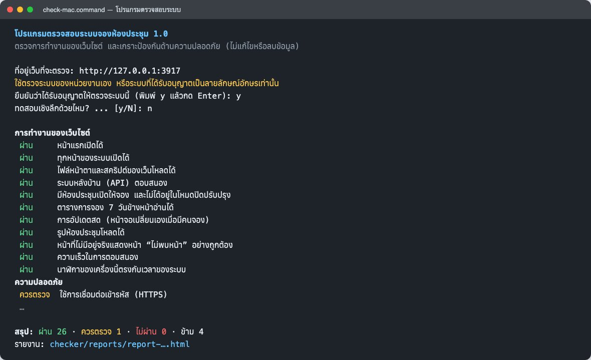
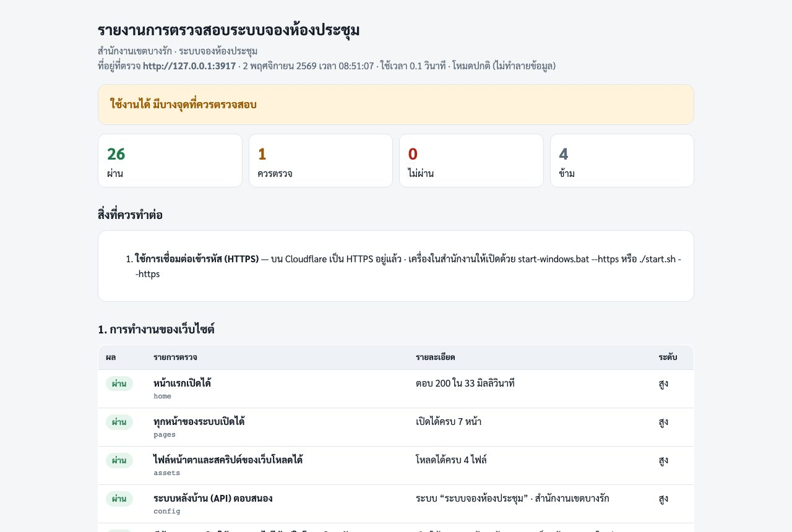
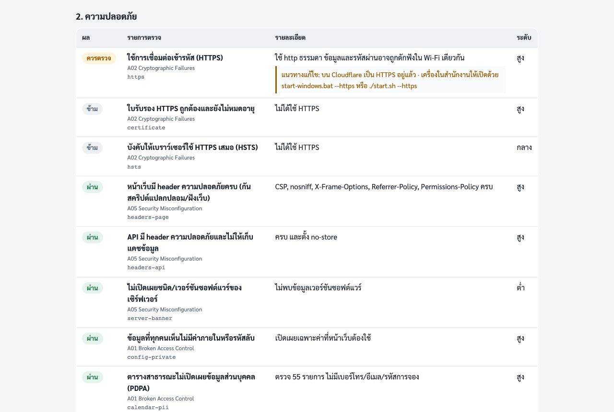

# คู่มือโปรแกรมตรวจสอบระบบ ระบบจองห้องประชุม

**สำนักงานเขตบางรัก กรุงเทพมหานคร**

โปรแกรมตรวจสอบระบบเป็นเครื่องมือของหน่วยงานสำหรับตรวจว่าเว็บไซต์จองห้องประชุม **ทำงานปกติ** และ **เกราะป้องกันด้านความปลอดภัยยังทำงานครบ** ใช้ได้บนคอมพิวเตอร์ Windows และ macOS ด้วยการดับเบิลคลิก ผลการตรวจออกเป็นรายงานหน้าเว็บที่อ่านง่าย พิมพ์หรือบันทึกเป็น PDF เพื่อเก็บเป็นหลักฐานได้

คู่มือเล่มนี้อธิบายการติดตั้ง การใช้งาน การอ่านผล แนวทางแก้ไขเมื่อพบปัญหา และการปรับปรุงโปรแกรมสำหรับนักพัฒนา

## สารบัญ

---

# ส่วนที่ 1 — ทำความรู้จักโปรแกรม

## 1. โปรแกรมนี้ทำอะไร และไม่ทำอะไร

**สิ่งที่โปรแกรมทำ**

- ตรวจ **การทำงานของเว็บไซต์** 11 รายการ เช่น หน้าเว็บทุกหน้าเปิดได้ ระบบหลังบ้านตอบสนอง ตารางการจองอ่านได้ การอัปเดตสดทำงาน รูปห้องโหลดได้ และความเร็วในการตอบสนอง
- ตรวจ **ความปลอดภัย** 20 รายการ อ้างอิงหมวดความเสี่ยง OWASP Top 10 เช่น HTTPS และใบรับรอง header ความปลอดภัย ข้อมูลส่วนบุคคลไม่รั่วในหน้าสาธารณะ เมนูผู้ดูแลต้องเข้าสู่ระบบ การกัน CSRF การรั่วของไฟล์โค้ด และการจำกัดการเดารหัสผ่าน
- ออกรายงาน `.html` (อ่าน/พิมพ์) และ `.json` (สำหรับเก็บหรือประมวลผลต่อ) พร้อม **แนวทางแก้ไข** ในทุกข้อที่ไม่ผ่าน

**สิ่งที่โปรแกรมไม่ทำ**

- **ไม่แก้ไข ไม่ลบ และไม่เพิ่มข้อมูล** การจอง ห้อง ผู้ใช้ หรือการตั้งค่า — ทุกคำขอเป็นการอ่าน หรือเป็นคำขอที่ระบบต้องปฏิเสธอยู่แล้ว และคำขอที่เปลี่ยนข้อมูลใช้ค่าที่ไม่ถูกต้องเสมอ แม้ระบบจะบกพร่องก็ไม่มีข้อมูลถูกแก้
- ไม่ต้องใช้รหัสผ่านผู้ดูแล และไม่เก็บหรือส่งข้อมูลไปที่ใด นอกจากระบบที่ตรวจ
- **ไม่ใช่การรับรองว่าไม่มีช่องโหว่** เป็นการตรวจอัตโนมัติเบื้องต้นที่ยืนยันว่าเกราะหลักยังทำงาน ไม่ทดแทนการทดสอบเจาะระบบโดยผู้เชี่ยวชาญ

> สิ่งที่อาจเห็นในระบบหลังรันโปรแกรม: บันทึกกิจกรรม (Log) “ค้นหาการจองไม่พบ” 1–2 รายการ และในโหมดเชิงลึก “เข้าสู่ระบบไม่สำเร็จ” ด้วยชื่อผู้ใช้ `checker-…` ซึ่งเป็นผลจากการทดสอบ ไม่ใช่การโจมตี

## 2. ข้อกำหนดการใช้งาน

- ใช้ตรวจ **ระบบของหน่วยงานเอง** หรือระบบที่ **ได้รับอนุญาตเป็นลายลักษณ์อักษร** เท่านั้น การทดสอบระบบของผู้อื่นโดยไม่ได้รับอนุญาตเป็นความผิดตาม พ.ร.บ.ว่าด้วยการกระทำความผิดเกี่ยวกับคอมพิวเตอร์
- โปรแกรมจะถามยืนยันทุกครั้งก่อนเริ่มตรวจ
- **โหมดเชิงลึก** จะจงใจใส่รหัสผ่านผิดซ้ำ ทำให้ **IP ของเครื่องที่รันเข้าสู่ระบบผู้ดูแลไม่ได้ประมาณ 15 นาที** และค้นหาการจองไม่ได้ 1 ชั่วโมง หากรันจากเครือข่ายสำนักงาน ผู้อื่นในเครือข่ายเดียวกันอาจได้รับผลด้วย จึงควรรันนอกเวลาทำการ หรือรันจากเน็ตมือถือ

## 3. สิ่งที่ต้องมี

| รายการ           | รายละเอียด                                                                                    |
| ---------------- | --------------------------------------------------------------------------------------------- |
| คอมพิวเตอร์      | Windows 10/11 หรือ macOS 12 ขึ้นไป ที่ต่ออินเทอร์เน็ต                                         |
| Node.js          | รุ่น 18 ขึ้นไป (แนะนำรุ่น LTS) ดาวน์โหลดฟรีที่ https://nodejs.org                            |
| ไฟล์โปรแกรม      | โฟลเดอร์ `checker` จากโค้ดของระบบ (ดาวน์โหลดจาก GitHub — หัวข้อ 5)                           |
| ที่อยู่เว็บ       | ที่อยู่ระบบที่จะตรวจ เช่น `https://bangrak-room-booking.<บัญชี>.workers.dev`                 |

ไม่ต้องติดตั้งโปรแกรมหรือไลบรารีอื่นเพิ่ม

---

# ส่วนที่ 2 — ติดตั้งและใช้งาน

## 4. ติดตั้ง Node.js (ทำครั้งเดียว)

**Windows**

1. เปิด https://nodejs.org กดปุ่มดาวน์โหลดรุ่น **LTS** (ไฟล์ `.msi`)
2. ดับเบิลคลิกไฟล์ที่ดาวน์โหลด กด **Next** ไปจนถึง **Install** (ใช้ค่าเริ่มต้นทั้งหมด) แล้วกด **Finish**
3. ตรวจ: กดปุ่ม Windows พิมพ์ `cmd` › Enter แล้วพิมพ์ `node --version` › Enter ต้องเห็นตัวเลข เช่น `v22.x.x`

**macOS**

1. เปิด https://nodejs.org กดปุ่มดาวน์โหลดรุ่น **LTS** (ไฟล์ `.pkg`)
2. ดับเบิลคลิกไฟล์ที่ดาวน์โหลด กด **Continue** › **Agree** › **Install** แล้วใส่รหัสผ่านเครื่อง
3. ตรวจ: เปิด **Terminal** (Launchpad › Other › Terminal) พิมพ์ `node --version` แล้วกด Return

> หากโปรแกรมตรวจสอบไม่พบ Node.js จะแจ้งเตือนและเปิดหน้า nodejs.org ให้อัตโนมัติ

## 5. ดาวน์โหลดโปรแกรมตรวจสอบ

1. เปิด repository ของระบบบน GitHub (ผู้ดูแลมีสิทธิ์เข้าถึง) › ปุ่มสีเขียว **Code** › **Download ZIP**
2. แตกไฟล์ ZIP (Windows: คลิกขวา › **Extract All** · macOS: ดับเบิลคลิกไฟล์ ZIP)
3. เปิดโฟลเดอร์ `checker` จะพบไฟล์

| ไฟล์                 | ใช้ทำอะไร                                                           |
| -------------------- | ------------------------------------------------------------------- |
| `check-windows.bat`  | ดับเบิลคลิกเพื่อตรวจบน Windows                                      |
| `check-mac.command`  | ดับเบิลคลิกเพื่อตรวจบน macOS                                        |
| `check.js`           | ตัวโปรแกรม (ไม่ต้องเปิด)                                            |
| `reports/`           | โฟลเดอร์รายงาน (ระบบสร้างให้หลังตรวจครั้งแรก)                      |
| `settings.local.json`| ที่อยู่เว็บที่ใช้ครั้งล่าสุด (ระบบสร้างให้ ลบได้)                   |

> นักพัฒนาที่ clone โค้ดด้วย Git แล้ว ใช้โฟลเดอร์ `checker` ในโค้ดได้เลย และควร `git pull` ก่อนใช้ทุกครั้งเพื่อให้รายการตรวจตรงกับระบบล่าสุด

## 6. ใช้งานบน Windows

1. ดับเบิลคลิก **`check-windows.bat`** — หาก Windows แสดง “Windows protected your PC” ให้กด **More info** › **Run anyway** (เป็นไฟล์สคริปต์ที่อ่านเนื้อหาได้ ไม่ใช่โปรแกรมแปลกปลอม)
2. หน้าต่างสีดำจะถาม **ที่อยู่เว็บที่จะตรวจ** พิมพ์ที่อยู่แล้วกด Enter (ครั้งถัดไปกด Enter เพื่อใช้ที่อยู่เดิมได้)
3. อ่านข้อความเตือน แล้วพิมพ์ **`y`** › Enter เพื่อยืนยันว่าได้รับอนุญาต
4. คำถาม **ทดสอบเชิงลึกด้วยไหม?** กด Enter (ไม่) สำหรับการตรวจปกติ หรือพิมพ์ `y` เมื่อต้องการทดสอบการล็อก (หัวข้อ 8)
5. รอประมาณ 30–60 วินาที ผลแต่ละข้อจะแสดงทีละบรรทัด และ **รายงานจะเปิดในเบราว์เซอร์อัตโนมัติ**
6. กดปุ่มใดก็ได้เพื่อปิดหน้าต่าง



## 7. ใช้งานบน macOS

1. ดับเบิลคลิก **`check-mac.command`**
2. ครั้งแรก macOS อาจแจ้งว่า “ไม่สามารถเปิดได้เพราะมาจากผู้พัฒนาที่ไม่ระบุ” ให้ **คลิกขวาที่ไฟล์ › Open › Open** (หรือ System Settings › Privacy & Security › **Open Anyway**) ทำครั้งเดียว
3. หากดับเบิลคลิกแล้วขึ้นว่าไม่มีสิทธิ์เปิด ให้เปิด Terminal พิมพ์ `bash ` (มีเว้นวรรค) แล้วลากไฟล์ `check-mac.command` มาวางในหน้าต่าง กด Return
4. ขั้นตอนถัดไปเหมือน Windows ข้อ 2–6

## 8. โหมดเชิงลึก

โหมดเชิงลึกเพิ่ม 2 รายการ

| รายการ                         | วิธีทดสอบ                                                       | ผลข้างเคียง                                        |
| ------------------------------ | ---------------------------------------------------------------- | -------------------------------------------------- |
| พักการเข้าสู่ระบบเมื่อเดารหัสผิด | ใส่รหัสผิดด้วยชื่อผู้ใช้ที่ไม่มีจริง จนกว่าระบบจะพัก (ไม่เกิน 14 ครั้ง) | IP นี้เข้าหน้าผู้ดูแลไม่ได้ ~15 นาที               |
| จำกัดการค้นหาการจองซ้ำ ๆ        | ค้นหาด้วยรหัสการจองที่ไม่มีจริง จนกว่าจะถูกจำกัด (ไม่เกิน 26 ครั้ง) | IP นี้ใช้ “ค้นหาและเพิ่ม” ไม่ได้ ~1 ชั่วโมง        |

- บัญชีจริงของผู้ดูแล **ไม่ถูกล็อก** เพราะใช้ชื่อผู้ใช้ที่ไม่มีอยู่
- หากรันจาก IP ที่ตั้งไว้ใน `OFFICE_IPS` ระบบผ่อนเพดานให้สำนักงาน ผลอาจเป็น “ควรตรวจ” ให้รันซ้ำจากเน็ตมือถือ
- แนะนำรันทุกไตรมาส นอกเวลาทำการ

## 9. ใช้แบบพิมพ์คำสั่ง (สำหรับผู้ดูแลระบบ IT)

```bash
node checker/check.js --url=https://<ที่อยู่เว็บ> --yes
node checker/check.js --url=https://<ที่อยู่เว็บ> --yes --deep --no-open
```

| ตัวเลือก        | ความหมาย                                                                    |
| --------------- | --------------------------------------------------------------------------- |
| `--url=...`     | ที่อยู่ระบบที่จะตรวจ                                                        |
| `--yes`         | ยืนยันสิทธิ์และข้ามคำถาม (ใช้ในสคริปต์อัตโนมัติ)                           |
| `--deep`        | รวมโหมดเชิงลึก                                                              |
| `--no-open`     | ไม่เปิดรายงานในเบราว์เซอร์                                                  |
| `--report=DIR`  | เก็บรายงานในโฟลเดอร์ที่กำหนด                                                |

โปรแกรมคืนค่า **0** เมื่อไม่มีข้อ “ไม่ผ่าน” และ **1** เมื่อมี จึงใช้ร่วมกับ Task Scheduler (Windows) หรือ cron (macOS/Linux) เพื่อตรวจตามรอบได้ เช่น รันทุกวันจันทร์ 07:30 แล้วตรวจไฟล์รายงานล่าสุด

---

# ส่วนที่ 3 — อ่านผลและแก้ไข

## 10. อ่านรายงาน



1. **บรรทัดบนสุด** ที่อยู่ที่ตรวจ วันเวลา เวลาที่ใช้ และโหมด
2. **กล่องผลรวม** สีเขียว = ทำงานปกติทุกข้อ · สีเหลือง = ใช้งานได้ มีจุดควรตรวจ · สีแดง = มีข้อไม่ผ่าน ต้องแก้โดยเร็ว
3. **ตัวเลขสรุป** ผ่าน · ควรตรวจ · ไม่ผ่าน · ข้าม
4. **สิ่งที่ควรทำต่อ** รวมทุกข้อที่ไม่ผ่านหรือควรตรวจ พร้อมแนวทางแก้ไข
5. **ตารางรายข้อ** แยก 2 หมวด (การทำงานของเว็บไซต์ / ความปลอดภัย) แสดงผล รายละเอียด หมวด OWASP และระดับความรุนแรง
6. ท้ายรายงานมีช่อง **ผู้ตรวจสอบ** และ **ผู้รับทราบ** สำหรับลงนาม — กด Ctrl+P (Mac: Cmd+P) เพื่อพิมพ์หรือบันทึก PDF



| ผล          | ความหมาย                                                               |
| ----------- | ---------------------------------------------------------------------- |
| **ผ่าน**    | ทำงานถูกต้อง                                                           |
| **ควรตรวจ** | ใช้งานได้ แต่มีสิ่งที่ควรปรับ หรือระบบยังไม่ได้อัปเดตเป็นเวอร์ชันล่าสุด |
| **ไม่ผ่าน** | พบปัญหาที่กระทบการใช้งานหรือความปลอดภัย ต้องแก้โดยเร็ว                 |
| **ข้าม**    | ไม่เกี่ยวกับระบบนี้ (เช่น ยังไม่มีรูปห้อง) หรือไม่ได้เลือกโหมดเชิงลึก  |

## 11. รายการตรวจทั้งหมด

**หมวดที่ 1 — การทำงานของเว็บไซต์**

| รหัส        | รายการ                                           |
| ----------- | ------------------------------------------------ |
| `home`      | หน้าแรกเปิดได้ (ถ้าไม่ผ่าน จะหยุดตรวจข้อที่เหลือ) |
| `pages`     | ทุกหน้าของระบบเปิดได้ (7 หน้า)                   |
| `assets`    | ไฟล์หน้าตาและสคริปต์โหลดได้                      |
| `config`    | ระบบหลังบ้าน (API) ตอบสนอง                       |
| `rooms`     | มีห้องเปิดให้จอง และไม่ได้อยู่ในโหมดปิดปรับปรุง   |
| `calendar`  | ตารางการจอง 7 วันข้างหน้าอ่านได้                 |
| `live`      | การอัปเดตสดเชื่อมต่อได้                           |
| `photos`    | รูปห้องประชุมโหลดได้                             |
| `not-found` | หน้าที่ไม่มีอยู่แสดง “ไม่พบหน้า” อย่างถูกต้อง    |
| `speed`     | ความเร็วเฉลี่ย (ผ่าน ≤ 1 วินาที · ควรตรวจ ≤ 3 วินาที) |
| `clock`     | นาฬิกาเครื่องที่ตรวจตรงกับเวลาของระบบ             |

**หมวดที่ 2 — ความปลอดภัย**

| รหัส               | รายการ                                                         | OWASP |
| ------------------ | -------------------------------------------------------------- | ----- |
| `https`            | ใช้ HTTPS และส่งต่อ http ไป https                              | A02   |
| `certificate`      | ใบรับรอง HTTPS ถูกต้อง ไม่ใกล้หมดอายุ                           | A02   |
| `hsts`             | บังคับเบราว์เซอร์ใช้ HTTPS เสมอ (HSTS)                          | A02   |
| `headers-page`     | header ความปลอดภัยครบทุกหน้า                                   | A05   |
| `headers-api`      | API มี header และไม่ให้เก็บแคช                                 | A05   |
| `server-banner`    | ไม่เปิดเผยชนิด/เวอร์ชันซอฟต์แวร์                                | A05   |
| `config-private`   | ข้อมูลสาธารณะไม่มีค่าภายในหรือรหัสลับ                           | A01   |
| `calendar-pii`     | ตารางสาธารณะไม่เปิดเผยเบอร์โทร อีเมล รหัสการจอง                 | A01   |
| `admin-read`       | ข้อมูลหน้าผู้ดูแลต้องเข้าสู่ระบบ (15 จุด)                       | A01   |
| `admin-write`      | คำสั่งแก้ไข/ลบของผู้ดูแลใช้ไม่ได้ถ้าไม่เข้าสู่ระบบ (11 คำสั่ง)  | A01   |
| `csrf`             | กันการสั่งงานแทนผู้ใช้จากเว็บอื่น                               | A01   |
| `cors`             | เว็บไซต์อื่นอ่านข้อมูลผ่านเบราว์เซอร์ไม่ได้                     | A05   |
| `json-only`        | รับข้อมูลเฉพาะรูปแบบ JSON                                       | A04   |
| `body-limit`       | ปฏิเสธข้อมูลขนาดใหญ่ผิดปกติ                                     | A04   |
| `error-leak`       | ข้อความผิดพลาดไม่เปิดเผยรายละเอียดภายใน                        | A05   |
| `source-files`     | โค้ด ค่าตั้ง ไฟล์ข้อมูลเปิดผ่านเว็บไม่ได้ (รวมการไต่โฟลเดอร์ ../) | A05   |
| `no-public-cookie` | หน้าสาธารณะไม่ตั้งคุกกี้โดยไม่จำเป็น                            | A05   |
| `input-validation` | ข้อมูลผิดรูปแบบ/ค่าอันตรายถูกปฏิเสธ                             | A03   |
| `login-lockout`    | พักการเข้าสู่ระบบเมื่อเดารหัสผิด (โหมดเชิงลึก)                  | A07   |
| `lookup-throttle`  | จำกัดการค้นหาการจองซ้ำ ๆ (โหมดเชิงลึก)                          | A07   |

## 12. เมื่อผลเป็น “ไม่ผ่าน” หรือ “ควรตรวจ”

1. อ่าน **แนวทางแก้ไข** ใต้ข้อนั้นในรายงาน
2. ถ้าเพิ่งแก้โค้ดหรือเพิ่งอัปเดตระบบ ให้ **Rollback** ที่ Cloudflare › Deployments ก่อน (คู่มือผู้ดูแลฯ หัวข้อ 24) แล้วรันโปรแกรมซ้ำ
3. ส่งไฟล์รายงาน `.html` ให้นักพัฒนา พร้อมแจ้งว่าแก้อะไรไปล่าสุด
4. หลังแก้ไข รันซ้ำจนไม่มีข้อ “ไม่ผ่าน” และเก็บรายงานทั้งก่อนและหลังแก้

| อาการที่พบบ่อย                                            | สาเหตุ / วิธีแก้                                                                         |
| --------------------------------------------------------- | ---------------------------------------------------------------------------------------- |
| `home` ไม่ผ่าน: เชื่อมต่อไม่ได้                           | อินเทอร์เน็ตของเครื่องที่ตรวจ ที่อยู่เว็บผิด หรือ Cloudflare deploy ไม่สำเร็จ            |
| `pages` ไม่ผ่าน: หน้าใดหน้าหนึ่งตอบ 404                   | ระบบยังไม่อัปเดตเป็นเวอร์ชันล่าสุด หรือไฟล์ใน `public/` ถูกลบ                             |
| `admin-read` / `admin-write` ควรตรวจ: “ไม่พบ … จุด”       | ระบบที่ตรวจเก่ากว่าโปรแกรมตรวจ — ตรวจว่า `main` ขึ้นเว็บแล้ว (Deployments)                 |
| `admin-read` / `admin-write` ไม่ผ่าน                      | **ร้ายแรง** มีเมนูผู้ดูแลที่เข้าได้โดยไม่ล็อกอิน — Rollback ทันที แล้วแจ้งนักพัฒนา        |
| `https` ควรตรวจ: เปิดแบบ http ได้                         | อัปเดตระบบเป็นเวอร์ชันล่าสุด (worker ส่งต่อไป https) หรือเปิด Always Use HTTPS ในโดเมน    |
| `hsts` ควรตรวจ                                            | อัปเดตระบบเป็นเวอร์ชันล่าสุด                                                             |
| `speed` ควรตรวจ                                           | ตรวจอินเทอร์เน็ตของเครื่องก่อน ถ้าช้าทุกเครื่อง ดู Cloudflare › Metrics และ cloudflarestatus.com |
| `clock` ควรตรวจ                                           | ตั้งนาฬิกาเครื่องที่ตรวจให้ซิงก์อัตโนมัติ (ไม่กระทบระบบ)                                 |
| `login-lockout` ควรตรวจ                                   | รันจาก IP สำนักงานที่ได้รับการผ่อนเพดาน — รันซ้ำจากเน็ตมือถือ                            |

## 13. รอบการตรวจที่แนะนำ และการเก็บหลักฐาน

| เมื่อใด                                   | โหมด      |
| ----------------------------------------- | --------- |
| หลังแก้โค้ดหรืออัปเดตระบบทุกครั้ง         | ปกติ      |
| ทุกเดือน (เช่น วันทำการแรกของเดือน)       | ปกติ      |
| ทุกไตรมาส นอกเวลาทำการ                    | เชิงลึก   |
| ก่อนส่งมอบระบบ และหลังรับมอบ              | เชิงลึก   |
| เมื่อสงสัยว่าถูกเจาะหรือหลังกู้คืนจากเหตุ | เชิงลึก   |

- รายงานถูกเก็บใน `checker/reports/` ชื่อไฟล์มีชื่อเว็บและวันเวลา เช่น `report-bangrak-room-booking....-20261102-0930.html`
- พิมพ์หรือบันทึก PDF ลงนาม แล้วเก็บในแฟ้มงานความปลอดภัยของหน่วยงาน 1 ปี
- รายงานมีที่อยู่ระบบจริง **ห้ามอัปโหลดขึ้น GitHub** (ไฟล์ `.gitignore` กันไว้แล้ว) และไม่ส่งในกลุ่มแชทสาธารณะ

## 14. แก้ปัญหาการใช้โปรแกรม

| อาการ                                                    | วิธีแก้                                                                                     |
| -------------------------------------------------------- | ------------------------------------------------------------------------------------------- |
| “ไม่พบ Node.js ในเครื่องนี้”                             | ติดตั้ง Node.js (หัวข้อ 4) แล้วปิด–เปิดหน้าต่างใหม่                                          |
| “ต้องใช้ Node.js เวอร์ชัน 18 ขึ้นไป”                     | ติดตั้งรุ่น LTS ล่าสุดทับของเดิม                                                            |
| macOS: เปิดไฟล์ `.command` ไม่ได้                        | คลิกขวา › Open หรือใช้คำสั่ง `bash check-mac.command` (หัวข้อ 7)                             |
| Windows: ตัวอักษรไทยในหน้าต่างเป็นสี่เหลี่ยม              | เป็นเรื่องฟอนต์ของหน้าต่างคำสั่ง ผลการตรวจไม่เสีย ให้อ่านจากรายงานในเบราว์เซอร์แทน           |
| รายงานไม่เปิดเอง                                         | เปิดไฟล์ `.html` ล่าสุดในโฟลเดอร์ `checker/reports/` ด้วยตนเอง                              |
| ทุกข้อขึ้น “หมดเวลารอ” หรือเชื่อมต่อไม่ได้                | ไฟร์วอลล์/พร็อกซีของหน่วยงานบล็อก ลองจากเครือข่ายอื่น หรือแจ้งฝ่าย IT                         |
| ต้องการเปลี่ยนที่อยู่เว็บที่จำไว้                         | พิมพ์ที่อยู่ใหม่ตอนโปรแกรมถาม หรือลบไฟล์ `settings.local.json`                               |

---

# ส่วนที่ 4 — สำหรับนักพัฒนา

## 15. โครงสร้างโปรแกรม และการเพิ่มรายการตรวจ

- โปรแกรมอยู่ในไฟล์เดียว `checker/check.js` ไม่มีไลบรารีภายนอก ใช้ `fetch` ของ Node.js
- รายการตรวจอยู่ในฟังก์ชัน `buildChecks()` แต่ละข้อเป็นออบเจกต์ `{ id, group, sev, owasp, title, fix, deep, run() }` โดย `run()` คืนค่า `["pass"|"warn"|"fail"|"skip", "รายละเอียด"]`
- รายชื่อหน้า (`PAGES`) เมนูผู้ดูแลแบบอ่าน (`ADMIN_READ`) และคำสั่งแบบเขียน (`ADMIN_WRITE`) อยู่ต้นไฟล์ — **เมื่อเพิ่มหน้าหรือ API ผู้ดูแลใหม่ในระบบ ต้องเพิ่มในรายการเหล่านี้ด้วย**
- คำสั่งในรายการ `ADMIN_WRITE` ต้องใช้ค่าที่ไม่ถูกต้องเสมอ (เช่น id ที่ไม่มีจริง) เพื่อให้ไม่มีผลกับข้อมูลแม้ระบบบกพร่อง
- `test/checker.test.js` รันโปรแกรมกับระบบจำลองในเครื่องทุกครั้งที่ `npm test` และต้องผ่านทุกข้อ ยกเว้น HTTPS — ช่วยให้โปรแกรมตรวจและระบบไม่คลาดกัน
- ฟังก์ชัน `runChecks()` และ `reportHtml()` ถูก export ไว้ให้เรียกจากสคริปต์อื่นได้

_คู่มือฉบับนี้ตรงกับโปรแกรมตรวจสอบระบบเวอร์ชัน 1.0 (พฤศจิกายน 2569)_
