# Meeting Room Booking System — Complete Manual

**Bang Rak District Office, Bangkok**

This English manual covers the website for staff and administrators, editing through GitHub, running on Cloudflare, building the system from scratch, handover, and security. The Thai edition is split into four books (users, administrators and development, the system checker, and deleting data); where they differ, the Thai books are the reference for the organisation.

## Contents

---

# Part A — Getting started and overview

## 1. What this system is, and who should read which part

The online meeting room booking system of Bang Rak District Office, for the **Small Meeting Room (2nd floor)** and the **Large Meeting Room (4th floor)**.
It runs in any browser on computers, tablets and phones; no app installation is needed.
The screens are in Thai — this guide gives each Thai label in **bold** followed by its English meaning.

| You are                                                    | Read parts                    |
| ---------------------------------------------------------- | ----------------------------- |
| Staff who book rooms                                       | A and B                       |
| Room coordinator / booking approver                        | A, B, C and H                 |
| Person who edits the site or runs it (GitHub / Cloudflare) | A, D, E and H                 |
| Person building the whole system again from scratch        | A, F and H                    |
| The creator, and the person taking over                    | All parts, especially G and H |

> Everyone with administrator rights, or with a GitHub / Cloudflare account for this system, **must read Part H (Security)**.

## 2. How the system fits together

```
Staff (computer / phone)
        │  opens the site over HTTPS
        ▼
Cloudflare  ── web pages + booking system + database (24/7, no office machine needed)
        ▲
        │  pulls the code and updates the site automatically whenever `main` changes
GitHub  ── the system's source code (github.com/MiminZeroX/-)
```

| What                                    | Where it lives                                   | Note                                             |
| --------------------------------------- | ------------------------------------------------ | ------------------------------------------------ |
| Code, pages, images, manuals            | GitHub                                           | Edit here; the site updates itself               |
| Bookings, users, activity log, backups  | Cloudflare (Durable Object named `TunnelTarget`) | **Not in GitHub** — back up from the admin pages |
| Initial / reset administrator passwords | Cloudflare › Variables and Secrets               | Secret; never put them in GitHub                 |

> **Important:** never delete the `bangrak-room-booking` Worker in Cloudflare — all booking data would be lost permanently. If it must be deleted, download a backup first.

The system can also run on an office computer or a cloud VM (section 37), but this manual focuses on the Cloudflare setup that is in production.

## 3. Words you need to know

| Word              | Plain meaning                                                                 |
| ----------------- | ----------------------------------------------------------------------------- |
| GitHub            | Website that stores the source code with the full history of every change     |
| Repository (repo) | The project “folder” on GitHub — this one is `MiminZeroX/-`                   |
| Commit            | One saved change, with a short description you can look back at               |
| Branch / `main`   | A line of changes — `main` is the line that runs the live site                |
| Pull Request (PR) | A request to bring changes from another branch into `main`, reviewed first    |
| Merge             | Bring changes into `main` (the site updates afterwards)                       |
| Cloudflare        | Cloud service that runs the site, with HTTPS and a permanent link             |
| Worker            | A program on Cloudflare — this system’s is `bangrak-room-booking`             |
| Deploy            | Putting a new version live (Cloudflare does it when `main` changes)           |
| Rollback          | Returning the site to an earlier version                                      |
| Secret            | A hidden value (such as a password) set in Cloudflare; it cannot be read back |
| Durable Object    | The part of Cloudflare that runs the system and stores the bookings           |
| 2FA               | Two-factor authentication (password + a code from a phone app)                |

---

# Part B — For staff (general users)

## 4. Opening the system and the home page

Open a browser (Chrome, Edge, Safari) and type the system address, or scan the QR code posted in the office.

| Item                         | For this office (filled in by the administrator) |
| ---------------------------- | ------------------------------------------------ |
| System address               | \***\*\*\*\*\***\_\_\***\*\*\*\*\***             |
| Room coordinator / extension | \***\*\*\*\*\***\_\_\***\*\*\*\*\***             |

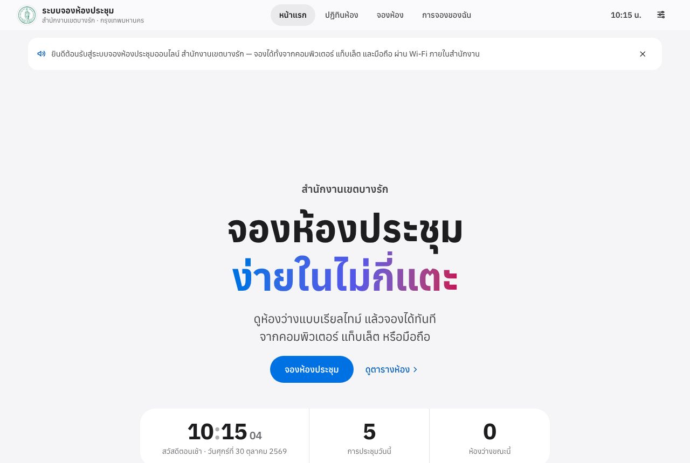

- Top menu: **หน้าแรก** (Home) · **ปฏิทินห้อง** (Calendar) · **จองห้อง** (Book) · **การจองของฉัน** (My bookings)
- The banner is an announcement from the administrators (× hides it)
- The tiles show the time, today’s meetings and how many rooms are free now
- **จองห้องประชุม** (Book a meeting room) starts a booking; **ดูตารางห้อง** opens the calendar

Scroll down for a card per room, with the **room photo** when an administrator has added one, and its status **ว่าง** (Free) / **ไม่ว่าง** (In use) / **ใกล้เริ่มประชุม** (Starting soon), today’s timeline (red line = now) and **จองห้องนี้** (Book this room).
Under the room name, **ยืนยันทันที** = confirmed instantly; **รอผู้ดูแลอนุมัติ** = awaits approval.

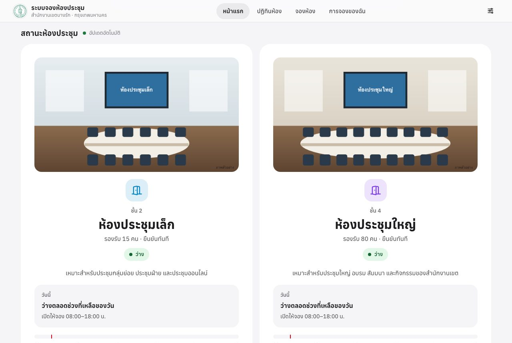

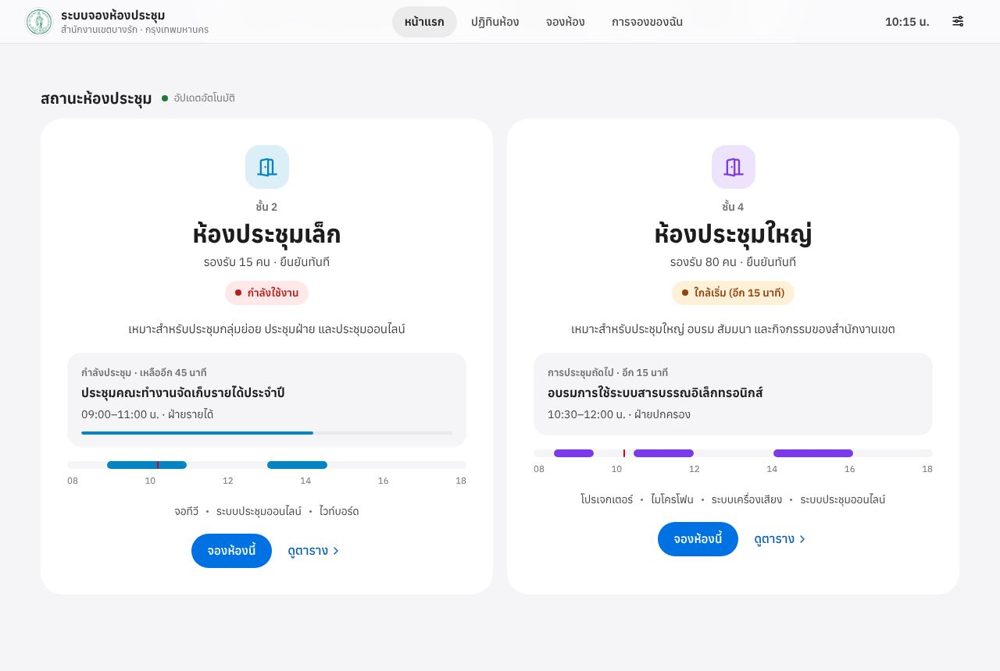

Every screen updates by itself when someone books or cancels.

**Complaints, problems and suggestions:** at the bottom of every page, the link **ร้องเรียน · แจ้งปัญหา · เสนอแนะ** opens a form (also at `/feedback`). Choose the type — problem / complaint / suggestion — describe what happened (page, room, date and device), optionally add a name and a phone number or e-mail for a reply, and press **ส่งเรื่อง** (Send). It reaches the administrators at once; each network can send about 10 items an hour.

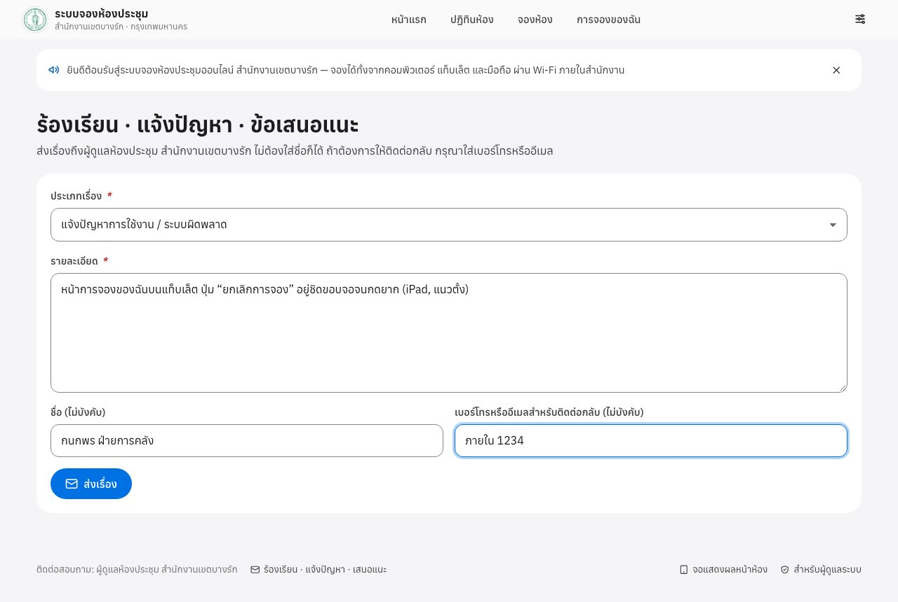

## 5. Room calendar

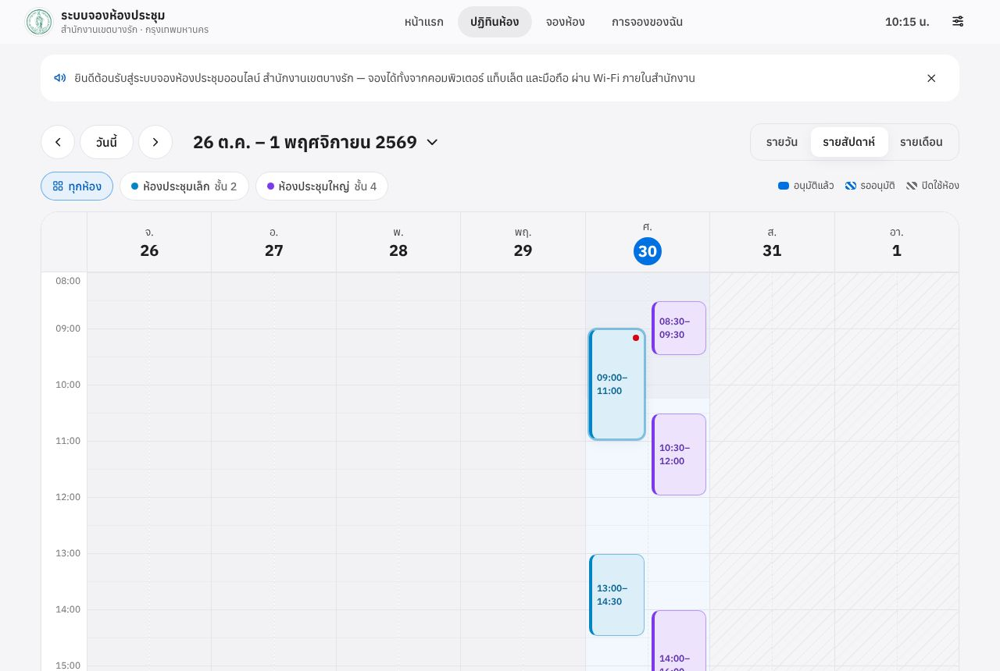

- Choose **รายวัน / รายสัปดาห์ / รายเดือน** (Day / Week / Month); **‹ วันนี้ ›** moves between dates
- Filter: **ทุกห้อง** (All rooms) / small room / large room
- Solid = **อนุมัติแล้ว** (Approved) · striped = **รออนุมัติ** (Pending) · grey stripes = **ปิดใช้ห้อง** (Blocked)
- **Tap an empty slot** to book it · tap an entry for details · swipe left/right on phones to change day

## 6. Booking in 3 steps

**Step 1 — Room and time:** choose the room, the date (crossed-out dates cannot be booked) and the time: tap the start slot, then the last slot, or use a duration / morning / afternoon / all-day button (hatched slots are taken).

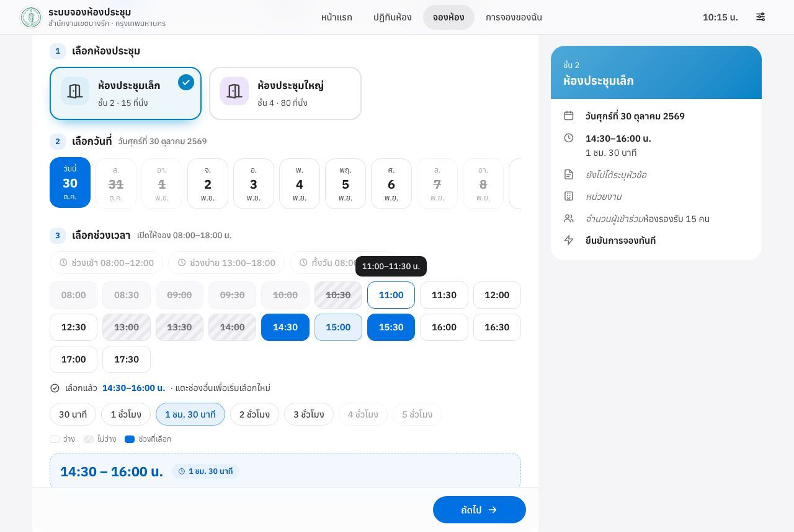

**Step 2 — Details:** meeting title\*, your name\*, department\*, phone\*, attendees\*, equipment, services, note (\* = required).

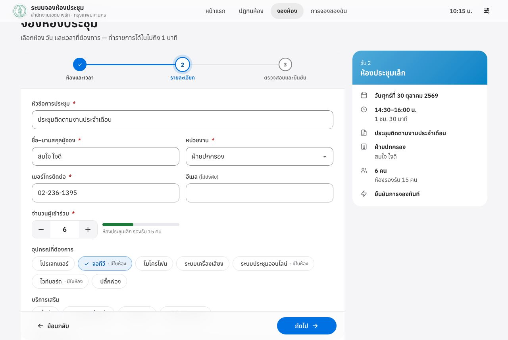

- **จองซ้ำ** (Recurring): **ทุกสัปดาห์** (Weekly) or **ทุกวันทำการ** (Every working day) and how many times; availability is checked for every date
- **Remember my name, department and phone on this device** — personal devices only
- **This is a shared device** — the booking is not kept on that device

**Step 3 — Review and confirm:** read the room rules, tick to agree, press **ยืนยันการจอง** (Confirm booking).

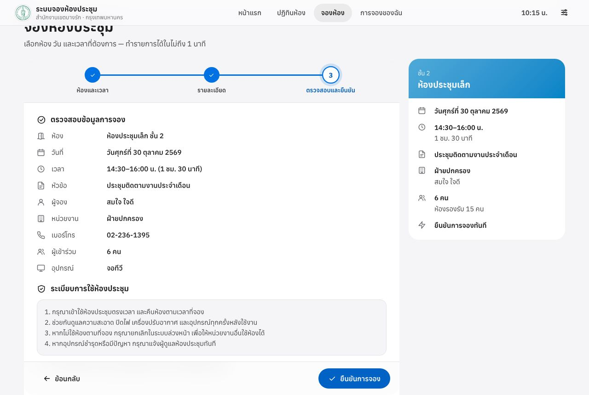

## 7. After booking, and booking status

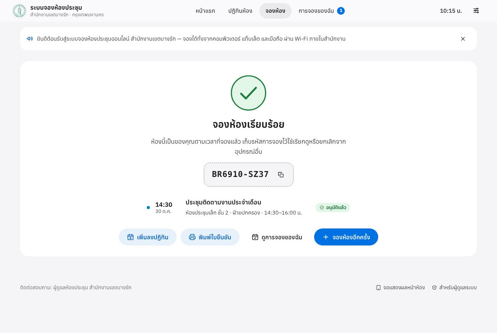

- You get a **booking code** such as `BR6910-5Y7M` — **keep it**
- **เพิ่มลงปฏิทิน** (Add to calendar, .ics) · **พิมพ์ใบยืนยัน** (Print slip with QR code) · **ดูการจองของฉัน** (My bookings)

| Status                     | Meaning                                     |
| -------------------------- | ------------------------------------------- |
| **อนุมัติแล้ว** (Approved) | The room is yours                           |
| **รออนุมัติ** (Pending)    | Awaiting approval; the time is held for you |
| **ไม่อนุมัติ** (Rejected)  | Not approved (reason shown in the details)  |
| **ยกเลิก** (Cancelled)     | Cancelled by you or an administrator        |

No e-mail or SMS is sent — check **การจองของฉัน** (My bookings).

## 8. My bookings: edit, cancel, print

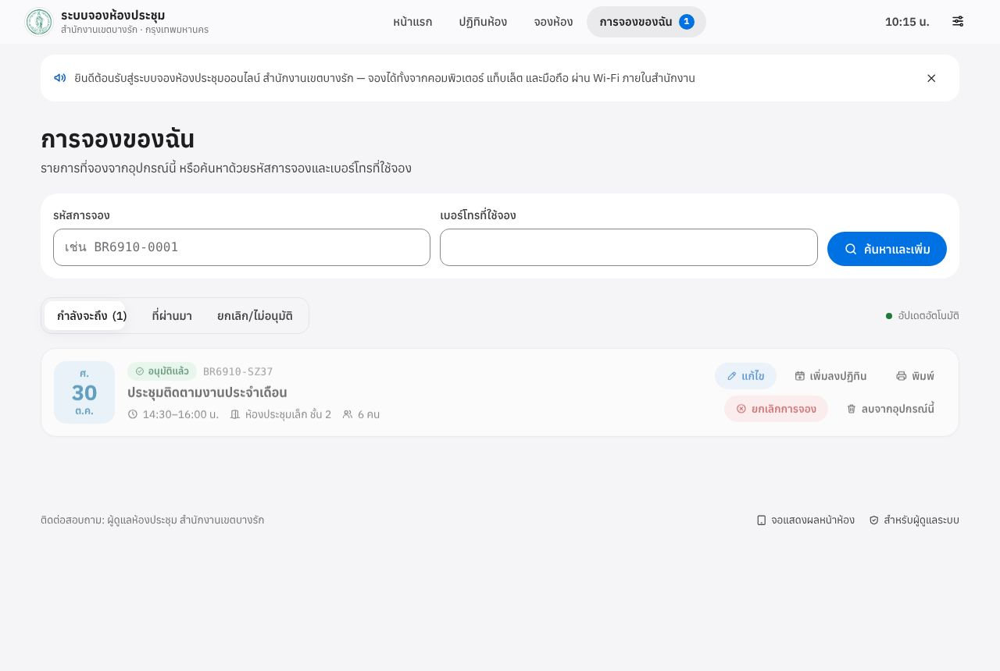

| Button                                   | What it does                                                                         |
| ---------------------------------------- | ------------------------------------------------------------------------------------ |
| **แก้ไข** (Edit)                         | Change time, room or details (an approved booking may need approval again)           |
| **เพิ่มลงปฏิทิน** (Add to calendar)      | Save to the device calendar                                                          |
| **พิมพ์** (Print)                        | Print the slip                                                                       |
| **ยกเลิกการจอง** (Cancel)                | Optional reason; for a series choose **this one only** or **this and all following** |
| **ลบจากอุปกรณ์นี้** (Remove from device) | Hides it on this device only — **does not cancel**                                   |

**From another device:** enter the **booking code** and **phone used**, then **ค้นหาและเพิ่ม** (Find and add). Repeated wrong phone numbers pause lookups for that code for 1 hour.

**If you no longer need the room, cancel it** so others can use it.

## 9. Check-in, early release and the door display

When the office has enabled check-in:

- **เช็คอินเข้าใช้ห้อง** (Check in) — shortly before the start, from My bookings or the door display
- Without check-in in time, **the room is released automatically**
- **คืนห้องก่อนเวลา** (Release early) — finished early; the end time becomes now

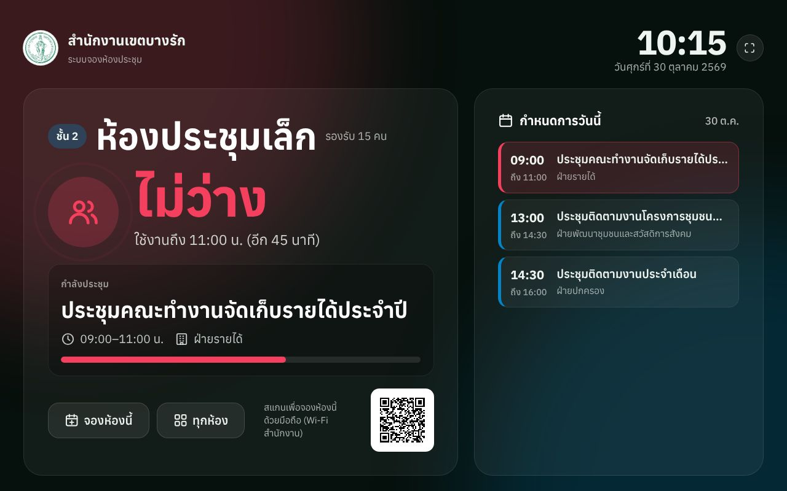

The door tablet shows the room status in large type, the current meeting, today’s schedule, **จองห้องนี้** (Book this room) and a QR code for booking by phone.

## 10. Phones, display settings and FAQ

<p>
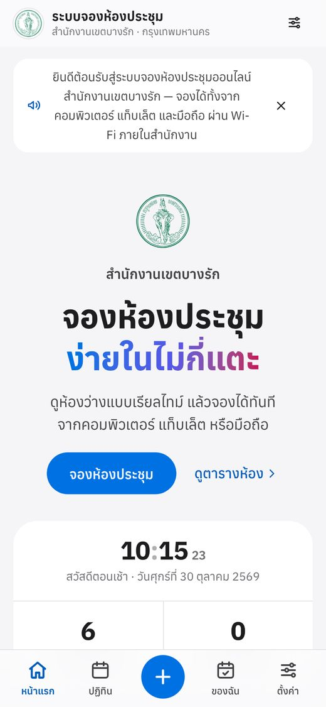
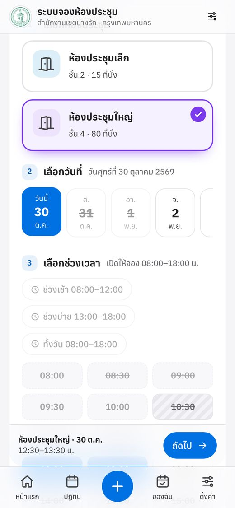
</p>

- **Add to Home Screen** to open it like an app: iPhone (Safari) Share › Add to Home Screen · Android (Chrome) ⋮ › Add to Home screen
- The settings icon (top right): theme (system/light/dark), motion (full/simple/off), click sound
- **Vibration on tap** (when the administrators turn it on): Android phones vibrate through the browser’s Vibration API (the phone’s touch vibration must be on); iPhones on **iOS 18 or later** vibrate through the iOS switch haptic (System Haptics must be on); older iPhones, iPads (no vibration motor) and computers do not vibrate. Setting motion to **off** also turns vibration off on that device

| Problem                                                     | What to do                                                              |
| ----------------------------------------------------------- | ----------------------------------------------------------------------- |
| A date is crossed out                                       | Holiday, weekend, or beyond the advance-booking window                  |
| “ช่วงที่เลือกทับกับการจองอื่น” (overlaps another booking)   | Choose a continuous free period                                         |
| “เกินความจุห้อง” (exceeds capacity)                         | Fewer attendees or a larger room                                        |
| “จองจากอุปกรณ์นี้ถี่เกินไป” (too many bookings from device) | Wait as shown, or contact the coordinator                               |
| “ปิดรับการจองชั่วคราว” (bookings closed)                    | Maintenance in progress; the calendar still works                       |
| Booking missing on another device                           | Use **ค้นหาและเพิ่ม** with the code and phone                           |
| Cannot edit/cancel                                          | Meeting started, deadline passed, or disabled — contact the coordinator |

---

# Part C — For administrators (admin pages)

## 11. Signing in, roles and passwords

Open `<system address>/admin` (or **สำหรับผู้ดูแลระบบ** at the bottom of any page).

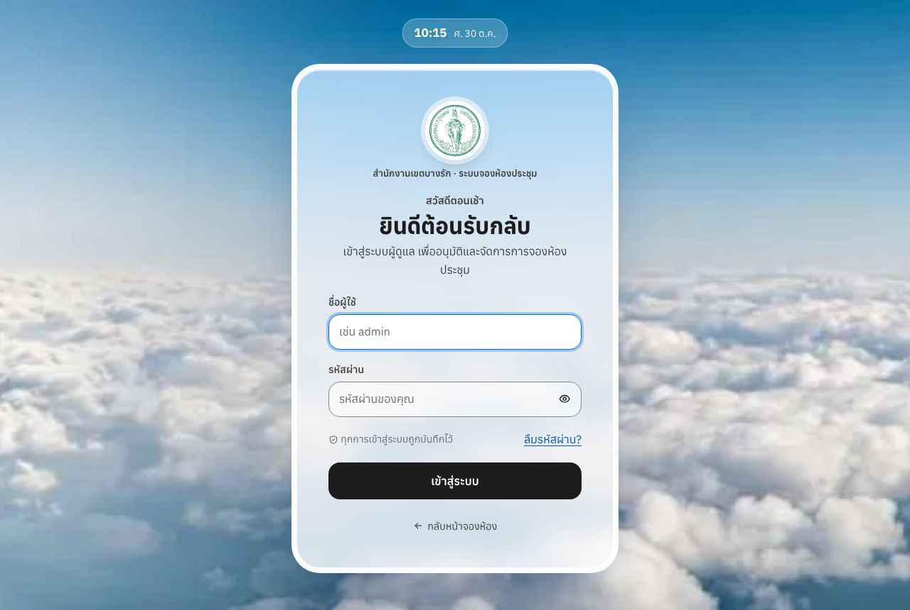

| Role                            | Access                                                    |
| ------------------------------- | --------------------------------------------------------- |
| **ผู้ดูแลระบบ** (Administrator) | Every menu                                                |
| **เจ้าหน้าที่** (Staff)         | Dashboard and Bookings (view, add, edit, approve, cancel) |

- **First time:** the `admin` account uses the password set in Cloudflare (`ADMIN_INITIAL_PASSWORD` or `ADMIN_RESET_PASSWORD` — section 27), then the system **forces you to set your own**
- New users receive a **temporary password** and must set a new one at first sign-in
- Passwords: at least **12 characters**, not guessable, not containing the username — a phrase works well
- Repeated wrong passwords pause sign-in; automatic sign-out after inactivity (12 hours by default)
- A change of network (Wi-Fi ↔ 4G) requires signing in again — this protects against stolen cookies
- Sensitive actions (adding users, changing roles, restoring data…) **ask for your password again**

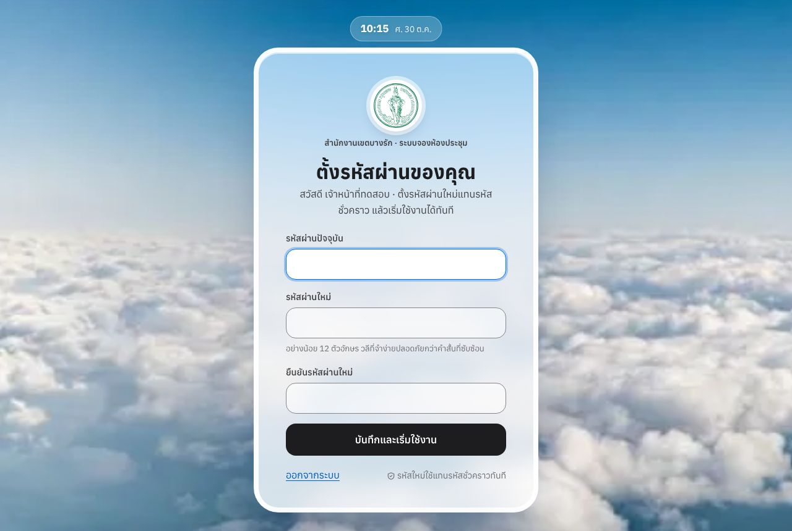

## 12. Dashboard and bookings

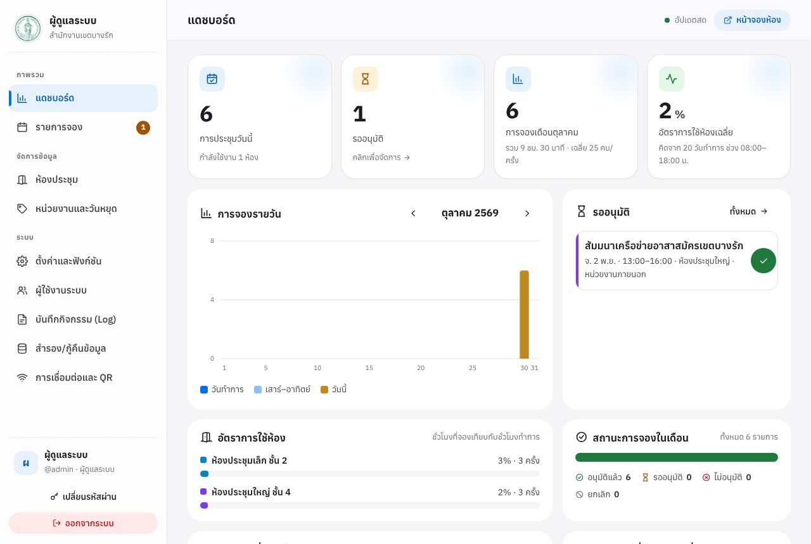

The dashboard shows today/this month, a bookings chart, requests **รออนุมัติ** (Pending) with instant approve ✓ / reject ✕, room utilisation and today’s schedule. An open admin page alerts you to new requests.

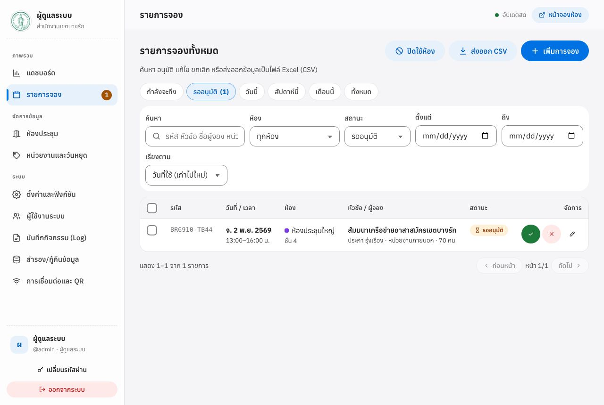

- Tabs: Upcoming · Pending · Today · This week · This month · All; search and filter by room, status, dates; tick several rows to act on them together
- **ปิดใช้ห้อง** (Block room) — maintenance, ceremonies · **ส่งออก CSV** — opens in Excel · **เพิ่มการจอง** (Add booking) — book on someone’s behalf (tick **ข้ามกฎการจอง** to override rules when needed; overlaps are always checked)
- Open a booking to **approve / reject / edit / cancel**, or **ลบถาวร** (delete permanently — test entries only; cancelling keeps history)

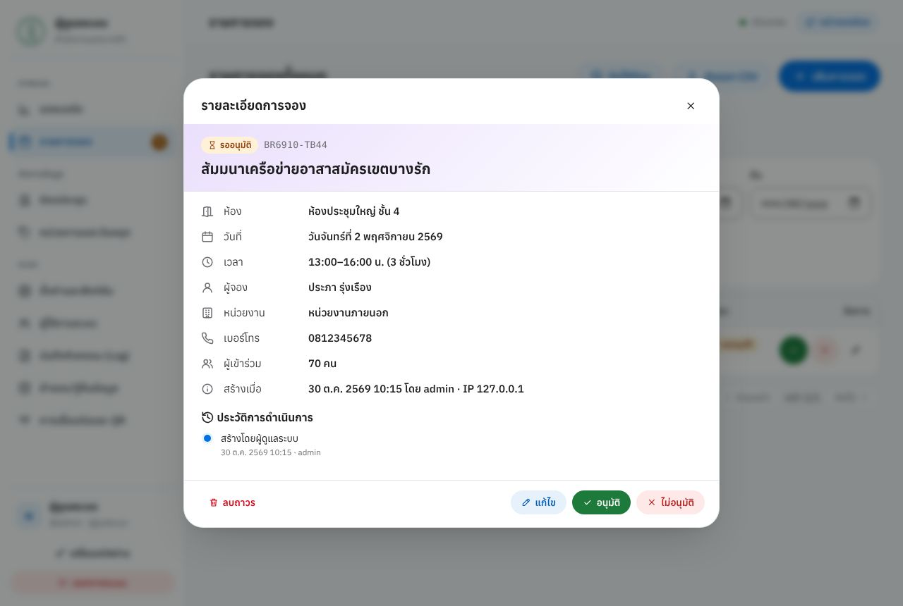

## 13. Rooms, departments and holidays

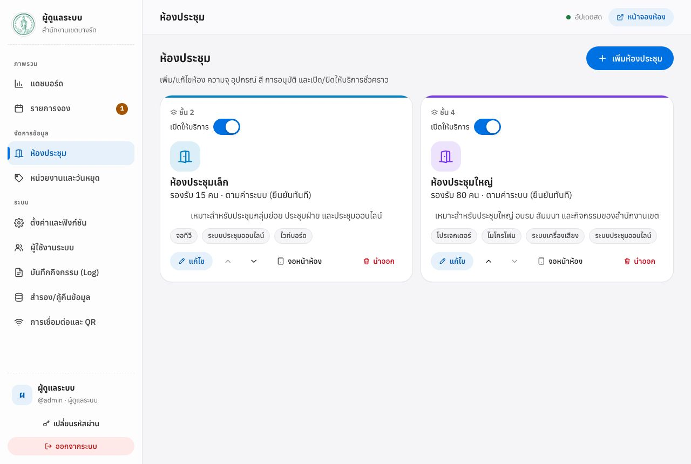

- **Add / edit / archive** rooms (archived rooms are hidden, history kept) · **เปิดให้บริการ** (In service) switch with a closed message
- **Approval per room:** use system setting / always require / always instant · set the real **capacity** · choose **room equipment**
- **Room photo:** **แก้ไข** (Edit) › **รูปห้อง** (Room photo) › **เลือกรูป** (Choose photo) — JPG, PNG or WEBP; the browser shrinks it to 1280 px before upload; SVG and files over about 500 KB are refused · **ลบรูป** removes it · press **บันทึก** (Save)

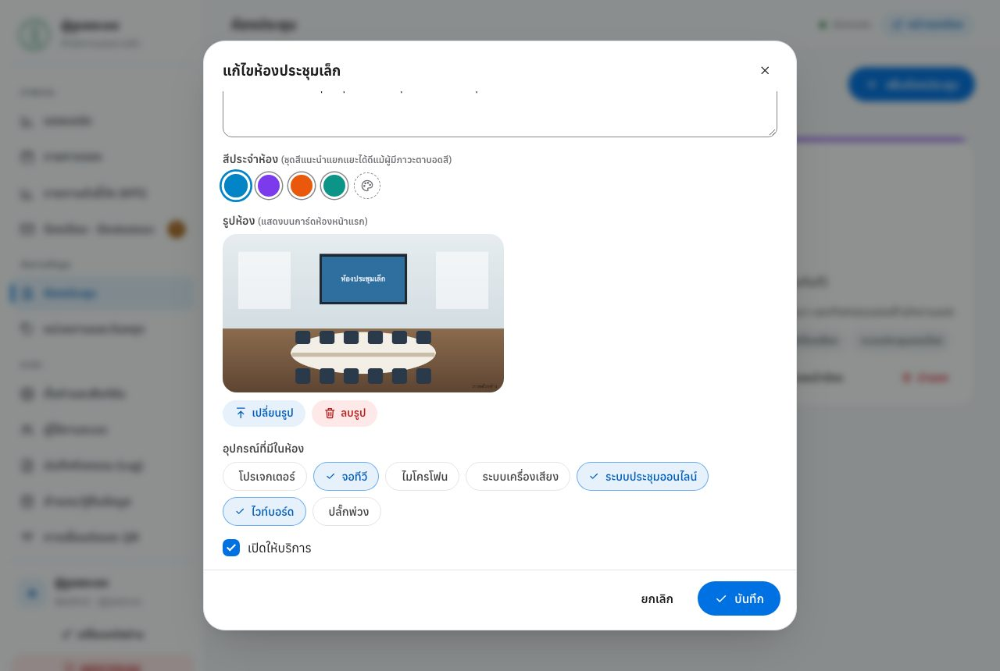

**Complaints and suggestions** (menu **ร้องเรียน · ข้อเสนอแนะ**): filter by not done / done / all, the orange number on the menu counts items not yet done (the browser tab title adds it to pending bookings) and a pop-up with the notification sound appears when a new item arrives; press **ทำเครื่องหมายว่าดำเนินการแล้ว** (Mark as done) when handled, and use the bin icon (administrators only) to delete an item permanently when its retention period ends or the sender asks.

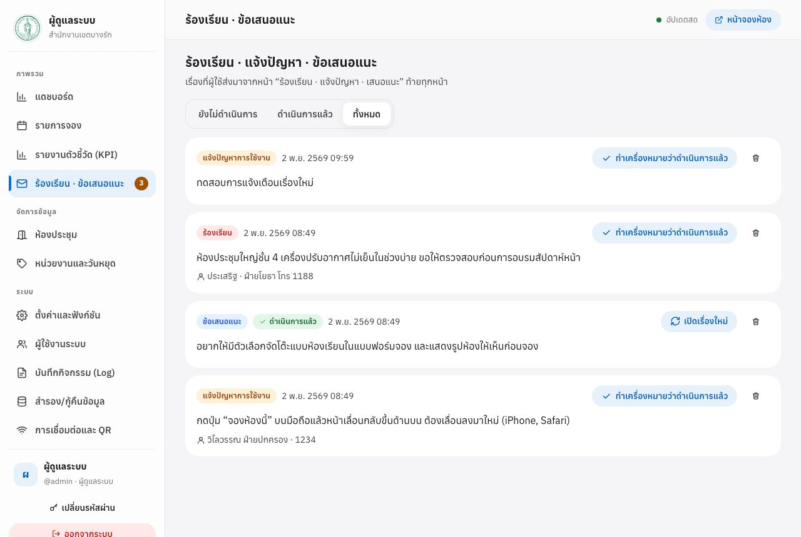

**KPI report** (menu **รายงานตัวชี้วัด (KPI)**): daily, weekly, monthly, yearly or custom periods with targets for daily backups (100%), room utilisation (≥ 30%), cancellations (≤ 20%), approval time (≤ 24 h), check-in rate (≥ 80%) and handled complaints (≥ 80%). **พิมพ์ / บันทึก PDF** prints it. Targets live in `KPI_TARGETS` at the top of `src/app.js`.

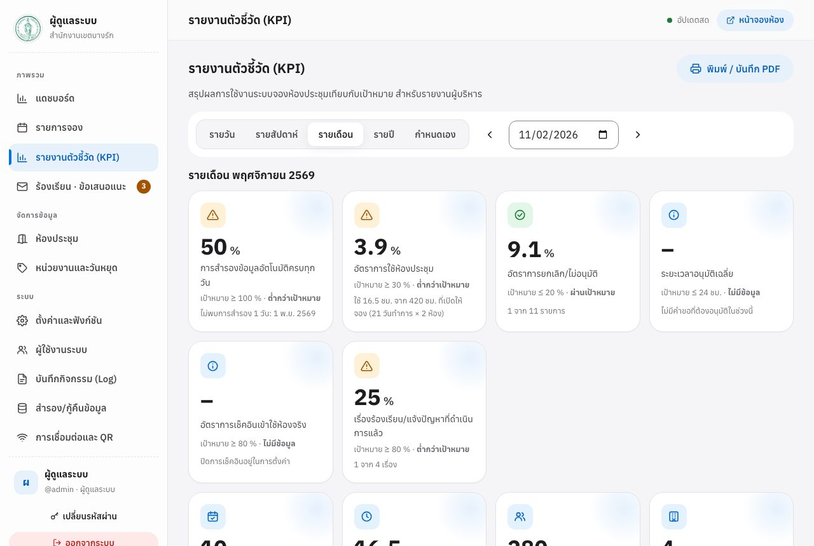

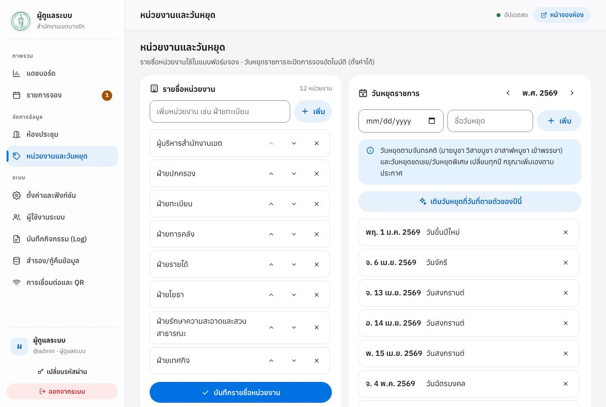

- **Departments** — choices on the booking form; press **บันทึกรายชื่อหน่วยงาน** (Save departments)
- **Public holidays** — press **เติมวันหยุดที่วันที่ตายตัวของปีนี้** (add fixed-date holidays), then **add every year by hand**: lunar holidays (Makha Bucha, Visakha Bucha, Asarnha Bucha, Buddhist Lent), substitution days and special Cabinet holidays — press **บันทึกวันหยุด** (Save holidays)

## 14. Settings and features

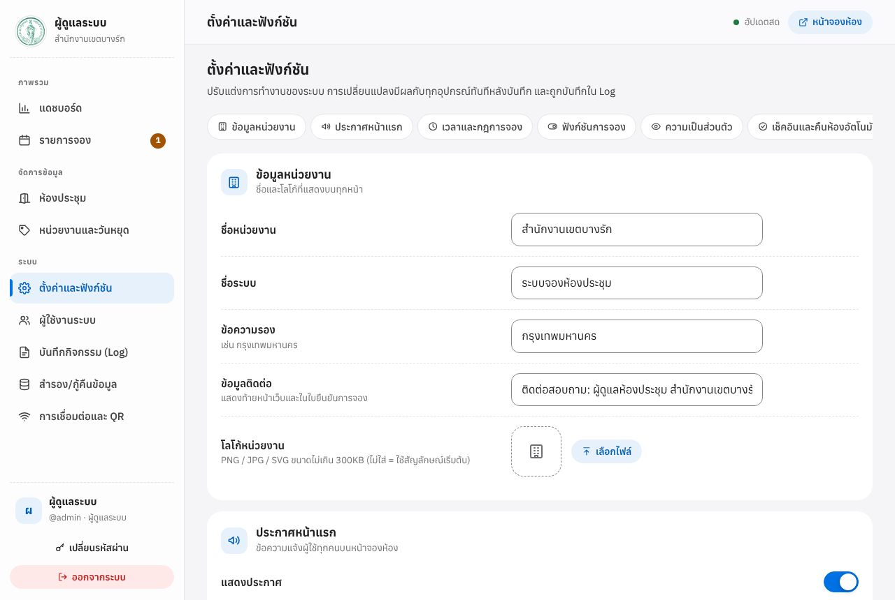

| Section                           | What you can set (default)                                                                                      |
| --------------------------------- | --------------------------------------------------------------------------------------------------------------- |
| Organisation                      | Name, system name, contact text, logo (PNG/JPG/SVG ≤ 300 KB)                                                    |
| Home announcement                 | On/off, style, text                                                                                             |
| Hours and rules                   | Opening hours (08:00–18:00), slot (30 min), min–max length, advance window (90 days), weekends/holidays (off)   |
| Booking features                  | Require approval (off), requester edit/cancel (on), recurring (max 12), capacity limit, phone required          |
| Privacy                           | Show title / requester name in the calendar — phone and e-mail are never public                                 |
| Check-in & auto-release           | Check-in (off), opens 15 min before, release after 15 min without check-in                                      |
| Equipment & services · Room rules | Form options, and the text requesters must accept                                                               |
| Look & effects · Door display     | Accent colour, theme, motion · enable door displays                                                             |
| System & security                 | Close bookings temporarily · sound alerts · auto sign-out (12 h) · keep log (365 days) · keep backups (30 days) |

Changes apply to every device immediately and are recorded in the log.

## 15. Users and the activity log

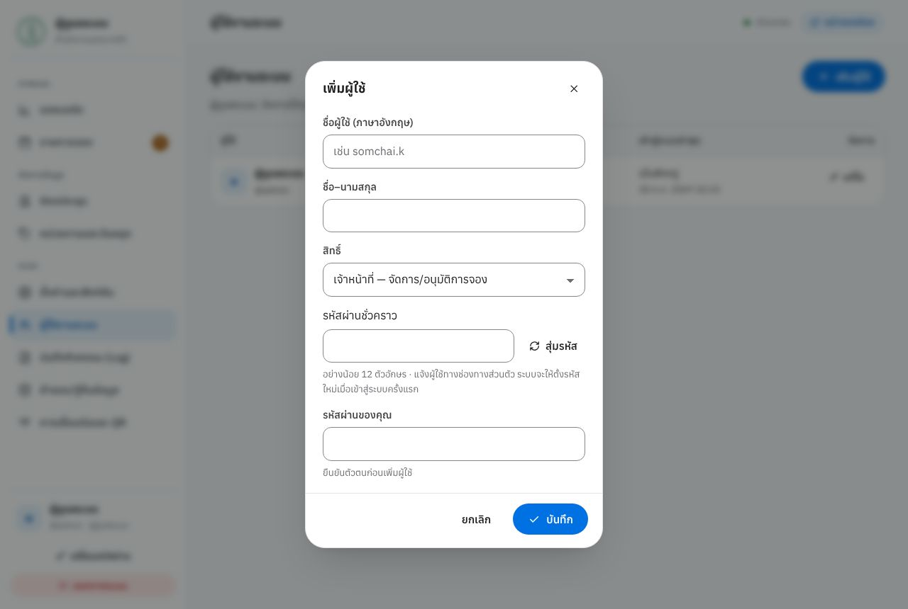

- **เพิ่มผู้ใช้** (Add user): username (Latin letters), full name, role, temporary password (**สุ่มรหัส** generates one) and your own password to confirm
- Give temporary passwords **privately** · **deactivate** leavers immediately
- Keep **at least two administrators**, and **every person uses their own account — never share accounts**

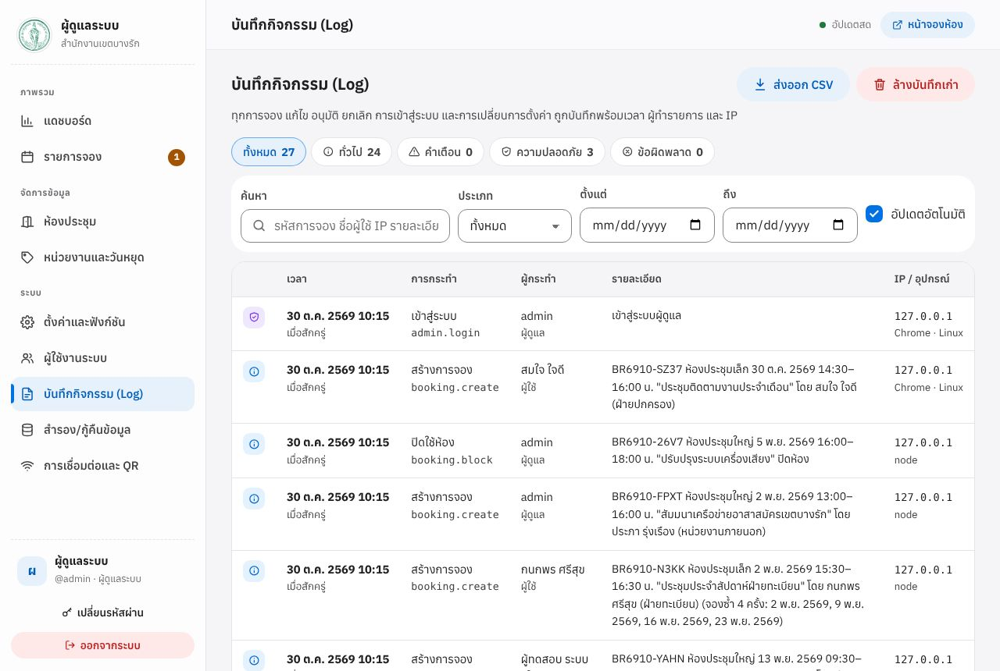

Every booking, edit, approval, sign-in (including failures) and settings change is logged with time, actor, IP and device. Filter by **security** level to spot problems; export CSV. The latest 30 days can never be deleted.

## 16. Backup/restore, connection and door displays

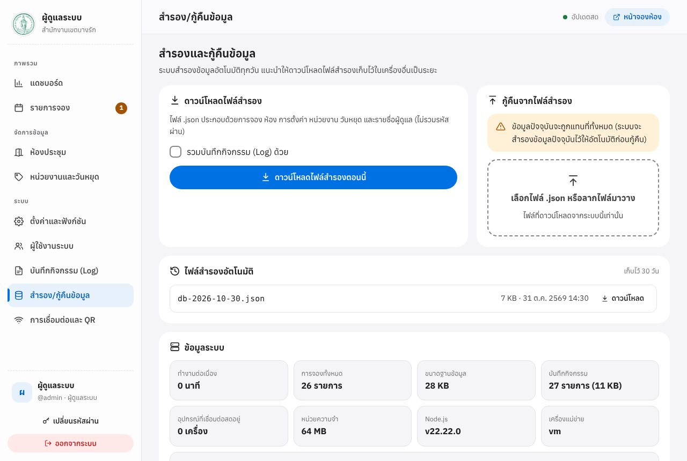

- **ดาวน์โหลดไฟล์สำรองตอนนี้** (Download backup now) — a .json file (bookings, rooms, settings, departments, holidays, admin list **without passwords**); optionally include the log
- **Automatic backups** — once a day, kept for the configured number of days
- **กู้คืนจากไฟล์สำรอง** (Restore) — replaces current data (a backup of it is made first); asks for your password — **user accounts are not replaced**
- Backups contain **personal data** (names, phones) — store them securely (section 45)

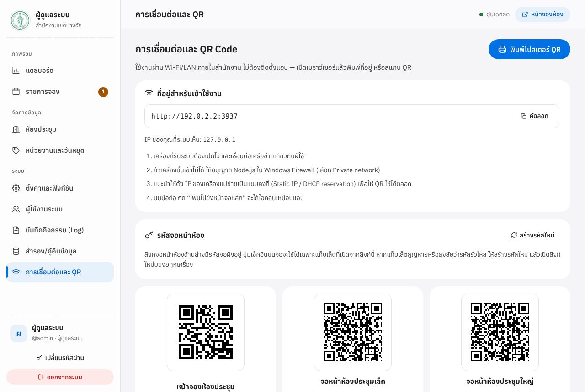

- Access address, **IP ของคุณที่ระบบเห็น** (your IP as the system sees it — use it for `OFFICE_IPS`), QR codes, **พิมพ์โปสเตอร์ QR** (Print QR poster)
- **Door displays:** open the link from this page on the tablet (it carries the display key, needed for check-in); disable screen lock, keep it charging — if a tablet is lost, press **สร้างรหัสใหม่** (Generate new key)

## 17. Deleting data and clearing the database

> **Before deleting anything:** press **ดาวน์โหลดไฟล์สำรองตอนนี้** (Download backup now) and keep the file · for real bookings that are no longer needed, **cancel** instead of **delete** so the history stays · every kind of deletion needs an **administrator** account and is recorded in the log

**What to delete, and where**

| To delete                                      | Admin menu                                                                                                          | What happens                                                                                       |
| ---------------------------------------------- | ------------------------------------------------------------------------------------------------------------------- | -------------------------------------------------------------------------------------------------- |
| One booking                                    | **รายการจอง** (Bookings) › open it › **ลบถาวร** (Delete permanently)                                                | Removed at once — for test entries or mistakes                                                     |
| Several bookings                               | **รายการจอง** › tick them › **ลบถาวร**                                                                              | Up to 500 at a time                                                                                |
| Bookings older than a date                     | **สำรอง/กู้คืนข้อมูล** › **ล้างข้อมูลการจอง** (Clear booking data) › **ลบการจองเก่า** (Delete old bookings)         | Only bookings whose meeting date is before the chosen date (a future date is not allowed)          |
| All bookings (clear test data before go-live) | **สำรอง/กู้คืนข้อมูล** › **ล้างข้อมูลการจอง** › **ล้างการจองทั้งหมด** (Clear all bookings)                          | You must type **ลบทั้งหมด** — rooms, settings, users, departments, holidays and the log are kept |
| Activity log                                   | **บันทึกกิจกรรม** (Log) › **ล้างบันทึกเก่า** (Clear old log)                                                        | Only entries older than 30 days · older entries are also removed automatically (default 365 days) |
| A room                                         | **ห้องประชุม** (Rooms) › **นำออก** (Remove)                                                                         | The room is hidden, its upcoming bookings are cancelled, history is kept                           |
| A user                                         | **ผู้ใช้งานระบบ** (Users) › **ลบ** (Delete)                                                                         | You cannot delete yourself or the last administrator — to keep history, **deactivate** instead     |
| Departments / holidays                         | **หน่วยงานและวันหยุด** › remove the item › **บันทึก** (Save)                                                        | Existing bookings are unchanged                                                                    |
| A complaint / suggestion                       | **ร้องเรียน · ข้อเสนอแนะ** › bin icon › **ลบถาวร**                                                                  | Text, name and contact are removed; restoring a backup does not bring complaints back             |
| Automatic backups                              | Cannot be deleted by hand                                                                                           | Removed automatically after the configured days (default 30)                                       |

**Clearing booking data (old bookings / everything)**

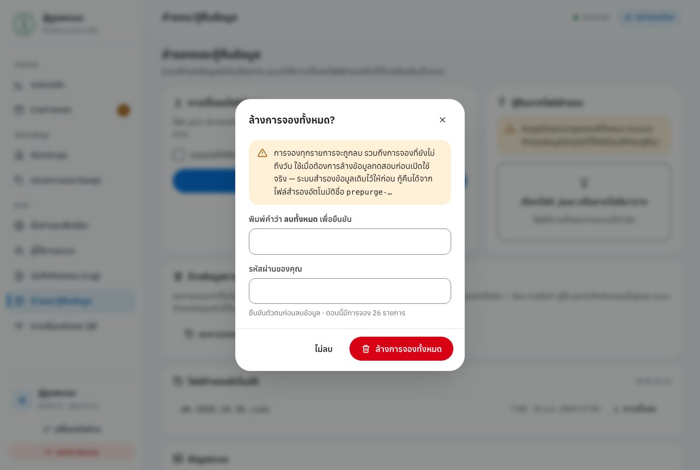

1. **สำรอง/กู้คืนข้อมูล** › **ดาวน์โหลดไฟล์สำรองตอนนี้** — store the file somewhere safe
2. On the **ล้างข้อมูลการจอง** card choose **ลบการจองเก่า** (pick a date, e.g. 1 January last year) or **ล้างการจองทั้งหมด** (type **ลบทั้งหมด**)
3. Enter **your password** › press the red button — the number removed is shown
4. Before deleting, the system always saves **`prepurge-date-time.json`** in the automatic backups list and logs **ล้างข้อมูลการจอง** (Clear booking data)

**Deleted by mistake — restore:** **สำรอง/กู้คืนข้อมูล** › **ไฟล์สำรองอัตโนมัติ** (Automatic backups) › **ดาวน์โหลด** the `prepurge-…` file › drop it on **กู้คืนจากไฟล์สำรอง** (Restore) › enter your password — data returns to how it was before (bookings made **after** the deletion are lost, so restore as soon as you notice)

> **Personal data:** deleted bookings remain in automatic backups for up to the configured days (30) before they are gone for good, and in any file you downloaded earlier — delete those files yourself

**Clearing the whole database, or shutting the system down**

| Situation                                                        | How                                                                                                                                                                                                                                            |
| ---------------------------------------------------------------- | ---------------------------------------------------------------------------------------------------------------------------------------------------------------------------------------------------------------------------------------------- |
| Testing is done, going live                                      | **ล้างการจองทั้งหมด**, then check rooms, settings and users — **nothing to do in Cloudflare**                                                                                                                                                  |
| Start completely fresh (rooms, settings, users back to defaults) | Download a backup › Cloudflare › **Workers & Pages** › `bangrak-room-booking` › **Settings** › bottom **Delete** › redo sections 33–34 (the same name is fine) — **all data in the Worker, including automatic backups, is gone for good**, and the Secrets must be set again |
| Retiring the system, or the creator removing the old one after handover | Download a backup and keep it per records policy › delete the Worker (row above) › delete the repository: GitHub › **Settings** › **Danger Zone** › **Delete this repository** › delete backups on personal devices                                  |
| Office computer / VM                                             | Stop the system, then delete the `data/` folder (database, log, backups and certificates) — the next start is an empty system with a temporary admin password in `data/initial-admin-password.txt`                                             |

## 18. Routine tasks for administrators

| When              | Task                                                                                   |
| ----------------- | -------------------------------------------------------------------------------------- |
| Daily             | Approve pending requests (if approval is on)                                           |
| Weekly            | **Download a backup and store it outside the system** · review security log entries    |
| Monthly           | **Run the system checker** and keep the report · print the KPI report · review users, deactivate unused · review GitHub / Cloudflare members (sections 20, 26) |
| Yearly (December) | Add next year’s holidays · test a restore · review settings and everyone’s access · **delete old bookings** past the organisation’s retention period (section 17) |

---

# Part D — GitHub: the code and how to edit it

## 19. What GitHub is, and which file does what

All code is at **https://github.com/MiminZeroX/-**. When files on `main` change, Cloudflare updates the site in about a minute. **Bookings are not lost**, because the data lives in Cloudflare.

| To change                                      | File                               |
| ---------------------------------------------- | ---------------------------------- |
| Text on the pages (headings, buttons, hints)   | `public/js.js`                     |
| Colours, sizes, spacing, look                  | `public/css.css`                   |
| Tab titles / page shells                       | `public/*.html`, e.g. `index.html` |
| Seal · login-page cloud image                  | `public/brand/` · `public/media/`  |
| System rules (leave to a developer)            | `src/*.js`                         |
| Cloudflare behaviour (do not edit unless sure) | `worker/` · `wrangler.jsonc`       |
| Manuals                                        | `docs/` (PDFs in `docs/pdf/`)      |

> Organisation name, announcement, rooms, hours and so on need **no code change** — use the admin pages (Part C).

## 20. Securing the account and the repository

1. **Turn on 2FA:** profile picture › **Settings** › **Password and authentication** › **Enable two-factor authentication** (use an authenticator app) and **store the recovery codes** safely
2. **Make the repository private (strongly recommended):** it is **Public** today, so anyone can read the code — repository › **Settings** › **General** › bottom **Danger Zone** › **Change repository visibility** › **Make private** (Cloudflare keeps working; it was granted access through its GitHub app)
3. **Collaborators:** **Settings** › **Collaborators** › **Add people** — least privilege; remove people who no longer need access
4. **Check installed apps:** profile picture › **Settings** › **Applications** — only Cloudflare (and tools you know)

## 21. Editing a file on the GitHub website (step by step)

Example: change the phrase “ง่ายในไม่กี่แตะ” on the home page.

1. Open https://github.com/MiminZeroX/- › folder `public` › file `js.js`
2. Press the **pencil ✏️ (Edit this file)** at the top right of the file
3. **Ctrl + F** (Mac: **Cmd + F**) to find the text and change it — **only change the Thai text; do not delete `<` `>` `$` `{` `}` or `` ` ``**
4. Press the green **Commit changes...** › type a short description, e.g. “Update home page text”
5. Choose **Commit directly to the main branch** and press **Commit changes** — the site updates in about a minute
6. Check: repository › **commits** — a green ✓ next to the commit means Cloudflare updated the site; a red ✗ means it failed (the old version stays live) — see section 28
7. Open the site and **refresh**

> For several changes, or when unsure, use section 22 or ask a developer to review.

## 22. The safer way: a branch and a Pull Request

1. Edit as in section 21, steps 1–4
2. In the commit window choose **Create a new branch for this commit and start a pull request** › **Propose changes**
3. **Open a pull request** › describe the change › **Create pull request**
4. Someone reviews (**Files changed** tab); if correct, **Merge pull request** › **Confirm merge** — the site updates after merging
5. Benefit: a second pair of eyes before going live, and an easy undo (section 23)

> A ✗ for “Workers Builds” may appear on a Pull Request — it is a trial build for non-main branches that this system does not support (section 30) and does not affect the live site. What matters is the ✓ after merging into `main`.
> **Never merge a Pull Request from someone you don’t know**, or one you don’t understand.

## 23. Undoing a bad change

| Situation                           | How to undo                                                                             |
| ----------------------------------- | --------------------------------------------------------------------------------------- |
| Site broken after a change, urgent  | Cloudflare › **Deployments** › an earlier version › **Rollback** (instant — section 28) |
| Change made through a Pull Request  | Open the merged PR › **Revert** › **Create pull request** › **Merge**                   |
| Change committed straight to `main` | Edit the file back (see the old text in the file’s **History**) and commit again        |

> A Cloudflare rollback is temporary: the next change to `main` deploys whatever `main` contains, so always fix the code in GitHub too.

## 24. Downloading the code and keeping a copy

- Everything: repository › green **Code** button › **Download ZIP** — used to rebuild the system (Part F) or as an archive copy
- The ZIP **contains no bookings and no passwords** (data lives in Cloudflare — use a backup from the admin pages)
- Rebuilding this PDF after editing `docs/manual.md` needs pandoc, poppler-utils and Playwright: `node docs/build/build-pdf.js` (or ask a developer)

---

# Part E — Cloudflare: the live site

## 25. What Cloudflare does for this system

- Serves the site 24/7 at **https://bangrak-room-booking.<account-name>.workers.dev** (or the organisation’s domain) with HTTPS
- **Workers Builds** watches GitHub — when `main` changes it runs `npx wrangler deploy` and updates the site
- Stores all data in a **Durable Object** (SQLite database), with automatic daily backups
- Applies all security protections on every page (section 46)

## 26. Menus you will use

Go to **https://dash.cloudflare.com** › your account › **Workers & Pages** (may be under **Compute**) › **bangrak-room-booking**

| Tab / menu                           | Use                                                           |
| ------------------------------------ | ------------------------------------------------------------- |
| Worker overview                      | The **site link** (`.workers.dev`) and usage                  |
| **Deployments**                      | Version history and **Rollback**                              |
| **Logs** / **Observability**         | System activity and errors                                    |
| **Settings › Build**                 | GitHub connection (repository, `main` branch, deploy command) |
| **Settings › Variables and Secrets** | Settings and secrets (section 27)                             |
| **Settings › Domains & Routes**      | The `.workers.dev` link and custom domains (section 29)       |
| **Manage Account › Members**         | Who can access the Cloudflare account — review monthly        |

## 27. Secrets and variables

**Settings › Variables and Secrets › + Add** › choose **Type** › **Variable name** and **Value** › **Deploy** (or Save) — saving creates a new site version; **data is kept**.

| Name                     | Type   | Purpose                                                                                                                                                       |
| ------------------------ | ------ | ------------------------------------------------------------------------------------------------------------------------------------------------------------- |
| `ADMIN_INITIAL_PASSWORD` | Secret | Initial password of `admin` — used **only on the very first start**; set it before the site is opened for the first time                                      |
| `ADMIN_RESET_PASSWORD`   | Secret | **Forgot the admin password:** set a new value and open the site — `admin` is reset to it **once per value** (reusing a value does nothing); delete after use |
| `OFFICE_IPS`             | Text   | Office public IP(s), comma-separated — stops the whole office being limited at once (IP shown under Admin › Connection)                                       |
| `PUBLIC_URL`             | Text   | Main address when using your own domain, e.g. `https://booking.example.go.th`                                                                                 |

- A **Secret** cannot be read back after saving (safe) — keep your own note in a safe place
- The system **never writes passwords to the logs**
- The Secret `UPDATE_TOKEN` (from the old redirect setup) **is no longer used — delete it**

## 28. Checking a deploy, and rolling back

- **Check:** the **Deployments** tab lists the latest version and time — or look for the green ✓ next to the commit on GitHub
- **If a build fails (✗):** Cloudflare **keeps the previous version live** — open Workers & Pages › bangrak-room-booking › **Deployments** / **Builds** › **View logs** and send the error to a developer
- **Rollback:** **Deployments** › a working version › **⋯** › **Rollback** › confirm — instant, data kept

## 29. Using the organisation’s own domain (optional)

1. The domain must be on Cloudflare: **Add a domain** and change its nameservers as instructed (for `.go.th` domains, coordinate with the organisation’s domain administrator)
2. Worker › **Settings › Domains & Routes › + Add › Custom domain** › e.g. `booking.example.go.th`
3. Set the Variable `PUBLIC_URL` = `https://booking.example.go.th` and print a new QR poster

## 30. Plans, costs and limits

- The **Free plan** covers Workers and Durable Objects within daily quotas, enough for a district office
- If **admin sign-in shows Error 1102** (CPU time exceeded — password checking is deliberately heavy to resist guessing) or quotas run out, switch to **Workers Paid (about US$5/month)**: Workers & Pages › **Plans**
- **Builds on other branches show ✗:** non-`main` branches use a trial upload command that this system does not support; it does not affect the live site — turn it off at **Settings › Build › Branch control** › untick **Builds for non-production branches**
- Live updates in the browser reconnect every 2 minutes (invisible to users)

---

# Part F — Building the system from scratch (for beginners)

## 31. What you need

- An **organisation e-mail address** (recommended over a personal one) for GitHub and Cloudflare
- A **phone** with an authenticator app (Google / Microsoft Authenticator) for 2FA
- The code file `bangrak-room-booking.zip` (from the creator, or downloaded as in section 24)
- A **backup .json file** from the old system (if moving data)
- About one hour and a computer with Chrome or Edge

## 32. Step 1 — GitHub account and uploading the code

1. Sign up at **https://github.com/signup** and turn on **2FA** immediately (section 20, item 1)
2. Top right **+** › **New repository** › name it, e.g. `bangrak-room-booking` › choose **Private** › **do not** tick Add a README › **Create repository**
3. Unzip the ZIP on your computer — you get a folder with `public`, `src`, `worker`, `wrangler.jsonc`, `package.json` and more
4. **Show hidden files** (names starting with a dot, such as `.gitignore`): Mac **Cmd + Shift + .** in Finder · Windows File Explorer › **View** › **Show** › **Hidden items**
5. On the new repository page, click **uploading an existing file** › drag **the files and folders inside the folder** (not the outer folder itself)
   - GitHub accepts up to 100 files per upload — if there are more, drag the `public` folder first and the rest in a second round
6. Press **Commit changes** at the bottom
7. Check: the repository’s front page must show `public/`, `src/`, `worker/` and `wrangler.jsonc` **at the top level** (not inside another folder)

## 33. Step 2 — Cloudflare account and connecting GitHub

1. Sign up at **https://dash.cloudflare.com/sign-up**, verify your e-mail, then enable 2FA: profile › **My Profile** › **Authentication** › **Two-Factor Authentication**
2. **Workers & Pages** (may be under **Compute**) › **Create** › **Workers** tab › **Import a repository**
3. **Connect GitHub** › on GitHub choose **Only select repositories** › your repository › **Install & Authorize**
4. Select the repository and set:

| Field          | Value                                                                |
| -------------- | -------------------------------------------------------------------- |
| Project name   | `bangrak-room-booking` (**must match `"name"` in `wrangler.jsonc`**) |
| Build command  | (leave empty)                                                        |
| Deploy command | `npx wrangler deploy`                                                |
| Root directory | `/`                                                                  |

5. Press **Create and deploy** / **Deploy** and wait 1–3 minutes for success
6. For a different name, first edit `"name"` in `wrangler.jsonc` on GitHub to match the project name

## 34. Step 3 — Administrator password and first start

> Do this **before opening the site link for the first time**.

1. Worker › **Settings › Variables and Secrets › + Add** › Type **Secret** › Name `ADMIN_INITIAL_PASSWORD` › Value = a temporary password of at least 12 characters › **Deploy**
2. Open the Worker’s `.workers.dev` link (overview page) — the home page appears
3. Open `<link>/admin` › username `admin` + the temporary password › set your own password
4. If the site was opened before the password was set: set the Secret `ADMIN_RESET_PASSWORD` instead and open the site again (section 27)

## 35. Step 4 — Configure before going live

1. **Move old data (if any):** Admin › **สำรอง/กู้คืนข้อมูล** (Backup/Restore) › choose the .json backup › confirm password
2. **Settings:** organisation name, contact, announcement, opening hours, booking rules, room rules
3. **Rooms:** real capacity, equipment, approval
4. **Departments and holidays:** department list and this year’s holidays (including lunar holidays)
5. **Users:** at least two administrators, plus staff accounts as needed
6. **Cloudflare:** set `OFFICE_IPS` (the IP is shown under Admin › Connection when opened from an office computer)
7. **Connection and QR:** print the QR poster and set up the door tablets
8. **GitHub:** confirm the repository is **Private**

## 36. Step 5 — Test before announcing

- [ ] The site opens on a phone using mobile data (not the office Wi-Fi)
- [ ] A test booking appears in the calendar immediately and other screens update by themselves
- [ ] An administrator can approve / edit / cancel, and it appears in the log
- [ ] A backup downloads and opens
- [ ] A staff account (limited role) works as expected
- [ ] **Delete the test bookings** (Backup/Restore › **ล้างการจองทั้งหมด** Clear all bookings — section 17), then announce to every department with Part B of this manual

## 37. Alternatives: an office computer or a cloud VM

Use these if the organisation prefers not to keep data on Cloudflare. Data is then stored in that machine’s `data/` folder.

| Option                | How to start                                                                                           | Notes                                                      |
| --------------------- | ------------------------------------------------------------------------------------------------------ | ---------------------------------------------------------- |
| Office computer       | Install Node.js (nodejs.org), then Windows: double-click `start-windows.bat` · Mac/Linux: `./start.sh` | Office network only; the computer must stay on             |
| + HTTPS in the office | Install mkcert and start with `--https`                                                                | Other devices must install mkcert’s root certificate       |
| Cloud VM              | `sudo bash deploy/install-vm.sh --domain=your.domain`                                                  | Details in `deploy/README.md`                              |
| Forgot admin password | Stop the system and run `node scripts/reset-admin.js` in the system folder                             | **Own-machine setups only** — on Cloudflare use section 27 |

---

# Part G — Handover (the creator and the recipient)

## 38. Choosing how to hand over

| Option                                                        | How                                                                                                                                                                                                                                | Best when                                         |
| ------------------------------------------------------------- | ---------------------------------------------------------------------------------------------------------------------------------------------------------------------------------------------------------------------------------- | ------------------------------------------------- |
| **A. Transfer the existing accounts**                         | GitHub: **Settings › General › Danger Zone › Transfer ownership** to the organisation’s account · Cloudflare: add the recipient under **Manage Account › Members** as **Super Administrator**, then the creator removes themselves | The current site link must stay the same          |
| **B. Recipient builds anew and moves the data (recommended)** | The recipient follows Part F with organisation accounts › restores the backup from the old system › changes the link/QR › once verified, the creator deletes the old system                                                        | Everything owned by the organisation from day one |

- After transferring the repository (A), check Cloudflare › **Settings › Build** still points to the right repository — if not, **Disconnect** and connect again
- User accounts of the booking system **do not travel with a backup** — create them again on the new system

## 39. What the creator (handing over) must do

- [ ] Latest code is on `main` and the latest commit shows ✓ (the site runs the latest version)
- [ ] Download a backup (with the log) and give it to the recipient **through a secure channel** (not a group chat)
- [ ] Hand over this manual and the code ZIP (or repository access)
- [ ] Tell the **names** of the Secrets/Variables in use (section 27) — **not the values**; the recipient sets new ones
- [ ] Grant GitHub / Cloudflare access per the chosen option and wait until the recipient confirms access
- [ ] Once the recipient has their own administrator account: **deactivate the creator’s account** in the booking system
- [ ] Remove yourself from GitHub Collaborators and Cloudflare Members · delete any API tokens you created
- [ ] Delete backups, data copies and any `data/` folders on personal devices
- [ ] With option B: once the recipient confirms the new system works, **delete your old Worker and repository** (section 17) so no personal data is left in a personal account
- [ ] Sign the handover form (section 41)

## 40. What the recipient must do

- [ ] Turn on **2FA** for every GitHub and Cloudflare account received
- [ ] Confirm access to the repository and the Worker, and that the repository is **Private**
- [ ] Set `ADMIN_RESET_PASSWORD` to **your own new value** › sign in as `admin` › set a new password › delete that Secret (so the creator’s old password no longer works)
- [ ] Create **named** administrator accounts · deactivate/delete the creator’s and anyone else’s unneeded accounts
- [ ] Review **Cloudflare › Members** and **GitHub › Collaborators** so only people with a role remain
- [ ] Test **downloading and restoring a backup** (on a test system or when nobody is using it)
- [ ] Update the contact details in Settings and in section 4 of this manual
- [ ] Assign owners for routine tasks (section 18) and an incident contact (section 47)
- [ ] Check the Cloudflare plan (Free/Paid) and who pays

## 41. Handover form

| #   | Item                                                                    | Done |
| --- | ----------------------------------------------------------------------- | ---- |
| 1   | GitHub / Cloudflare access received, or new system built (Part F)       | ☐    |
| 2   | The site opens and the latest commit shows ✓                            | ☐    |
| 3   | Backup received and restored/checked                                    | ☐    |
| 4   | New administrator password set and the creator’s account deactivated    | ☐    |
| 5   | 2FA on for every account · repository is Private                        | ☐    |
| 6   | Cloudflare members / GitHub collaborators limited to people with a role | ☐    |
| 7   | This manual and the code ZIP received                                   | ☐    |

| Handed over by (creator) | Received by | Date |
| ------------------------ | ----------- | ---- |
|                          |             |      |

---

# Part H — Security

## 42. Ten key rules

1. **2FA** on every GitHub and Cloudflare account
2. **No shared accounts** — everyone has their own
3. **Least privilege** (staff get the “Staff” role, not “Administrator”)
4. **Passwords and secrets live only in Cloudflare Secrets** — never in GitHub files, chats, e-mail, or AI tools
5. The repository is **Private**
6. **Review before merging** — never merge what you don’t understand or from people you don’t know
7. **Back up weekly** and store backups securely (they contain personal data)
8. **Remove leavers immediately** from the booking system, GitHub and Cloudflare
9. **Review security log entries** and member lists regularly
10. Know the incident steps (section 47) before an incident happens

## 43. Accounts and passwords

- Use a **password manager** and a unique password per service
- Prefer an authenticator app over SMS, and keep the **recovery codes** safe (to recover the account if the phone is lost)
- GitHub / Cloudflare accounts for this system should use an **organisation e-mail**, not a personal one
- In the booking system: passwords ≥ 12 characters · sign out on shared computers · don’t save passwords in shared browsers

## 44. Secrets and code

- Values in `ADMIN_INITIAL_PASSWORD` / `ADMIN_RESET_PASSWORD` are **temporary** — the system forces a new password at sign-in
- If a password or token leaks: **change/delete it immediately** (Cloudflare › My Profile › **API Tokens** › Roll/Delete)
- Don’t create API tokens unless needed; if you must, give the least permissions and an expiry date
- Install only known apps into GitHub (Cloudflare) · review **Settings › Applications** regularly
- **Never upload backups or a `data/` folder to GitHub**

## 45. Personal data (Thailand PDPA) and backups

- Stored: requester names, departments, phone numbers (and e-mail if enabled), meeting titles, IP and device in the log
- The public calendar **never shows phone or e-mail**; requester names can be hidden under Privacy settings
- Set retention for the log and automatic backups appropriately (Settings › System & security)
- **Keep only what is needed:** agree a retention period for bookings with the DPO (e.g. 1–2 years) and **delete old bookings** every year — bookings are never deleted automatically (section 17)
- Downloaded backups: keep them on an access-restricted organisation drive or encrypted · delete old ones · never send them through chat
- Inform the organisation’s Data Protection Officer (DPO) / IT that the data is on Cloudflare

## 46. Protections already built in

- HTTPS everywhere, `http://` redirected to `https://`, HSTS · full security headers (CSP, nosniff, framing) on every page
- scrypt password hashing · forced change on first sign-in · password policy · guessing limits per IP and per account
- HttpOnly + Secure + SameSite=Strict cookies bound to the IP · re-authentication for sensitive actions
- CSRF protection (JSON only + custom header) · output escaping everywhere (XSS) · size and rate limits
- The public calendar hides booking codes and contact details · random booking codes · repeated wrong lookups paused
- Downloaded backups contain no password hashes · the latest 30 days of logs cannot be deleted · no passwords in Cloudflare logs
- Room photos accept only JPG/PNG/WEBP within a size limit · the feedback form is rate-limited and always shown as plain text
- Penetration-tested and reviewed against the OWASP Top 10, with 57 automated tests
- **System checker** (`checker/`): double-click `check-windows.bat` (Windows) or `check-mac.command` (macOS, needs Node.js 18+) to test the live site’s functions and 20 security guards without changing data; it writes an HTML report with fixes for anything that fails. `--deep` also proves the sign-in lockout (it locks the running computer’s IP out of sign-in for about a minute). Use it only on systems you own or are authorised to test

**Optional hardening:** use **Cloudflare Access** (Zero Trust › Access › Applications) to allow only organisation e-mail addresses to open `/admin*` and `/api/admin/*` (free for up to 50 users).

## 47. Suspected breach or unusual activity

1. **Stay calm and record:** time, what you saw, screenshots
2. **Close bookings temporarily** (Settings › System & security) if data is being changed abnormally
3. **Reset the administrator password:** set a new `ADMIN_RESET_PASSWORD` › sign in › set a new password · **deactivate suspicious accounts** under Users
4. **Review the log** at security level (repeated failed sign-ins, sessions from another IP, settings changes)
5. **Generate a new door-display key** (Connection and QR) if a tablet is lost or suspect
6. Change GitHub / Cloudflare passwords · review Members, Collaborators and API tokens · check recent commits for anything unexpected (if found: Rollback + Revert — section 23)
7. **Restore** from a backup taken before the incident if data was damaged
8. **Report** to management and the DPO — if personal data leaked, notify Thailand’s Personal Data Protection Committee office (PDPC) **within 72 hours** under the PDPA

## 48. Troubleshooting

| Symptom                                            | What to do                                                                                                             |
| -------------------------------------------------- | ---------------------------------------------------------------------------------------------------------------------- |
| The site does not open at all                      | Check the link (`.workers.dev`) · Cloudflare › Deployments shows a recent version? · after a code change, try Rollback |
| Edited a file on GitHub but the site didn’t change | Wait 1–2 minutes and refresh · check ✓/✗ next to the commit — ✗ = build failed, see View logs (section 28)             |
| Cannot sign in as admin / forgot password          | Set `ADMIN_RESET_PASSWORD` to a **new value** and open the site (a reused value does nothing)                          |
| Error 1102 after signing in                        | Switch to Workers Paid (section 30)                                                                                    |
| The whole office is limited at once                | Set `OFFICE_IPS` (section 27)                                                                                          |
| Administrators get signed out often                | The network’s IP changes (mobile data) — by design, sign in again                                                      |
| Data missing / wrong                               | Admin › Backup/Restore › restore from an automatic or downloaded backup                                                |
| ✗ on a Pull Request (Workers Builds)               | Trial build for non-main branches; the live site is unaffected (section 30)                                            |
| Pages look broken after editing `js.js`            | Probably a code character was deleted — Rollback now, then revert the edit (section 23)                                |

_This manual matches the version running on Cloudflare (November 2026). Screenshots use sample data._
