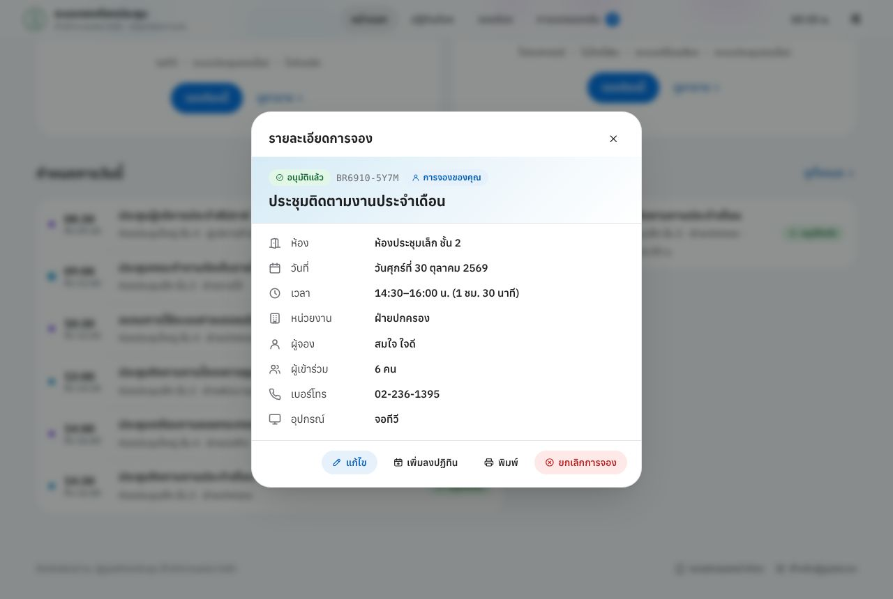
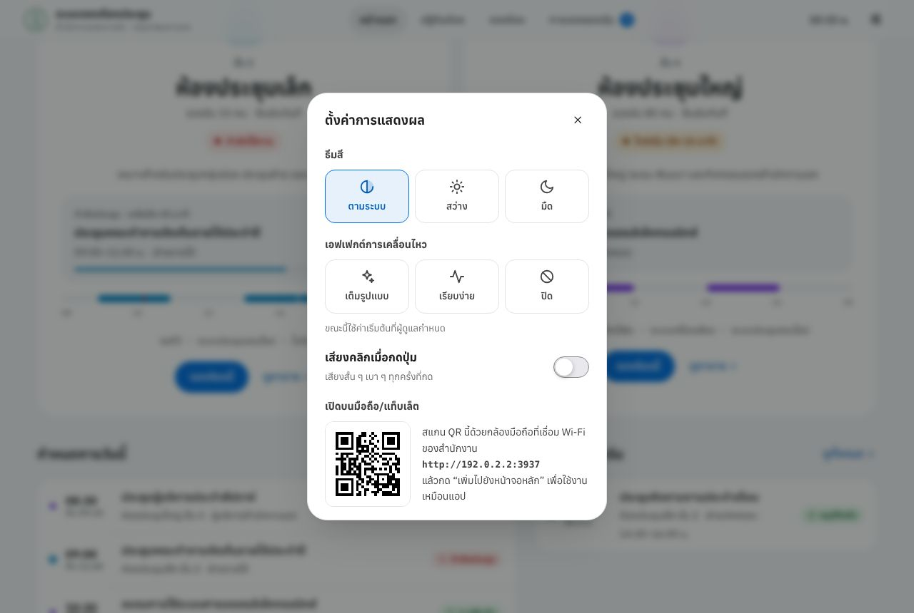

# Staff User Guide

**Meeting Room Booking System — Bang Rak District Office** — Small Meeting Room (2nd floor) and Large Meeting Room (4th floor)

This guide is for all staff who want to check room schedules and book a meeting room. No user account and no app installation are needed.
It works on computers, tablets and phones.

> The system's screens are in Thai. This guide gives each Thai label in **bold** followed by its English meaning, e.g. **จองห้อง** (Book a room).
> **Thai version:** [user-guide.th.md](user-guide.th.md)

---

## Contents

1. [Opening the system](#1-opening-the-system)
2. [Home: room status](#2-home-room-status)
3. [Room calendar](#3-room-calendar)
4. [Booking in 3 steps](#4-booking-in-3-steps)
5. [After booking](#5-after-booking)
6. [My bookings: edit, cancel, print](#6-my-bookings-edit-cancel-print)
7. [Check-in and early release](#7-check-in-and-early-release)
8. [Room door display](#8-room-door-display)
9. [Using a phone](#9-using-a-phone)
10. [Display settings](#10-display-settings)
11. [FAQ and troubleshooting](#11-faq-and-troubleshooting)

---

## 1. Opening the system

Open a browser (Chrome, Edge or Safari) and type the system address, or scan the QR code posted in the office.

| Item                                 | For this office (filled in by IT)    |
| ------------------------------------ | ------------------------------------ |
| System address                       | \***\*\*\*\*\***\_\_\***\*\*\*\*\*** |
| Meeting room coordinator / extension | \***\*\*\*\*\***\_\_\***\*\*\*\*\*** |

> If the system is hosted inside the office (not in the cloud), you must be on the **office Wi-Fi or LAN** to open it.

The main menu is at the top of every page: **หน้าแรก** (Home) · **ปฏิทินห้อง** (Calendar) · **จองห้อง** (Book a room) · **การจองของฉัน** (My bookings)

---

## 2. Home: room status

- The banner at the top is an announcement from the administrators (press × to hide it).
- The number tiles show the current time, today's meetings, and how many rooms are free right now.
- Press **จองห้องประชุม** (Book a meeting room) to start, or **ดูตารางห้อง** (View schedule) to open the calendar.

Scroll down to see a card for each room.

| Card status                         | Meaning                                     |
| ----------------------------------- | ------------------------------------------- |
| **ว่าง** (Free)                     | No meeting at the moment                    |
| **ไม่ว่าง** (In use)                | A meeting is on; shows when it will be free |
| **ใกล้เริ่มประชุม** (Starting soon) | A meeting starts shortly                    |

The timeline under each card shows today's booked periods (the red line is the current time).
Below it are the room's equipment and the buttons **จองห้องนี้** (Book this room) / **ดูตาราง** (Schedule).

**ยืนยันทันที** (Instant confirmation) under the room name means the booking is confirmed immediately. **รอผู้ดูแลอนุมัติ** (Awaits administrator approval) means an administrator must approve it first.

Every screen updates itself instantly when someone books or cancels — no need to refresh.

---

## 3. Room calendar

- Choose **รายวัน / รายสัปดาห์ / รายเดือน** (Day / Week / Month) at the top right.
- Use **‹ วันนี้ ›** (Today) to move between dates, or press the date title to pick a date.
- Filter by room: **ทุกห้อง** (All rooms) / Small room / Large room.
- Colours: solid = **อนุมัติแล้ว** (Approved), striped = **รออนุมัติ** (Pending), grey stripes = **ปิดใช้ห้อง** (Room blocked by an administrator).
- **Press an empty slot** to book that time straight away.
- Press an existing entry to see its details.
- On phones, swipe left/right to change the day.

---

## 4. Booking in 3 steps

Press **จองห้อง** (Book a room) in the top menu, or **จองห้องนี้** on a room card. The summary box on the right always shows what you have chosen.

### Step 1 — Room and time (ห้องและเวลา)

1. **เลือกห้องประชุม** — choose the room.
2. **เลือกวันที่** — choose the date. Crossed-out dates cannot be booked (holidays, weekends, or beyond the advance-booking window).
3. **เลือกช่วงเวลา** — choose the time:
   - Tap the **start slot**, then tap the **last slot** you need; or
   - tap a start slot and press a duration button such as **1 ชั่วโมง** (1 hour), **2 ชั่วโมง** (2 hours); or
   - press **ช่วงเช้า / ช่วงบ่าย / ทั้งวัน** (Morning / Afternoon / All day).
   - Hatched slots are taken. Tap another slot to start over.

Press **ถัดไป** (Next).

### Step 2 — Details (รายละเอียด)

| Field                                      | Notes                                                                |
| ------------------------------------------ | -------------------------------------------------------------------- |
| **หัวข้อการประชุม** (Meeting title) \*     | e.g. "Monthly follow-up meeting"                                     |
| **ชื่อ–นามสกุลผู้จอง** (Your full name) \* |                                                                      |
| **หน่วยงาน** (Department) \*               | Pick from the list                                                   |
| **เบอร์โทรติดต่อ** (Phone) \*              | Used to find the booking from another device and for call-backs      |
| **อีเมล** (Email)                          | Optional unless the office requires it                               |
| **จำนวนผู้เข้าร่วม** (Attendees) \*        | Use − / +; the bar compares it with room capacity                    |
| **อุปกรณ์ที่ต้องการ** (Equipment)          | Tap to select; items tagged **มีในห้อง** are permanently in the room |
| **บริการเสริม** (Services)                 | e.g. drinking water, coffee, snacks                                  |
| **หมายเหตุ** (Note)                        | Message for the room coordinator                                     |

\* = required

**Recurring booking (จองซ้ำ):** choose **ทุกสัปดาห์** (Weekly) or **ทุกวันทำการ** (Every working day) and the number of times. The system checks availability for every date in advance;
free dates get a tick. If some dates are taken, it asks whether to book only the free ones.

Options at the end of the form:

- **จดจำชื่อ หน่วยงาน และเบอร์โทรไว้ในอุปกรณ์นี้** (Remember my name, department and phone on this device) — only on your own device.
- **นี่เป็นอุปกรณ์ส่วนกลาง** (This is a shared device) — the booking is not kept on that device.
  Write down the booking code and look it up later from your own device.

Press **ถัดไป** (Next).

### Step 3 — Review and confirm (ตรวจสอบและยืนยัน)

Check the details, read the room rules, tick **ข้าพเจ้าได้อ่านและยินยอมปฏิบัติตามระเบียบการใช้ห้องประชุม** (I have read and agree to the room rules),
then press **ยืนยันการจอง** (Confirm booking).

---

## 5. After booking

- You get a **booking code** such as `BR6910-5Y7M` (press the icon next to it to copy). **Keep this code.**
- **เพิ่มลงปฏิทิน** (Add to calendar) — saves an .ics event for your phone or Outlook.
- **พิมพ์ใบยืนยัน** (Print confirmation) — a confirmation slip with a QR code.
- **ดูการจองของฉัน** (My bookings) / **จองห้องอีกครั้ง** (Book again).

### Booking status

| Status                     | Meaning                                                         |
| -------------------------- | --------------------------------------------------------------- |
| **อนุมัติแล้ว** (Approved) | The room is yours                                               |
| **รออนุมัติ** (Pending)    | The room needs administrator approval; the time is held for you |
| **ไม่อนุมัติ** (Rejected)  | Not approved (see the reason in the booking details)            |
| **ยกเลิก** (Cancelled)     | Cancelled by you or an administrator                            |

No e-mail is sent. Check **การจองของฉัน** (My bookings); the status changes there as soon as an administrator approves.

---

## 6. My bookings: edit, cancel, print

This page lists bookings made from this device, in tabs **กำลังจะถึง** (Upcoming) · **ที่ผ่านมา** (Past) · **ยกเลิก/ไม่อนุมัติ** (Cancelled/Rejected).

| Button                                   | What it does                                                                                                                                   |
| ---------------------------------------- | ---------------------------------------------------------------------------------------------------------------------------------------------- |
| **แก้ไข** (Edit)                         | Change time, room or details. Editing an approved booking may send it back for approval.                                                       |
| **เพิ่มลงปฏิทิน** (Add to calendar)      | Save to the device calendar                                                                                                                    |
| **พิมพ์** (Print)                        | Print the confirmation slip                                                                                                                    |
| **ยกเลิกการจอง** (Cancel booking)        | Optional reason. For a recurring booking choose **เฉพาะครั้งนี้** (This one only) or **ครั้งนี้และครั้งถัดไปทั้งหมด** (This and all following) |
| **ลบจากอุปกรณ์นี้** (Remove from device) | Hides it on this device only — **it does not cancel the booking**                                                                              |

**If you no longer need the room, please cancel** so other departments can use it.

### Finding a booking from another device

Booked on a computer but want to manage it on your phone? Enter the **รหัสการจอง** (Booking code) and the **เบอร์โทรที่ใช้จอง** (Phone used for booking), then press **ค้นหาและเพิ่ม** (Find and add).
The booking (and the whole recurring series) is added to that device.

> After several wrong phone numbers, lookups for that code are paused for 1 hour to prevent guessing.

### Booking details

Press any booking (on Home, Calendar or My bookings) to see its details. Your own bookings show the tag **การจองของคุณ** (Your booking) and action buttons.

---

## 7. Check-in and early release

Only when the office has enabled check-in (ask the coordinator).

- **เช็คอินเข้าใช้ห้อง** (Check in) — available shortly before the start time, from My bookings or the door display.
- **If nobody checks in within the set time after the start, the room is released automatically** for others.
- **คืนห้องก่อนเวลา** (Release room early) — finished early? Press this; the end time is set to now.

---

## 8. Room door display

The tablet at the door shows the status in large type (Free / In use / Starting soon), the current meeting with a progress bar, and today's schedule.

- **จองห้องนี้** (Book this room) — book directly on the screen.
- **Scan the QR code** with your phone to book this room from your own device.
- Check-in is available on the display when enabled.

---

## 9. Using a phone

- Every page fits the screen; buttons are easy to tap.
- **Add to Home Screen** to open the system like an app:
  - iPhone (Safari): Share → **Add to Home Screen**
  - Android (Chrome): menu ⋮ → **Add to Home screen**

---

## 10. Display settings

Press the settings icon (top right, next to the clock).

- **ธีมสี** (Theme): ตามระบบ / สว่าง / มืด (System / Light / Dark)
- **เอฟเฟกต์การเคลื่อนไหว** (Motion): เต็มรูปแบบ / เรียบง่าย / ปิด (Full / Simple / Off) — choose Off if animations bother you or the device is slow
- **เสียงคลิกเมื่อกดปุ่ม** (Click sound)
- A **QR code** to open the system on your phone

These settings apply to the current device only.

---

## 11. FAQ and troubleshooting

| Problem / question                                          | What to do                                                                                                                 |
| ----------------------------------------------------------- | -------------------------------------------------------------------------------------------------------------------------- |
| The site does not open                                      | Check the address. If the system is hosted in the office, make sure you are on the office Wi-Fi/LAN. Otherwise contact IT. |
| A date is crossed out                                       | It is a holiday, a weekend, or beyond the advance-booking window.                                                          |
| "ช่วงที่เลือกทับกับการจองอื่น" (overlaps another booking)   | That period is taken. Choose a continuous free period.                                                                     |
| "เกินความจุห้อง" (exceeds room capacity)                    | Reduce the number or choose a larger room.                                                                                 |
| "จองจากอุปกรณ์นี้ถี่เกินไป" (too many bookings from device) | Wait for the time shown, or contact the coordinator.                                                                       |
| "ปิดรับการจองชั่วคราว" (bookings temporarily closed)        | Administrators are doing maintenance. You can still view the calendar; try again later.                                    |
| My booking is not on my other device                        | Use **ค้นหาและเพิ่ม** (Find and add) with the booking code and phone (section 6).                                          |
| I lost the booking code                                     | Check the printed slip or calendar entry, or contact the coordinator with your name, date and time.                        |
| I cannot edit or cancel                                     | The meeting has started, the cancellation deadline has passed, or the office has disabled it — contact the coordinator.    |
| Still "รออนุมัติ" (Pending)                                 | Waiting for approval. If the meeting is soon, contact the coordinator.                                                     |

---

_This guide matches the delivered version of the system. Screenshots use sample data._
