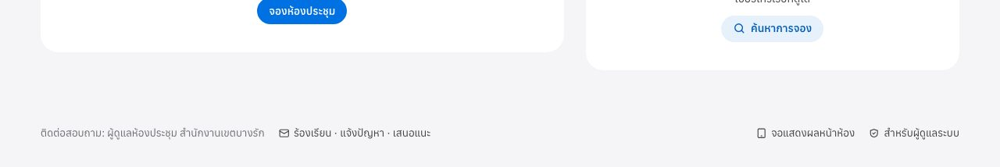

# คู่มือการใช้งานระบบจองห้องประชุม สำหรับผู้ใช้ทั่วไป

**สำนักงานเขตบางรัก กรุงเทพมหานคร**

คู่มือเล่มนี้อธิบายการใช้งานระบบจองห้องประชุมสำหรับเจ้าหน้าที่ทุกฝ่าย ตั้งแต่การเปิดระบบ ดูห้องว่าง จองห้อง แก้ไขและยกเลิกการจอง การเช็คอิน ไปจนถึงการส่งเรื่องร้องเรียนหรือแจ้งปัญหาถึงผู้ดูแล โดยเรียงตามลำดับการใช้งานจริง ผู้อ่านสามารถเปิดดูเฉพาะหัวข้อที่ต้องการได้จากสารบัญ

ภาพหน้าจอในคู่มือใช้ข้อมูลตัวอย่าง สีและข้อความบนหน้าจอจริงอาจต่างเล็กน้อยตามที่ผู้ดูแลตั้งค่าไว้ ผู้ดูแลระบบโปรดดู **คู่มือผู้ดูแลระบบและการพัฒนาต่อยอด** ซึ่งแยกเป็นอีกเล่มหนึ่ง

## สารบัญ

---

# ส่วนที่ 1 — ทำความรู้จักระบบ

## 1. ระบบนี้ใช้ทำอะไร

ระบบจองห้องประชุมเป็นเว็บไซต์สำหรับจองห้องประชุมของสำนักงานเขตบางรัก ได้แก่ **ห้องประชุมเล็ก ชั้น 2** และ **ห้องประชุมใหญ่ ชั้น 4** ใช้งานผ่านเบราว์เซอร์ได้ทั้งคอมพิวเตอร์ แท็บเล็ต และโทรศัพท์มือถือ โดยไม่ต้องติดตั้งแอปพลิเคชันและไม่ต้องสมัครสมาชิก

สิ่งที่ผู้ใช้ทั่วไปทำได้

| งาน                                    | หัวข้อ |
| -------------------------------------- | ------ |
| ดูสถานะห้องและห้องที่ว่างในขณะนี้      | 4      |
| ดูตารางการใช้ห้องรายวัน สัปดาห์ เดือน | 5      |
| จองห้อง และจองซ้ำทุกสัปดาห์            | 6–7    |
| แก้ไข ยกเลิก หรือพิมพ์ใบยืนยันการจอง   | 8      |
| เช็คอินเข้าใช้ห้อง และคืนห้องก่อนเวลา   | 9      |
| ส่งเรื่องร้องเรียน แจ้งปัญหา เสนอแนะ    | 10     |

## 2. สิ่งที่ต้องมี และการเปิดระบบ

- อุปกรณ์ที่ต่ออินเทอร์เน็ตได้ และเบราว์เซอร์รุ่นปัจจุบัน เช่น Google Chrome, Microsoft Edge หรือ Safari
- ที่อยู่เว็บของระบบ ซึ่งผู้ดูแลจะแจ้งให้ทราบ หรือสแกน QR Code ที่ติดไว้ในสำนักงานและหน้าห้องประชุม

| รายการ                                     | ของสำนักงาน (ผู้ดูแลกรอก) |
| ------------------------------------------ | ------------------------- |
| ที่อยู่เว็บของระบบ                         |                           |
| ผู้ดูแลห้องประชุม / หมายเลขโทรศัพท์ภายใน |                           |

**วิธีเปิดระบบ**

1. เปิดเบราว์เซอร์ แล้วพิมพ์ที่อยู่เว็บของระบบในช่องที่อยู่ด้านบน หรือสแกน QR Code ด้วยกล้องโทรศัพท์
2. ระบบจะแสดงหน้าแรกทันที ไม่ต้องเข้าสู่ระบบ
3. แนะนำให้บันทึกหน้าเว็บไว้ (Bookmark) หรือเพิ่มไปยังหน้าจอหลักของโทรศัพท์ (หัวข้อ 11) เพื่อเปิดครั้งต่อไปได้เร็วขึ้น

> ระบบใช้การเชื่อมต่อแบบเข้ารหัส (ที่อยู่เว็บขึ้นต้นด้วย `https://` และมีรูปแม่กุญแจ) หากเบราว์เซอร์แจ้งเตือนว่าการเชื่อมต่อไม่ปลอดภัย ให้หยุดกรอกข้อมูลและแจ้งผู้ดูแลทันที

## 3. คำศัพท์และสัญลักษณ์ที่ควรรู้

| คำ / สัญลักษณ์      | ความหมาย                                                                       |
| ------------------- | ------------------------------------------------------------------------------ |
| ยืนยันทันที         | ห้องนี้จองแล้วได้ห้องเลย ไม่ต้องรออนุมัติ                                      |
| รอผู้ดูแลอนุมัติ    | ห้องนี้ต้องให้ผู้ดูแลอนุมัติก่อน ระหว่างรอ ระบบกันเวลานั้นไว้ให้แล้ว           |
| รหัสการจอง          | รหัสประจำการจอง เช่น `BR6910-5Y7M` ใช้ค้นหาการจองจากเครื่องอื่น                |
| ช่องลายขีด          | ช่วงเวลาที่ไม่ว่าง                                                             |
| วันที่ขีดฆ่า        | วันที่จองไม่ได้ (วันหยุด เสาร์–อาทิตย์ หรือเกินช่วงที่เปิดให้จองล่วงหน้า)       |
| เส้นสีแดงบนแถบเวลา | เวลาปัจจุบัน                                                                   |
| เช็คอิน             | การยืนยันว่ามาใช้ห้องจริง (ใช้เมื่อสำนักงานเปิดฟังก์ชันนี้)                      |
| อุปกรณ์ส่วนกลาง     | คอมพิวเตอร์ที่หลายคนใช้ร่วมกัน ระบบจะไม่เก็บข้อมูลการจองไว้ในเครื่องนั้น          |

---

# ส่วนที่ 2 — การจองห้องประชุม

## 4. หน้าแรกและสถานะห้อง

- **เมนูด้านบน** ได้แก่ หน้าแรก · ปฏิทินห้อง · จองห้อง · การจองของฉัน (บนโทรศัพท์ เมนูจะอยู่ด้านล่างของจอ)
- **แถบประกาศ** คือข้อความจากผู้ดูแล กดเครื่องหมาย × เพื่อซ่อน
- **กล่องตัวเลข** บอกเวลาปัจจุบัน จำนวนการประชุมวันนี้ และจำนวนห้องที่ว่างขณะนี้
- กด **จองห้องประชุม** เพื่อเริ่มจอง หรือ **ดูตารางห้อง** เพื่อเปิดปฏิทิน

เลื่อนลงมาจะพบการ์ดของแต่ละห้อง ซึ่งแสดง **รูปห้อง** (ถ้าผู้ดูแลใส่ไว้) ชั้น ความจุ อุปกรณ์ในห้อง และสถานะ **ว่าง / กำลังใช้งาน / ใกล้เริ่ม** พร้อมแถบเวลาของวันนี้ และปุ่ม **จองห้องนี้**

ทุกหน้าของระบบปรับข้อมูลเองทันทีเมื่อมีผู้จองหรือยกเลิก ไม่ต้องกดรีเฟรช

## 5. ดูตารางห้อง (ปฏิทิน)

1. กดเมนู **ปฏิทินห้อง**
2. เลือกมุมมอง **รายวัน / รายสัปดาห์ / รายเดือน** ที่มุมขวาบน และใช้ปุ่ม **‹ วันนี้ ›** เพื่อเลื่อนวัน
3. กรองห้องด้วยปุ่ม **ทุกห้อง / ห้องประชุมเล็ก / ห้องประชุมใหญ่**
4. ความหมายของสี: สีทึบ = อนุมัติแล้ว · ลายเส้น = รออนุมัติ · ลายเทา = ปิดใช้ห้อง (เช่น ซ่อมบำรุง)
5. **กดช่องว่าง** เพื่อจองเวลานั้นได้ทันที · กดรายการที่มีอยู่เพื่อดูรายละเอียด · บนโทรศัพท์ปัดซ้าย/ขวาเพื่อเปลี่ยนวัน

## 6. จองห้อง 3 ขั้นตอน

**ขั้นที่ 1 — เลือกห้องและเวลา**

1. เลือกห้อง แล้วเลือกวันที่ (วันที่ขีดฆ่าจองไม่ได้)
2. เลือกช่วงเวลาโดยแตะช่องเวลาเริ่ม แล้วแตะช่องเวลาสุดท้าย หรือกดปุ่มลัด **ระยะเวลา / ช่วงเช้า / ช่วงบ่าย / ทั้งวัน**
3. ช่องลายขีดคือเวลาที่ไม่ว่าง ให้เลือกช่วงที่ว่างต่อเนื่องกัน แล้วกด **ถัดไป**

**ขั้นที่ 2 — กรอกรายละเอียด**

กรอกหัวข้อการประชุม ชื่อผู้จอง หน่วยงาน เบอร์โทรศัพท์ และจำนวนผู้เข้าร่วม (ช่องที่มีเครื่องหมาย \* ต้องกรอก) เลือกอุปกรณ์และบริการเสริมที่ต้องการ และใส่หมายเหตุถึงผู้ดูแลได้ เช่น ต้องการจัดโต๊ะรูปตัว U

- **จองซ้ำ** — เลือก **ทุกสัปดาห์** หรือ **ทุกวันทำการ** แล้วระบุจำนวนครั้ง ระบบตรวจห้องว่างให้ทุกวัน และให้เลือกจองเฉพาะวันที่ว่างได้
- **จดจำชื่อ หน่วยงาน และเบอร์โทรไว้ในอุปกรณ์นี้** — ใช้กับเครื่องส่วนตัวเท่านั้น
- **นี่เป็นอุปกรณ์ส่วนกลาง** — ติ๊กเมื่อจองจากเครื่องที่ผู้อื่นใช้ร่วม ระบบจะไม่เก็บการจองและข้อมูลส่วนตัวไว้ในเครื่องนั้น

**ขั้นที่ 3 — ตรวจสอบและยืนยัน**

ตรวจข้อมูลอีกครั้ง อ่านระเบียบการใช้ห้อง ติ๊กยอมรับ แล้วกด **ยืนยันการจอง**

## 7. หลังจองเสร็จ และสถานะการจอง

- ระบบแสดง **รหัสการจอง** เช่น `BR6910-5Y7M` — **ควรจดหรือถ่ายภาพเก็บไว้** ใช้ค้นหาการจองจากเครื่องอื่น
- **เพิ่มลงปฏิทิน** — ดาวน์โหลดไฟล์ .ics เพื่อบันทึกลงปฏิทินในเครื่องหรือ Outlook
- **พิมพ์ใบยืนยัน** — มี QR Code สำหรับเปิดดูการจอง
- **ดูการจองของฉัน** — ไปยังรายการการจองทั้งหมดในอุปกรณ์นี้

| สถานะ           | ความหมาย                                                 |
| --------------- | -------------------------------------------------------- |
| **อนุมัติแล้ว** | ได้ห้องแล้ว                                              |
| **รออนุมัติ**   | รอผู้ดูแลพิจารณา เวลานี้ถูกกันไว้ให้แล้ว                 |
| **ไม่อนุมัติ**  | ผู้ดูแลไม่อนุมัติ ดูเหตุผลได้ในรายละเอียดการจอง          |
| **ยกเลิก**      | ถูกยกเลิกโดยผู้จองหรือผู้ดูแล                            |

> ระบบไม่ส่งอีเมลหรือ SMS แจ้งผล โปรดตรวจสถานะที่เมนู **การจองของฉัน** หน้าที่เปิดค้างไว้จะเปลี่ยนสถานะให้เองเมื่อผู้ดูแลอนุมัติ

## 8. การจองของฉัน: แก้ไข ยกเลิก พิมพ์

| ปุ่ม                | ใช้ทำอะไร                                                                                  |
| ------------------- | ------------------------------------------------------------------------------------------ |
| **แก้ไข**           | เปลี่ยนเวลา ห้อง หรือรายละเอียด (การจองที่อนุมัติแล้วอาจต้องรออนุมัติใหม่)                 |
| **เพิ่มลงปฏิทิน**   | บันทึกลงปฏิทินในเครื่อง                                                                    |
| **พิมพ์**           | พิมพ์ใบยืนยันการจอง                                                                        |
| **ยกเลิกการจอง**    | ระบุเหตุผลได้ การจองซ้ำเลือก **เฉพาะครั้งนี้** หรือ **ครั้งนี้และครั้งถัดไปทั้งหมด**       |
| **ลบจากอุปกรณ์นี้** | ซ่อนรายการจากเครื่องนี้เท่านั้น **ไม่ได้ยกเลิกการจอง**                                     |

**ดูการจองจากเครื่องอื่น** — ที่หน้า **การจองของฉัน** กรอก **รหัสการจอง** และ **เบอร์โทรศัพท์ที่ใช้จอง** แล้วกด **ค้นหาและเพิ่ม** (หากใส่เบอร์ผิดหลายครั้ง ระบบจะพักการค้นหารหัสนั้น 1 ชั่วโมงเพื่อความปลอดภัย)

> หากไม่ใช้ห้องแล้ว **โปรดยกเลิกการจอง** เพื่อให้หน่วยงานอื่นจองต่อได้

## 9. เช็คอิน คืนห้องก่อนเวลา และจอหน้าห้อง

ใช้เมื่อสำนักงานเปิดฟังก์ชันเช็คอิน

- **เช็คอินเข้าใช้ห้อง** — กดได้ก่อนเวลาเริ่มประชุมเล็กน้อย จากหน้าการจองของฉัน หรือจากจอหน้าห้อง
- หากไม่เช็คอินภายในเวลาที่กำหนด **ระบบคืนห้องอัตโนมัติ** ให้ผู้อื่นจองต่อได้
- **คืนห้องก่อนเวลา** — เมื่อประชุมเสร็จเร็ว ระบบปรับเวลาสิ้นสุดเป็นเวลาปัจจุบัน

จอแท็บเล็ตหน้าห้องแสดงสถานะห้องตัวใหญ่ การประชุมปัจจุบัน กำหนดการวันนี้ ปุ่ม **จองห้องนี้** และ QR Code สำหรับจองด้วยโทรศัพท์

---

# ส่วนที่ 3 — การติดต่อผู้ดูแลและการใช้บนอุปกรณ์ต่าง ๆ

## 10. ร้องเรียน แจ้งปัญหา และเสนอแนะ

ผู้ใช้ทุกคนส่งเรื่องถึงผู้ดูแลห้องประชุมได้โดยตรงจากหน้าเว็บ เช่น แจ้งระบบผิดพลาด ร้องเรียนเรื่องการใช้ห้อง หรือเสนอสิ่งที่อยากให้เพิ่มในระบบ

**ขั้นตอน**

1. เลื่อนลงไปท้ายหน้าใดก็ได้ จะพบข้อความ **ติดต่อสอบถาม** และลิงก์ **ร้องเรียน · แจ้งปัญหา · เสนอแนะ** แล้วกดลิงก์นั้น (หรือพิมพ์ที่อยู่เว็บของระบบตามด้วย `/feedback`)

2. เลือก **ประเภทเรื่อง**
   - **แจ้งปัญหาการใช้งาน / ระบบผิดพลาด** — เช่น กดปุ่มไม่ได้ หน้าจอแสดงผิด
   - **ร้องเรียน** — เช่น ห้องไม่พร้อมใช้ อุปกรณ์ชำรุด การใช้ห้องไม่เป็นไปตามระเบียบ
   - **ข้อเสนอแนะ / สิ่งที่อยากให้เพิ่ม**
3. เขียน **รายละเอียด** (อย่างน้อย 5 ตัวอักษร ไม่เกิน 2,000 ตัวอักษร) ควรระบุ **หน้าไหน ห้องไหน วันเวลาใด อุปกรณ์อะไร** และสิ่งที่เกิดขึ้น
4. **ชื่อ** และ **เบอร์โทรหรืออีเมลสำหรับติดต่อกลับ** ไม่บังคับ — ใส่เมื่อต้องการให้ผู้ดูแลติดต่อกลับ
5. กด **ส่งเรื่อง** ระบบจะแสดงข้อความ “ส่งเรื่องเรียบร้อยแล้ว”

> - เรื่องที่ส่งจะไปถึงหน้าผู้ดูแลทันที ผู้ส่งไม่เห็นเรื่องของผู้อื่น และผู้อื่นไม่เห็นเรื่องของท่าน
> - หากไม่ใส่ชื่อและช่องทางติดต่อ ผู้ดูแลจะติดต่อกลับไม่ได้ เรื่องเร่งด่วนโปรดโทรแจ้งผู้ดูแลโดยตรง
> - เพื่อป้องกันการส่งซ้ำจำนวนมาก แต่ละเครือข่ายส่งได้ไม่เกินประมาณ 10 เรื่องต่อชั่วโมง

## 11. ใช้งานบนโทรศัพท์และแท็บเล็ต

**เพิ่มไปยังหน้าจอหลัก** เพื่อเปิดระบบได้เหมือนแอป

| อุปกรณ์                    | วิธี                                                                 |
| -------------------------- | -------------------------------------------------------------------- |
| iPhone / iPad (Safari)     | กดปุ่มแชร์ (สี่เหลี่ยมมีลูกศรขึ้น) › **เพิ่มไปยังหน้าจอโฮม** › **เพิ่ม** |
| Android (Chrome)           | กดเมนู ⋮ มุมขวาบน › **เพิ่มลงในหน้าจอหลัก** หรือ **ติดตั้งแอป**       |
| Android (Samsung Internet) | กดเมนู ☰ › **เพิ่มหน้าไปยัง** › **หน้าจอหลัก**                        |

**การสั่นเบา ๆ เมื่อกดปุ่ม** — เมื่อผู้ดูแลเปิดฟังก์ชันนี้ โทรศัพท์จะสั่นสั้น ๆ ทุกครั้งที่กดปุ่ม และสั่นยาวขึ้นเล็กน้อยเมื่อกรอกข้อมูลผิด

| อุปกรณ์                        | รองรับ | สิ่งที่ต้องเปิดในเครื่อง                                                                                                                         |
| ------------------------------ | ------ | ------------------------------------------------------------------------------------------------------------------------------------------------ |
| Android ทุกยี่ห้อ (Chrome, Edge, Samsung Internet) | ได้    | เปิดการสั่นของเครื่อง: การตั้งค่า › เสียงและการสั่น › **การสั่นเมื่อสัมผัส/ความแรงการสั่น** ไม่เป็นศูนย์ และไม่อยู่ในโหมดประหยัดพลังงานสูงสุด |
| iPhone ที่ใช้ iOS 18 ขึ้นไป (Safari, Chrome)       | ได้    | การตั้งค่า › เสียงและการสั่น › **การสั่นของระบบ (System Haptics)** ต้องเปิด                                                                    |
| iPhone รุ่นที่ใช้ iOS 17 หรือต่ำกว่า              | ไม่ได้ | อัปเดต iOS เป็นรุ่น 18 ขึ้นไป                                                                                                                   |
| iPad ทุกรุ่น                                       | ไม่ได้ | iPad ไม่มีมอเตอร์สั่นในตัวเครื่อง (ข้อจำกัดของฮาร์ดแวร์ ระบบอื่นก็สั่นไม่ได้เช่นกัน)                                                           |
| คอมพิวเตอร์                                         | ไม่มี  | —                                                                                                                                                |

> หากไม่ต้องการให้สั่น กดไอคอนปรับแต่งมุมขวาบน › **เอฟเฟกต์การเคลื่อนไหว** › **ปิด** (จะปิดทั้งภาพเคลื่อนไหวและการสั่นในเครื่องนั้น)

**ตั้งค่าการแสดงผล** — กดไอคอนปรับแต่งมุมขวาบนของทุกหน้า

- **ธีมสี** ตามระบบของเครื่อง / สว่าง / มืด
- **เอฟเฟกต์การเคลื่อนไหว** เต็มรูปแบบ / เรียบง่าย / ปิด (ผู้ที่ไวต่อภาพเคลื่อนไหวควรเลือก “เรียบง่าย” หรือ “ปิด”)
- **เสียงคลิก** เมื่อกดปุ่ม
- การตั้งค่านี้เก็บไว้ในอุปกรณ์แต่ละเครื่อง ไม่กระทบผู้อื่น

## 12. คำถามที่พบบ่อยและการแก้ปัญหา

| อาการ / คำถาม                       | สาเหตุและวิธีแก้                                                                                    |
| ----------------------------------- | --------------------------------------------------------------------------------------------------- |
| วันที่ถูกขีดฆ่า                     | วันหยุดราชการ เสาร์–อาทิตย์ หรือเกินช่วงที่เปิดให้จองล่วงหน้า                                       |
| “ช่วงที่เลือกทับกับการจองอื่น”      | มีผู้จองช่วงนั้นแล้ว ให้เลือกช่วงที่ว่างต่อเนื่องกัน                                                |
| “เกินความจุห้อง”                    | ลดจำนวนผู้เข้าร่วม หรือเลือกห้องที่ใหญ่กว่า                                                         |
| “จองจากอุปกรณ์นี้ถี่เกินไป”         | ระบบจำกัดจำนวนการจองต่อชั่วโมง โปรดรอตามเวลาที่แจ้ง หรือติดต่อผู้ดูแล                               |
| “ปิดรับการจองชั่วคราว”              | ผู้ดูแลกำลังปรับปรุงระบบ ยังดูปฏิทินได้ตามปกติ                                                      |
| ไม่เห็นการจองในอีกเครื่อง           | ใช้ **ค้นหาและเพิ่ม** ด้วยรหัสการจองและเบอร์โทร (หัวข้อ 8)                                          |
| แก้ไข/ยกเลิกไม่ได้                  | การประชุมเริ่มแล้ว เลยกำหนดยกเลิก หรือสำนักงานปิดฟังก์ชันนี้ — ติดต่อผู้ดูแล                       |
| กดปุ่มแล้วโทรศัพท์ไม่สั่น           | ดูตารางในหัวข้อ 11 (iPad สั่นไม่ได้ · iPhone ต้อง iOS 18 ขึ้นไป · ตรวจการสั่นในการตั้งค่าเครื่อง) |
| หน้าเว็บค้างหรือแสดงผลแปลก          | กดรีเฟรช หรือปิดแล้วเปิดเบราว์เซอร์ใหม่ หากยังเป็นอยู่ ส่งเรื่องแจ้งปัญหา (หัวข้อ 10)              |
| ส่งเรื่องร้องเรียนไม่ได้             | ตรวจว่าเลือกประเภทและเขียนรายละเอียดแล้ว หากขึ้นว่า “ส่งเรื่องบ่อยเกินไป” ให้รอแล้วลองใหม่        |

## 13. ข้อปฏิบัติและข้อมูลส่วนบุคคล

- ใช้ห้องตามเวลาที่จอง และยกเลิกทันทีเมื่อไม่ใช้ห้อง
- ข้อมูลที่ระบบเก็บ ได้แก่ ชื่อผู้จอง หน่วยงาน เบอร์โทรศัพท์ หัวข้อการประชุม และรายละเอียดเรื่องร้องเรียน ใช้เพื่อการบริหารห้องประชุมเท่านั้น
- ปฏิทินที่ทุกคนเห็น **ไม่แสดงเบอร์โทรศัพท์หรืออีเมลของผู้จองเสมอ**
- เมื่อใช้เครื่องส่วนกลาง ให้ติ๊ก **นี่เป็นอุปกรณ์ส่วนกลาง** และอย่าบันทึกข้อมูลส่วนตัวไว้ในเบราว์เซอร์
- หากต้องการให้ลบข้อมูลส่วนบุคคลของท่านออกจากระบบ แจ้งผู้ดูแลห้องประชุมผ่านหัวข้อ 10 หรือทางโทรศัพท์

_คู่มือฉบับนี้ตรงกับระบบเวอร์ชันพฤศจิกายน 2569 ภาพหน้าจอเป็นข้อมูลตัวอย่าง_
